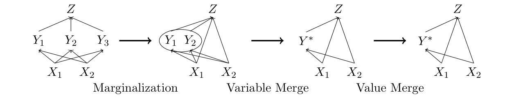
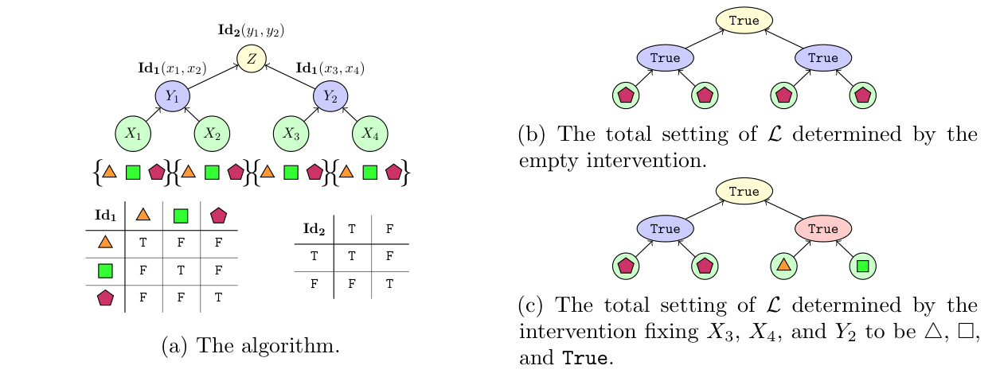
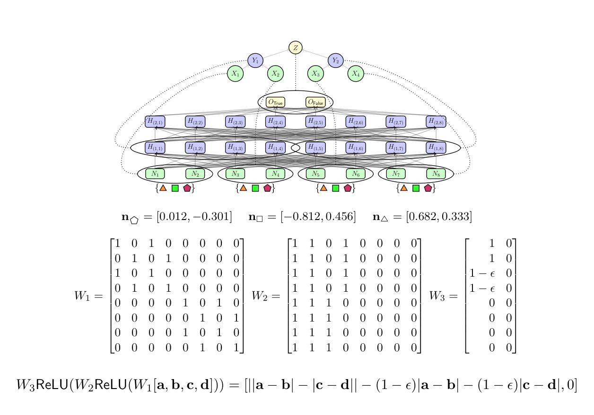
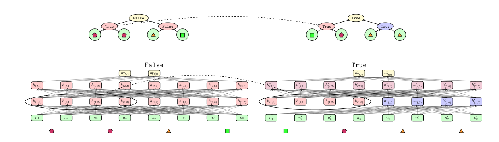
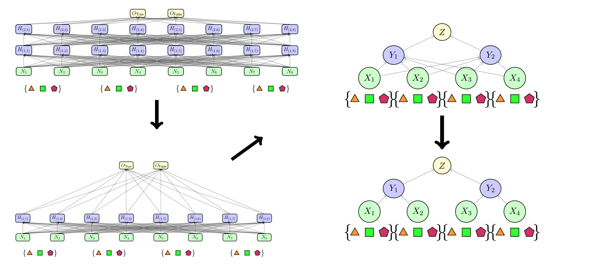
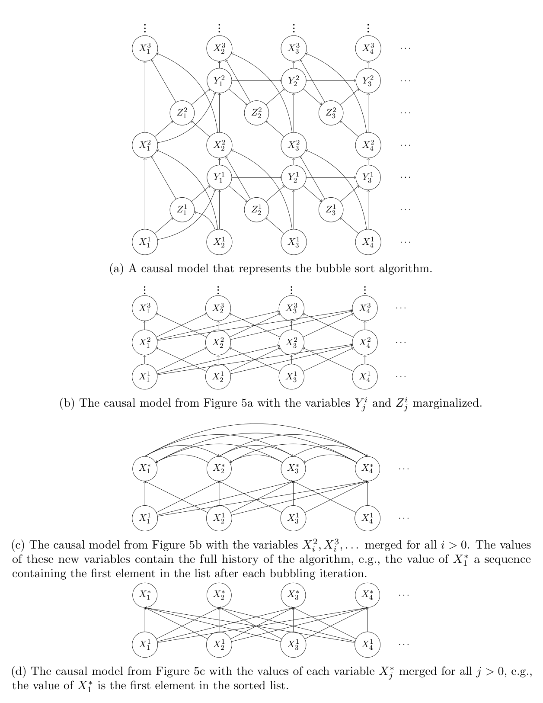
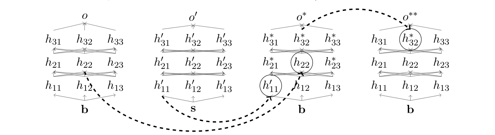
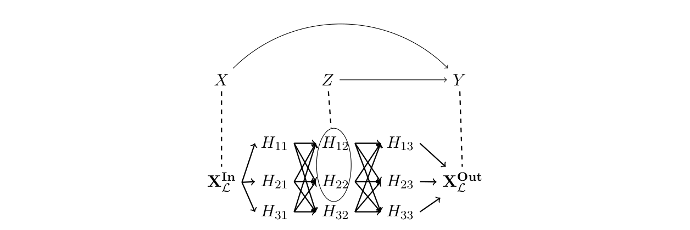
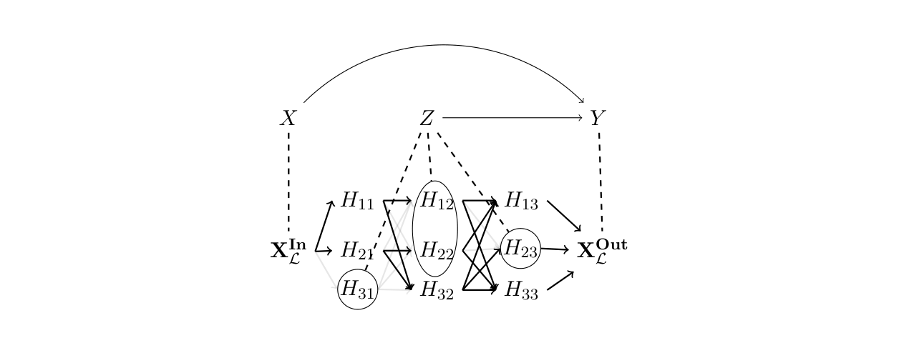

# Causal Abstraction: A Theoretical Foundation for Mechanistic Interpretability

**Atticus Geiger\*♢, Duligur Ibeling♠, Amir Zur♢, Maheep Chaudhary♢, Sonakshi Chauhan♢, Jing Huang♠, Aryaman Arora♠, Zhengxuan Wu♠, Noah Goodman♠, Christopher Potts♠, Thomas Icard\*♠**

*♢ Pr(Ai)²R Group, ♠ Stanford University. \*Corresponding authors: atticusg@gmail.com; icard@stanford.edu*

*Journal of Machine Learning Research 26 (2025), paper 23-0058 (submitted 1/23, revised 12/24, published 5/25). arXiv:2301.04709 (v4).*

*Converted from the arXiv v4 LaTeX source with pandoc, then post-processed. Citations are given as (Author, year); the reference list is at the end. Definition/theorem/section/figure numbers match the PDF; of the numbered equations only the four that the text references carry their tags (1)–(4). The TikZ diagrams (no LaTeX toolchain was available) are crops of the arXiv v4 PDF in `figures/`; their content is not otherwise transcribed, except Algorithm 1, which is transcribed as pseudocode. The paper has an empty appendix.*

---

## Abstract

Causal abstraction provides a theoretical foundation for mechanistic interpretability, the field concerned with providing intelligible algorithms that are faithful simplifications of the known, but opaque low-level details of black box AI models. Our contributions are (1) generalizing the theory of causal abstraction from mechanism replacement (i.e., hard and soft interventions) to arbitrary mechanism transformation (i.e., functionals from old mechanisms to new mechanisms), (2) providing a flexible, yet precise formalization for the core concepts of polysemantic neurons, the linear representation hypothesis, modular features, and graded faithfulness, and (3) unifying a variety of mechanistic interpretability methods in the common language of causal abstraction, namely, activation and path patching, causal mediation analysis, causal scrubbing, causal tracing, circuit analysis, concept erasure, sparse autoencoders, differential binary masking, distributed alignment search, and steering.

**Keywords:** Mechanistic Interpretability, Causality, Abstraction, Explainable AI

---

## Notation

| Symbol | Meaning | Location |
|:---|:--:|---:|
| $\mathsf{Domain}(f)$ | the domain of a function $f$ |  |
| $\mathbf{v}\mapsto f(\mathbf{v})$ | the function $f$ |  |
| $\mathbbm{1}[\varphi]$ | An indicator function that outputs $1$ if $\varphi$ is true, $0$ otherwise. |  |
| $\mathbf{V}$ | A complete set of variables | Definition 2 |
| $\mathsf{Val}_{\mathbf{X}}$ | A function mapping variables $\mathbf{X}\subseteq \mathbf{V}$ to values | Definition 2 |
| $\Sigma$ | A signature (variables $\mathbf{V}$ and values $\mathsf{Val}_{}$) | Definition 2 |
| $\mathbf{v}$ | A total setting $\mathbf{v}\in \mathsf{Val}_{\mathbf{V}}$ | Definition 3 |
| $X, x$ | A variable $X\in \mathbf{V}$ and a value $x\in \mathsf{Val}_{X}$ | Definition 3 |
| $\mathbf{X}, \mathbf{x}$ | A set of variables $\mathbf{X}\subseteq \mathbf{V}$ and a partial setting $\mathbf{x}\in \mathsf{Val}_{\mathbf{X}}$ | Definition 3 |
| $\mathsf{Proj}_{\mathbf{X}}(\mathbf{y})$ | The restriction of a partial setting $\mathbf{y}$ to variables $\mathbf{X}\subseteq \mathbf{Y}\subseteq \mathbf{V}$ | Definition 4 |
| $\mathsf{Proj}^{-1}_{\mathbf{Y}}(\mathbf{x})$ | The set of partial settings $\mathbf{y}$ where $\mathsf{Proj}_{\mathbf{X}}(\mathbf{y}) = \mathbf{x}$ | Definition 4 |
| $\{\mathcal{F}_{X}\}_{X \in \mathbf{V}}$ | Mechanisms for the variables in $\mathbf{V}$ | Definition 5 |
| $\prec$ | An ordering of $\mathbf{V}$ by causal dependency as induced via $\{\mathcal{F}_{X}\}_{X \in \mathbf{V}}$ | Definition 5 |
| $\mathcal{M}$ | A causal model (a signature $\Sigma$ and mechanisms $\{\mathcal{F}_{X}\}_{X \in \mathbf{V}}$) | Definition 5 |
| $\mathsf{Solve}(\mathcal{M})$ | The set of total settings that are solutions to a model $\mathcal{M}$ | Definition 5 |
| $\mathbf{i}\in \mathsf{Hard}$ | A hard intervention that fixes the variables $\mathbf{I}\subseteq \mathbf{V}$ | Definition 9 |
| $\{\mathcal{I}_{X}\}_{X \in \mathbf{X}} \in \mathsf{Soft}$ | A soft intervention that replaces the mechanisms of $\mathbf{X}\subseteq \mathbf{V}$ | Definition 10 |
| $\{\mathbb{I}_{X}\}_{X \in \mathbf{X}} \in \mathsf{Func}$ | An interventional that edits the mechanisms of $\mathbf{X}\subseteq \mathbf{V}$ | Definition 11 |
| $\mathsf{Func}_{\mathbf{V}}$ | The set of interventionals that edit all mechanisms | Definition 11 |
| $\Phi$ | The interventionals in $\mathsf{Func}_{\mathbf{V}}$ equivalent to hard interventions. | Definition 11 |
| $\alpha$ | A sequence of elements | Definition 11 |
| $\Psi$ | A set of interventionals | Definition 11 |
| $\tau$ | A map from total settings of $\mathcal{M}$ to total settings of $\mathcal{M}^*$ | Definition 25 |
| $\omega$ | A map from interventionals in $\mathcal{M}$ to interventionals of $\mathcal{M}^*$ | Definition 25 |
| $\mathcal{H}, \mathcal{L}$ | High-level and low-level causal models | Definition 33 |
| $\Pi_{X_{\mathcal{H}}}$ | A partition cell of $\mathbf{V}_{\mathcal{L}}$ assigned to the variable $X_{\mathcal{H}} \in \mathbf{V}_{\mathcal{H}}$ | Definition 31 |
| $\pi_{X_{\mathcal{H}}}$ | A function mapping from values of $\Pi_{X_{\mathcal{H}}}$ to values of $X_{\mathcal{H}}$ | Definition 31 |

## 1 Introduction

We take the fundamental aim of explainable artificial intelligence to be explaining *why* a model makes the predictions it does. For many purposes the paradigm of explanation is causal explanation (Woodward, 2003; Pearl, 2019), elucidating counterfactual difference-making details of the mechanisms underlying model behavior. However, not just any causal explanation will be apt. There is an obvious sense in which we already know all the low-level causal facts about a deep learning model. After all, we can account for every aspect of model behavior in terms of real-valued vectors, activation functions, and weight tensors. The problem, of course, is that these low-level explanations are typically not *transparent* to humans—they fail to instill an understanding of the high-level principles underlying model behavior (Lipton, 2018; Creel, 2020) that can guide human action (Karimi et al., 2021; Karimi et al., 2023).

In many contexts it can be quite straightforward to devise simple algorithms for tasks that operate on human-intelligible concepts. The crucial question is, under what conditions does such a transparent algorithm constitute a *faithful interpretation* (Jacovi and Goldberg, 2020) of the known, but opaque, low-level details of a black box model? This is the motivating question for the explainable AI subfield known as *interpretability*. The question takes on particular significance for *mechanistic interpretability*,[^1] which, in contrast to behavioral interpretability, is precisely aimed at reverse engineering the *internals* of a black box model in terms of a transparent algorithm.

Mechanistic interpretability research is quite analogous to the problem that cognitive scientists face in understanding how the human mind works. At one extreme, we can try to understand minds at a very low level, e.g., of biochemical processes in the brain. At the other extreme, we can focus just on the input-output facts of the system, roughly speaking, on ‘observable behavior.’ Analogously, for a deep learning model, we can focus either on low-level features (weight tensors, activation functions, etc.), or on what input-output function is computed. In both cases, however, it can be illuminating to investigate the mediating processes and mechanisms that transform input to output at a slightly higher-level of abstraction. This is what Marr (1982) famously called the *algorithmic* level of analysis. To the extent that these algorithmic-level hypotheses are transparent to the scientist, we may have a useful elucidation of the agent’s inner workings.

However, it is crucial that mechanistic interpretability methods avoid telling ‘just-so’ stories that are completely divorced from the internal workings of the model. To clarify what this means exactly, we need a common language for explicating and comparing methodologies, and for precisifying core concepts. We submit that the theory of *causal abstraction* provides this common language.

In some ways, modern deep learning models are like the weather or an economy: they involve large numbers of densely connected ‘microvariables’ with complex, non-linear dynamics. One way of reining in this complexity is to find ways of understanding these systems in terms of higher-level, more abstract variables (‘macrovariables’). For instance, the many microvariables might be clustered together into more abstract macrovariables. A number of researchers have been exploring theories of causal abstraction, providing a mathematical framework for causally analyzing a system at multiple levels of detail (Chalupka et al., 2017; Rubenstein et al., 2017; Beckers and Halpern, 2019; Beckers et al., 2019; Rischel and Weichwald, 2021; Massidda et al., 2023; Massidda et al., 2024). These methods tell us when a high-level causal model is a simplification of a (typically more fine-grained) low-level model. To date, causal abstraction has been used to analyze weather patterns (Chalupka et al., 2016), human brains (Dubois et al., 2020; Dubois et al., 2020), physical systems (Kekic et al., 2023), batteries (Zennaro et al., 2023), epidemics (Dyer et al., 2023), and deep learning models (Chalupka et al., 2015; Geiger et al., 2021; Hu and Tian, 2022; Geiger et al., 2023; Wu et al., 2023).

Macrovariables will not always correspond to sets of microvariables. Just as with neural network models of human cognition (Smolensky, 1986), this is the typical situation in mechanistic interpretability, where high-level concepts are thought to be represented by modular ‘features’ distributed across individual neural activations (Harradon et al., 2018; Olah et al., 2020; Huang et al., 2024). For example, the linear subspaces of activation space learned from distributed alignment search (Geiger et al., 2023) and the output dimensions of sparse autoencoders (Bricken et al., 2023; Cunningham et al., 2023) are features that are distributed across overlapping sets of neural activations.

Our first contribution is to extend the theory of causal abstraction to remove this limitation, building heavily on previous work. The core issue is that typical hard and soft interventions replace variable mechanisms entirely, so they are unable to isolate quantities distributed across overlapping sets of microvariables. To address this, we consider a very general type of intervention—what we call *interventionals*—that maps from old mechanisms to new mechanisms. While this space of operations is generally unconstrained, we isolate special classes of interventionals that form *intervention algebras*, satisfying two key modularity properties. Such classes can essentially be treated as hard interventions with respect to a new (‘translated’) variable space. We elucidate this situation, generalizing earlier work by Rubenstein et al. (2017) and Beckers and Halpern (2019).

Our second contribution is to show how causal abstraction provides a solid theoretical foundation for the field of mechanistic interpretability. We leverage our general presentation to provide flexible, yet mathematically precise, definitions for the core mechanistic interpretability concepts of polysemantic neurons, the linear representation hypothesis, modular features, and graded faithfulness. Furthermore, we unify a wide range of existing interpretability methodologies in a common language, including activation and path patching, causal mediation analysis, causal scrubbing, causal tracing, circuit analysis, concept erasure, sparse autoencoders, differential binary masking, distributed alignment search, and activation steering. We also connect the behavioral interpretability methods of LIME, integrated gradients, and causal effect estimation to the language of causal abstraction.

We are optimistic about productive interplay between theoretical work on causal abstraction and applied work on mechanistic interpretability. In stark contrast to weather, brains, or economies, we can measure and manipulate the microvariables of deep learning models with perfect precision and accuracy, and thus empirical claims about their structure can be held to the highest standard of rigorous falsification through experimentation.

## 2 Causality and Abstraction

This section presents a general theory of causal abstraction. Although we build on much existing work in the recent literature, our presentation is in some ways more general, and in other ways less so. Due to our focus on (deterministic) neural network models, we do not incorporate probability into the picture. At the same time, because the operations employed in the study of modern machine learned system go beyond ‘hard’ and ‘soft’ interventions that replace model mechanisms (see Def. 9 and 10 below), we define a very general kind of intervention, the *interventional*, which is a functional mapping from old mechanisms to new mechanisms (see Def. 11). In order to impose structure on this unconstrained class of model transformations, we establish some new results on classes of interventionals that form what we will call *intervention algebras* (see especially Theorems 20, 21).

Next, we explore key relations that can hold between causal models. We begin with *exact transformations* (Rubenstein et al., 2017), which characterize when the mechanisms of one causal model are realized by the mechanisms of another (‘causal consistency’). We generalize exact transformation from hard interventions to interventionals that form intervention algebras (see Def. 25). A bijective translation (see Def. 28) is an exact transformation that retains all the details in the original model, staying at the same level of granularity. On the other hand, a constructive causal abstraction (see Def. 33) is a ‘lossy’ exact transformation that merges microvariables into macrovariables, while maintaining a precise and accurate description of the original model. Also, we (1) decompose constructive causal abstraction into three operations, namely marginalization, variable merge, and value merge (see Prop. 40), and (2) provide a framework for approximate transformations (see Def. 41).

Lastly, we define a family of *interchange intervention* operations, which are central to understanding mechanistic interpretability through the lens of causal abstraction. We begin with simple interchange interventions (see Def. 44), where a causal model with input and output variables has certain variables fixed to values they would have under different input conditions. We extend these to recursive interchange interventions (see Def. 45), which allow variables to be fixed based on the results of previous interchange interventions. Crucially, we also define distributed interchange interventions that target variables distributed across multiple causal variables and involve a bijective translation to and from a transformed variable space (see Def. 46). We conclude by explicating how to construct an alignment for interchange intervention analysis and how to use interchange intervention accuracy to quantify approximate abstractions.

### 2.1 Deterministic Causal Models with Implicit Graphical Structure

We start with some basic notation.

**Remark 1** (Notation throughout the paper).

*Capital letters (e.g., $X$) are used for variables and lower case letters (e.g., $x$) are used for values. Bold faced letters (e.g. $\mathbf{X}$ or $\mathbf{x}$) are used for sets of variables and sets of values. When a variable (or set of variables) and a value (or set of values) have the same letter, the values correspond to the variables (e.g., $x\in \mathsf{Val}_{X}$ or $\mathbf{x}\in \mathsf{Val}_{\mathbf{X}}$).*

**Definition 2** (Signature). *We use $\mathbf{V}$ to denote a fixed set of variables, each $X\in \mathbf{V}$ coming with a non-empty range $\mathsf{Val}_{X}$ of possible values. Together $\Sigma= (\mathbf{V},\mathsf{Val}_{})$ are called a *signature*.*

**Definition 3** (Partial and Total Settings).

*We assume $\mathsf{Val}_{X} \cap \mathsf{Val}_{Y} = \varnothing$ whenever $X\neq Y$, meaning no two variables can take on the same value.[^2] This assumption allows representing the values of a set of variables $\mathbf{X}\subseteq \mathbf{V}$ as a set $\mathbf{x}$ of values, with exactly one value $x\in \mathsf{Val}_{X}$ in $\mathbf{x}$ for each $X\in \mathbf{X}$. When we need to be specific about the choice of variable $X$, we denote this element of $\mathsf{Val}_{X}$ as $x$. We thus have $\mathbf{x}\subseteq \bigcup_{X\in \mathbf{X}} \mathsf{Val}_{X}$, and we refer to the values $\mathbf{x}\in \mathsf{Val}_{\mathbf{X}}$ as *partial settings*. In the special case where $\mathbf{v}\in \mathsf{Val}_{\mathbf{V}}$, we call $\mathbf{v}$ a *total setting*.*

Another useful construct in this connection is the *projection* of a partial setting:

**Definition 4** (Projection).

*Given a partial setting $\mathbf{y}$ for a set of variables $\mathbf{Y}\supseteq \mathbf{X}$, we define $\mathsf{Proj}_{\mathbf{X}}(\mathbf{y})$ to be the restriction of $\mathbf{y}$ to the variables in $\mathbf{X}$. Given a partial setting $\mathbf{x}$, we define the inverse:
$$
\mathsf{Proj}^{-1}_{\mathbf{Y}}(\mathbf{x}) = \{\mathbf{y}\in \mathsf{Val}_{\mathbf{Y}}: \mathsf{Proj}_{\mathbf{X}}(\mathbf{y}) = \mathbf{x}\}.
$$*

**Definition 5**. *A (deterministic) *causal model* is a pair $\mathcal{M}= (\Sigma,\{\mathcal{F}_{X}\}_{X \in \mathbf{V}})$, such that $\Sigma$ is a signature and $\{\mathcal{F}_{X}\}_{X \in \mathbf{V}}$ is a set of *mechanisms*, with $\mathcal{F}_{X}: \mathsf{Val}_{\mathbf{V}} \rightarrow \mathsf{Val}_{X}$ assigning a value to $X$ as a function of the values of all the variables, including $X$ itself. We write $\mathcal{F}_{\mathbf{X}}$ for $\{\mathcal{F}_{X}\}_{X\in \mathbf{X}}$. We will often break up the input argument to a mechanism into partial settings that form a total setting, e.g., $\mathcal{F}_{X}(\mathbf{y}, \mathbf{z})$ for $\mathbf{Y}\cup \mathbf{Z}= \mathbf{V}$.*

**Remark 6** (Inducing Graphical Structure). *Observe that our definition of causal model makes no explicit reference to a graphical structure defining a causal ordering on the variables. While the mechanism for a variable takes in total settings, it might be that the output of a mechanism depends only on a subset of values. This induces a *causal ordering* among the variables, such that $Y\prec X$—or $Y$ is a *parent* of $X$—just in case there is a setting $\mathbf{z}$ of the variables $\mathbf{Z}= \mathbf{V}\setminus\{Y\}$, and two settings $y,y'$ of $Y$ such that $\mathcal{F}_{X}(\mathbf{z},y) \neq \mathcal{F}_{X}(\mathbf{z},y')$ (see, e.g., Woodward 2003). The resulting order $\prec$ captures a notion of direct causation, which can be extended to indirect causation by taking its transitive closure $\prec^*$. Throughout the paper, we will define mechanisms to take in partial settings of parent variables, though technically they take in total settings and depend only on the parent variables.*

When $\prec^*$ is irreflexive, we say the causal model is *acyclic*. Most of our examples of causal models will have this property. However, it is often also possible to give causal interpretations of cyclic models (see, e.g., Bongers et al. 2021). Indeed, the abstraction operations to be introduced generally create cycles among variables, even from initially acyclic models (see Rubenstein et al. 2017, §5.3 for an example). In Section 2.7, we provide an example where we abstract a causal model representing the bubble sort algorithm into a cyclic model where any sorted list is a solution satisfying the equations.

**Remark 7** (Acyclic Model Notation). *Our example in Section 2.6 will involve causal abstraction between two finite, acyclic causal models. We will call variables that depend on no other variable *input variables* ($\mathbf{X}^{\mathbf{In}}$), and variables on which no other variables depend *output variables* ($\mathbf{X}^{\mathbf{Out}}$). The remaining variables are *intermediate variables*. We can intervene on input variables $\mathbf{X}^{\mathbf{In}}$ to ‘prime’ the model with a particular input.[^3] As such, the constant functions for input variables in our examples will be overwritten.*

As $\mathcal{M}$ can also be interpreted simply as a set of equations, we can define the set of solutions, which may be empty.

**Definition 8** (Solution Sets). *Given $\mathcal{M}= (\mathbf{V},\{\mathcal{F}_{X}\}_{X \in \mathbf{V}})$, the set of solutions, called $\mathsf{Solve}(\mathcal{M})$, is the set of all $\mathbf{v}\in \mathsf{Val}_{\mathbf{V}}$ such that all the equations $\mathsf{Proj}_{X}(\mathbf{v})= \mathcal{F}_{X}(\mathbf{v})$ are satisfied for each $X\in \mathbf{V}$. When $\mathcal{M}$ is acyclic, there is a single solution and we use $\mathsf{Solve}(\mathcal{M})$ to refer interchangeably to a singleton set of solutions and its sole member, relying on context to disambiguate.*

We give a general definition of intervention on a model (see, e.g., Spirtes et al. 2000; Woodward 2003; Pearl 2009). For the following, assume we have fixed a signature $\Sigma$.

**Definition 9** (Intervention). *Define a *hard intervention* to be a partial setting $\mathbf{i}\in  \mathsf{Val}_{\mathbf{I}}$ for finite $\mathbf{I}\subseteq \mathbf{V}$. Given a model $\mathcal{M}$ with signature $\Sigma$, define $\mathcal{M}_{\mathbf{i}}$ to be just like $\mathcal{M}$, except that we replace $\mathcal{F}_{X}$ with the constant function $\mathbf{v}\mapsto \mathsf{Proj}_{X}(\mathbf{i})$ for each $X\in \mathbf{I}$. Define $\mathsf{Hard}_{\mathbf{X}} = \mathsf{Val}_{\mathbf{X}}$ to be the set of all hard interventions on $\mathbf{X}$.*

**Definition 10** (Soft Intervention). *We define a *soft intervention* on some finite set of variables $\mathbf{X}\subseteq \mathbf{V}$ to be a family of functions $\{\mathcal{I}_{X}\}_{X \in \mathbf{X}}$ where $\mathcal{I}_{X}:\mathsf{Val}_{\mathbf{V}} \to \mathsf{Val}_{X}$ for each $X\in \mathbf{X}$. Given a model $\mathcal{M}$ with signature $\Sigma$, define $\mathcal{M}_{\mathcal{I}}$ to be just like $\mathcal{M}$, except that we replace each function $\mathcal{F}_{X}$ with the function $\mathcal{I}_{X}$. Define $\mathsf{Soft}_{\mathbf{X}}$ to be the set of all soft interventions on $\mathbf{X}$.*

Soft interventions generalize hard interventions. The hard intervention $\mathbf{i}$ is equivalent to a constant soft intervention $\mathcal{I}= \{\mathbf{v}\mapsto x\}_{x\in \mathbf{i}}$.

**Definition 11** (Interventional). *We define an *interventional* on some finite set of variables $\mathbf{X}\subseteq \mathbf{V}$ to be a family of functions $\mathbb{I}= \{\mathbb{I}_{X}\}_{X \in \mathbf{X}}$ where $\mathbb{I}_{X}:\mathsf{Soft}_{\mathbf{X}} \to \mathsf{Soft}_{X}$ for each $X\in \mathbf{X}$. We define $\mathcal{M}_{\mathbb{I}}$ to be just like $\mathcal{M}$, except that we replace each function $\mathcal{F}_{X}$ with the function $\mathbb{I}_X\langle \mathcal{F}_{\mathbf{X}}\rangle$. Define $\mathsf{Func}_{\mathbf{X}}$ to be the set of interventionals on $\mathbf{X}$.*

Interventionals generalize soft interventions. The soft intervention $\mathcal{I}$ is a constant interventional—namely, the family of functions that, for each $X \in \mathbf{X}$, sends any element of $\mathsf{Soft}_{\mathbf{X}}$ to $\mathcal{I}_{X}$. When only one variable is targeted, we say that the intervention(al) is *atomic*.

**Remark 12** (On Terminology). *What we are calling hard interventions are sometimes called *structural* interventions (Eberhardt and Scheines, 2007). Our soft interventions are essentially the same as the soft interventions studied, e.g., in Tian (2008); Bareinboim and Correa (2020), although as mentioned, we set aside probabilistic aspects of causal models in this paper. The main difference between soft interventions and interventionals is that the latter ‘mechanism replacements’ can depend on the previous mechanisms in the model. This type of dependence has also been studied, e.g., in the setting of so-called *parametric* interventions (Eberhardt and Scheines, 2007).*

**Remark 13** (Interventionals as Unconstrained Model Transformations). *The set\
$\mathsf{Func}_{\mathbf{V}}$ contains the interventionals that targets *all* variables $\mathbf{V}$. This set of interventionals is quite general, containing every function that maps from and to causal models with the same signature.*

**Remark 14** (Composing Intervention(al)s). *Interventionals containing families of constant functions to constant functions are exactly the set of hard interventions. Similarly, interventionals containing families of constant functions are exactly the set of soft interventions. As such, we treat all three types of interventions as interventionals on all variables, i.e., $\bigcup_{\mathbf{X}\subseteq \mathbf{V}} \mathsf{Hard}_{\mathbf{X}} \subseteq \bigcup_{\mathbf{X}\subseteq \mathbf{V}} \mathsf{Soft}_{\mathbf{X}}  \subseteq \bigcup_{\mathbf{X}\subseteq \mathbf{V}} \mathsf{Func}_{\mathbf{X}} \subseteq \mathsf{Func}_{\mathbf{V}}$. This allows us to understand the composition of interventions as function composition. We simplify notation by writing, e.g., $x\,\circ\, y$ for the composition of hard interventions (setting $X$ to $x$ and then $Y$ to $y$).[^4]*

The unconstrained space of interventionals $\mathsf{Func}_{\mathbf{V}}$ is unruly, and there is no guarantee that an interventional can be thought of as isolating a natural model component. We want to characterize spaces of interventionals that ‘act like hard interventions’ insofar as they possess a basic algebraic structure. We elaborate on this in the next section.

The following is an example of a causal model with hard interventions, soft interventions, and interventionals defined on it.

**Example 1**. *Define a signature $\Sigma$ with variables $\mathbf{V}= \{X, Y\}$ with values $\mathsf{Val}_{X} = \{0, \dots, 9\}$ and $\mathsf{Val}_{Y} = \{\mathsf{True}, \mathsf{False}\}$. Define a model $\mathcal{M}$ with mechanisms $\mathcal{F}_{X}(\mathbf{v}) = 0$ (recall that input variables have no parents and are mapped to constants per Remark 7) and $\mathcal{F}_{Y}(\mathbf{v}) = [\mathsf{Proj}_{X}(\mathbf{v}) > 5]$. The graphical structure of $\mathcal{M}$ has one directed edge from $X$ to $Y$ because $X\prec Y$. Per Remark 6, we could define the mechanism for $Y$ as $\mathcal{F}_{Y}(x) = [x> 5]$ omitting the value that $Y$ does not depend on, namely its own.*

*Define the hard intervention $y= \{\mathsf{True}\} \in \mathsf{Hard}_{Y}$, the soft intervention $\mathcal{I}= \mathbf{v}\mapsto [\mathsf{Proj}_{X}(\mathbf{v}) \leq 5] \in \mathsf{Soft}_{Y}$, and the interventional $\mathbb{I}= \mathcal{F}_{Y} \mapsto (\mathbf{v}\mapsto \lnot \mathcal{F}_{Y}(\mathbf{v})) \in \mathsf{Func}_{Y}$. The model $\mathcal{M}_{y}$ has mechanisms $\mathcal{F}_{X}(\mathbf{v}) = 0$ and $\mathcal{F}_{Y}(\mathbf{v}) = \mathsf{True}$ and a graphical structure with no edges. The models $\mathcal{M}_{\mathcal{I}}$, $\mathcal{M}_{\mathcal{I}\circ \mathcal{I}}$, and $\mathcal{M}_{\mathbb{I}}$ all have the mechanisms $\mathcal{F}_{X}(\mathbf{v}) = 0$ and $\mathcal{F}_{Y}(x) = [x\leq 5]$ and the same graphical structure as $\mathcal{M}$. The model $\mathcal{M}_{\mathbb{I}\circ \mathbb{I}}$ is identical to $\mathcal{M}$.*

*Define the interventional $\mathbb{J}= \{\mathcal{F}_{X}, \mathcal{F}_{Y}\} \mapsto \{ \mathbf{v}\to 6 \times \mathbbm{1}[\mathsf{Proj}_{Y}(\mathbf{v})],\mathbf{v}\mapsto [\lnot \mathcal{F}_{Y}(\mathbf{v})] \} \in \mathsf{Func}_{\mathbf{V}}$. The model $\mathcal{M}_{\mathbb{J}}$ has mechanisms $\mathcal{F}_{X}(y) = 6 \times \mathbbm{1}[y]$ and $\mathcal{F}_{Y}(x) = [x\leq 5]$ with a cyclic graphical structure where $X\prec Y$ and $Y\prec X$. This model has no solutions. The model $\mathcal{M}_{\mathbb{J}\circ \mathbb{J}}$ has mechanisms $\mathcal{F}_{X}(y) = 6 \times \mathbbm{1}[y]$ and $\mathcal{F}_{Y}(x) = [x> 5]$ with a cyclic graphical structure where $X\prec Y$ and $Y\prec X$. The solutions to this model are $\{6, \mathsf{True}\}$ and $\{0, \mathsf{False}\}$.*

### 2.2 Intervention Algebras

We are interested in the subsets of $\mathsf{Func}_{\mathbf{V}}$ that are well-behaved in the sense that they share an algebraic structure with hard interventions under the operation of function composition. The relevant algebraic structure is captured in the next definition.

**Definition 15**. *Let $\Lambda$ be a set and $\oplus$ be a binary operation on $\Lambda$. We define $(\Lambda, \oplus)$ to be an *intervention algebra* if there exists a signature $\Sigma= (\mathbf{V}, \mathsf{Val}_{})$ such that $(\Phi,\circ) \simeq (\Lambda, \oplus)$—that is, these structures are isomorphic—where $\Phi$ is the set of all constant functionals mapping to constant functions (i.e., hard interventions) for signature $\Sigma$, and $\circ$ is function composition.*

As a matter of fact, intervention algebras can be given an intuitive characterization based on two key properties of hard interventions.

**Definition 16** (Commutativity and Left-Annihilativity). *Hard interventions $x, y\in \Phi$ under function composition have the following properties:*

1.  *If hard interventions target different variables, $\circ$ is commutative:\
    if $X\neq Y$ then $x\circ y= y\circ x$; *

2.  *If hard interventions target the same variable, $\circ$ is left-annihilative:\
    if $X= Y$, then $x\circ y= y$; *

*Note equality signifies the compositions are the very same functions from models to models.*

These two properties highlight an important sense in which hard interventions are modular: when intervening on two different variables, the order does not matter; and when intervening on the same variable twice, the second undoes any effect of the first intervention.

We can use commutativity and left-annihilativity to build an equivalence relation that we will show captures the fundamental algebraic structure of hard interventions.

**Definition 17**. *Let $A$ be any set with equivalence relation $\sim$, and define $(A^*,\cdot)$ to be the free algebra generated by elements of $A$ under concatenation. Define $\approx$ to be the smallest congruence on $A^*$ extending the following:
$$
\begin{equation}
\{\langle x\cdot y, y\cdot x\rangle : x\not \sim y\} \cup \{\langle y\cdot x, x\rangle: x\sim y\},\tag{1}
\end{equation}
$$
for all $x,y\in A$, where $\cdot$ is concatenation in $A^*$.*

As it turns out, $\approx$ can be obtained constructively as the result of two operations that define a normal form for sequences of atomic hard interventions.

**Definition 18** (Normal form). *Let $A$ be a set equipped with equivalence relation $\sim$. Fix an order $\lessdot$ on $\sim$-equivalence classes. Define $\mathsf{Collapse}: A^* \to A^*$ to take a sequence and remove every element that has an $\sim$-equivalent element that occurs to its right. Define $\mathsf{Sort}: A^* \to A^*$ to take a sequence and sort it according to $\lessdot$. For any element $\alpha\in A^*$, we call $\mathsf{Sort}(\mathsf{Collapse}(\alpha))$ the *normal form* of $\alpha$. This normal form clearly exists and is unique.*

**Lemma 19**. *For $\alpha,\beta\in A^*$, we have $\alpha\approx \beta$ iff $\mathsf{Sort}(\mathsf{Collapse}(\alpha)) = \mathsf{Sort}(\mathsf{Collapse}(\beta))$, that is, iff $\alpha$ and $\beta$ have the same normal form.*

*Proof.* Let us write $\alpha\equiv \beta$ when $\mathsf{Sort}(\mathsf{Collapse}(\alpha)) = \mathsf{Sort}(\mathsf{Collapse}(\beta))$. First note that $\equiv$ is a congruence extending the relation in ((1)), and hence $\approx \;\subseteq\; \equiv$.

For the other direction, it suffices to observe that both $\mathsf{Collapse}(\mathbf{c}) \approx \mathbf{c}$ and $\mathsf{Sort}(\mathbf{c}) \approx \mathbf{c}$, for any $\mathbf{c} \in A^*$. This follows from the fact that $\approx$ is a congruence extending ((1)). Then if $\alpha\equiv \beta$, we have $\mathsf{Sort}(\mathsf{Collapse}(\alpha)) \approx \mathsf{Sort}(\mathsf{Collapse}(\beta))$ (by reflexivity of $\approx$), and moreover:
$$
\begin{eqnarray*}
    \alpha& \approx & \mathsf{Sort}(\mathsf{Collapse}(\alpha)) \\
    & \approx & \mathsf{Sort}(\mathsf{Collapse}(\beta)) \\
    & \approx & \beta,
\end{eqnarray*}
$$
and hence $\equiv \; \subseteq \; \approx$. Consequently, $\alpha\approx \beta$ iff $\alpha$ and $\beta$ have the same normal form. ◻

The foregoing produces a representation theorem for intervention algebras.

**Theorem 20**. *The quotient $(A^*/\!\approx, \odot)$ of $(A^*,\cdot)$ under $\approx$, with $\odot$ defined so
$$
\begin{eqnarray*}
       [\alpha]_{\approx} \odot [\beta]_{\approx} & = & [\alpha\cdot \beta]_\approx,
\end{eqnarray*}
$$
is a intervention algebra.*

*Proof.* Define a signature $\Sigma$ where the variables $\mathbf{V}$ are the $\sim$-equivalence classes of $A$ and the values of each variable are the members of the respective $\sim$-equivalence class. We need to show that $(A^*/\!\approx, \odot)$ is isomorphic to $(\Phi,\circ)$, the set of all (finite) hard interventions with function composition.

Begin by defining the map $\iota^*:A^* \rightarrow \Phi$, where $\iota^* (x_1\cdot {{ }_{\dots}} \cdot x_n) = x_1 \circ {{ }_{\dots}} \circ x_n$. First observe:
$$
\begin{equation}
    \tag{2}
\iota^*(\alpha) = \iota^*(\mathsf{Collapse}(\alpha)) = \iota^*(\mathsf{Sort}(\mathsf{Collapse}(\alpha)))
\end{equation}
$$
Eq. ((2)) follows from commutativity and left-annihilativity (Def. 16).

Moreover, again by commutativity and left-annihilativity, if $X=Y$ but $X\notin \mathbf{Z}$, then $x\circ \mathbf{z}\circ y= \mathbf{z}\circ y$, which is precisely what justifies the first equality.

Finally, define $\iota:A^*/\! \approx\; \to \Phi$ so that $\iota([\alpha]_{\approx}) = \iota^*(\alpha)$. This is well-defined by Eq. ((2)) and Lemma 19. It is surjective because $\iota^*$ is surjective. It is also injective: if $\mathsf{Sort}(\mathsf{Collapse}(\alpha)) \neq \mathsf{Sort}(\mathsf{Collapse}(\beta))$, then pick the $\lessdot$-least $\sim$-equivalence class of $A$—that is, the $\lessdot$-least variable $X$—such that $\mathsf{Sort}(\mathsf{Collapse}(\alpha))$ and $\mathsf{Sort}(\mathsf{Collapse}(\beta))$ disagree on $X$. Without loss, we can assume $\iota^*(\mathsf{Sort}(\mathsf{Collapse}(\alpha)))$ assigns $X$ to some value $x$, but $\iota^*(\mathsf{Sort}(\mathsf{Collapse}(\beta)))$ does not assign $X$ to $x$ (either because it does not assign $X$ to any value or because it assigns $X$ to a different value). In any case, if $[\alpha]_{\approx} \neq [\beta]_{\approx}$, then $\iota([\alpha]_{\approx}) = \iota^*(\mathsf{Sort}(\mathsf{Collapse}(\alpha)))\neq  \iota^*(\mathsf{Sort}(\mathsf{Collapse}(\beta))) = \iota([\beta]_{\approx})$.

That $\iota$ is an isomorphism follows from the sequence of equalities below:
$$
\begin{align*}
 \iota([\alpha]_{\approx} \odot [\beta]_{\approx}) & =  \iota([\alpha\cdot \beta]_{\approx}) & \text{By the definition of } \odot \\
  & =  \iota(\mathsf{Sort}(\mathsf{Collapse}(\alpha\cdot\beta))) & \text{By Lemma \ref{lemma:equivs}} \\
  & =  \iota^*(\mathsf{Sort}(\mathsf{Collapse}(\alpha\cdot\beta))) & \text{By the definition of } \iota \\
  & =  \iota^*(\alpha\cdot \beta) & \text{By Equation } (\ref{eq:collapseSort})\\
  & =  \iota^*(\alpha) \circ \iota^*(\beta) & \text{By the definition of } \iota^* \\
  & =  \iota^*(\mathsf{Sort}(\mathsf{Collapse}(\alpha))) \circ \iota^*(\mathsf{Sort}(\mathsf{Collapse}(\beta))) & \text{By Equation } (\ref{eq:collapseSort}) \\
  & =  \iota(\mathsf{Sort}(\mathsf{Collapse}(\alpha))) \circ \iota(\mathsf{Sort}(\mathsf{Collapse}(\beta))) & \text{By the definition of } \iota \\
  & =  \iota([\alpha]_{\approx}) \circ \iota([\beta]_{\approx}) & \text{By Lemma \ref{lemma:equivs}}
\end{align*}
$$
This concludes the proof of Theorem 20. ◻

Sets of atomic soft interventions also form intervention algebras:

**Theorem 21**. *Suppose $\Psi_0$ is a set of atomic soft interventions with signature $\Sigma$. Let $\Psi$ be the closure of $\Psi_0$ under function composition. Then $(\Psi,\circ)$ is an intervention algebra.*

*Proof.* Just as in the proof of Theorem 20 we can consider the free algebra generated by $A = \Psi_0$, quotiented under $\approx$, to obtain $(A/\!\approx, \odot)$. The proof that this algebra is isomorphic to a set of hard interventions follows exactly as in the proof of Theorem 20, relying on the fact that soft interventions also satisfy the key properties (a) and (b) in Definition 16:

1.  If soft interventions target different variables, $\circ$ is commutative: if $X\neq Y$ then $\mathcal{I}_{X} \circ \mathcal{I}_{Y} = \mathcal{I}_{Y}  \circ \mathcal{I}_{X}$;

2.  If interventions target the same variable, $\circ$ is left-annihilative: if $X= Y$, then $\mathcal{I}_{X}  \circ \mathcal{I}_{Y}  = \mathcal{I}_{Y}$. 
Consequently, we know that there exists a signature $\Sigma^*$ such that hard interventions on $\Sigma$ are isomorphic to the soft interventions $\Psi$ with respect to function composition. Specifically, where $\Psi^{X}_0\subseteq \Psi_0$ is the set of atomic soft interventions that target $X$, the variables of $\Sigma^*$ are $\mathbf{V}^* = \{X^*:  \Psi^{X}_0 \not = \emptyset \}$ and, for each $X^* \in \mathbf{V}^*$, the values are $\mathsf{Val}_{X^*} = \Psi^{X}_0$. ◻

**Remark 22**. *While both hard and soft interventions give rise to intervention algebras, the more general class of interventionals satisfies weaker algebraic constraints. For instance, it is easy to see that left-annihilativity (see (b) and (b) above) often fails. Consider a signature $\Sigma$ with a single variable $X$ that takes on binary values $\{0,1\}$. Define the interventional $\mathbb{I}\langle \mathcal{F}_{X}\rangle = x\mapsto 1 - \mathcal{F}_{X}(x)$. Observe that $\mathbb{I}\circ \mathbb{I}\not = \mathbb{I}$ because $\mathbb{I}\circ \mathbb{I}$ is the identity function, and so left-annihilativity fails.*

While interventionals do not form intervention algebras in general, particular classes of interventionals can form intervention algebras.

**Example 2**. *Consider a signature $\Sigma$ with variables $\{X_1, \dots, X_n\}$ that take on integer values. Define $\Psi$ to contain interventionals that fix the $p$th digit of a number to be the digit $q$, where $\%$ is modulus and $//$ is integer division:
$$
\mathbb{I}\langle \mathcal{F}_{X_k} \rangle  = \mathbf{v}\mapsto \mathcal{F}_{X_k}(\mathbf{v}) - \big((\mathcal{F}_{X_k}(\mathbf{v}) // 10^{p}) \mathbin{\%} 10\big) \cdot 10^p  + q \cdot 10^{p}
$$
This class of interventionals is isomorphic to hard interventions on a signature $\Sigma^*$ with variables $\{Y^{p}_0, Y^{p}_1, \dots, Y^{p}_n: p \in \{0,1,\dots\}\}$ that take on values $\{0, 1, \dots, 9\}$. The interventional fixing the $p$th digit of $X_k$ to be the digit $q$ corresponds to the hard intervention fixing $Y^{p}_k$ to the value $q$.*

**Remark 23** (Assignment mutations). *As a side remark, it is worth observing that another setting where intervention algebras appear is in programming language semantics and the semantics of, e.g., first-order predicate logic. Let $D$ be some domain of values and $\mathsf{Var}$ a set of variables. An *assignment* is a function $g:\mathsf{Var}\rightarrow D$. Let $g^{x}_d$ be the *mutation* of $g$, defined so that $g^{x}_d(y) = g(y)$ when $y \neq x$, and $g^x_d(y) = d$ when $y=x$. Then a mutation $(\,\cdot\,)^x_d$ can be understood as a function from the set of assignments to the set of assignments. Where $\mathfrak{M}$ is the set of all mutations, it is then easy to show that the pair $(\mathfrak{M},\circ)$ forms an intervention algebra. Furthermore, every intervention algebra can be obtained this way (up to isomorphism), for a suitable choice of $D$ and $\mathsf{Var}$.*

**Definition 24** (Ordering on Intervention Algebras). *Let $(\Lambda,\oplus)$ be a intervention algebra. We define an ordering $\leq$ on elements of $\Lambda$ as follows:
$$
\begin{eqnarray*}
 \lambda \leq \lambda' & \mbox{ iff } & \lambda' \oplus \lambda = \lambda'.
\end{eqnarray*}
$$
So, in particular, if the intervention algebra contains hard interventions—if it is of the form $(\Phi,\circ)$—then this amounts to the ordering from Rubenstein et al. (2017):
$$
\begin{eqnarray*}
 \mathbf{x}\leq \mathbf{y}& \mbox{ iff } & \mathbf{X}\subseteq \mathbf{Y}\mbox{ and }\mathbf{x}= \mathsf{Proj}_{\mathbf{X}}(\mathbf{y}) \\
& \mbox{ iff } & \mathbf{x}\subseteq \mathbf{y}.
\end{eqnarray*}
$$
Note that $\leq$ is defined as in a semi-lattice, except that $\oplus$ (or $\circ$) is not commutative in general. So the order matters.*

### 2.3 Exact Transformation with Interventionals

Researchers have been interested in the question of when two models—potentially defined on different signatures—are compatible with one another in the sense that they could both accurately describe the same target causal phenomena. The next definition presents a deterministic variant of the notion of ‘exact transformation’ from Rubenstein et al. (2017) (see also Def. 3.5 in Beckers and Halpern 2019), generalized to interventionals. The other notions we study in this paper—namely, bijective translation and constructive abstraction—are special cases of exact transformation.

**Definition 25**. *Let $\mathcal{M}, \mathcal{M}^*$ be causal models and let $(\Psi, \circ)$ and $(\Psi^*, \circ)$ be two intervention algebras where $\Psi$ and $\Psi^*$ are interventionals on $\mathcal{M}$ and $\mathcal{M}^*$, respectively. Furthermore, let $\tau: \mathsf{Val}_{\mathbf{V}} \to \mathsf{Val}_{\mathbf{V}^*}$ and $\omega: \Psi\to \Psi^*$ be two partial surjective functions where $\omega$ is $\leq$-preserving; that is, $\omega(\mathbb{I}) \leq \omega(\mathbb{I}')$ whenever $\mathbb{I} \leq \mathbb{I}'$.*

*Then $\mathcal{M}^*$ is an *exact transformation* of $\mathcal{M}$ under $(\tau, \omega)$ if for all $\mathbb{I}\in \mathsf{Domain}(\omega)$, the following diagram commutes:*

*

*Diagram (text description written during conversion, from the PDF figure):* commutative square: top row $\mathbb{I} \xrightarrow{\omega} \omega(\mathbb{I})$; bottom row $\mathsf{Solve}(\mathcal{M}_{\mathbb{I}}) \xrightarrow{\tau} \mathsf{Solve}(\mathcal{M}^*_{\omega(\mathbb{I})})$; vertical arrows from each interventional down to the solutions of the intervened model.
*

*That is to say, the interventional $\omega(\mathbb{I})$ on $\mathcal{M}^*$ results in the same total settings of $\mathbf{V}^*$ as the result of first determining a setting of $\mathbf{V}$ from $\mathbb{I}$ and then applying the translation $\tau$ to obtain a setting of $\mathbf{V}^*$. In a single equation:[^5]
$$
\begin{eqnarray}
\tau\big(\mathsf{Solve}(\mathcal{M}_{\mathbb{I}})\big)  & = & \mathsf{Solve}\big(\mathcal{M}^*_{\omega(\mathbb{I})}\big).\tag{3}
\end{eqnarray}
$$
*

This definition captures the intuitive idea that $\mathcal{M}$ and $\mathcal{M}^*$ are consistent descriptions of the same causal situation.

**Remark 26**. *Definition 25 is a variant of exact transformation in Rubenstein et al. (2017) with intervention algebras. However, their definition of exact transformation includes an existential quantifier over $\omega$, stating that $\mathcal{M}^*$ is an exact transformation of $\mathcal{M}$ under $\tau$ if an $\omega$ exists that satisfies the commuting diagram. Our definition tells us when a particular pair $\tau$ and $\omega$ constitute an exact transformation. We believe this difference to be inessential.*

**Remark 27**. *The composition of exact transformations is an exact transformation. That is, if $(\tau_1,\omega_1)$ and $(\tau_2,\omega_2)$ are exact transformation, then so is $(\tau_1\circ \tau_2,\omega_1\circ \omega_2)$, when these compositions are all defined. (See Lemma 5 from Rubenstein et al. 2017.)*

#### 2.3.1 Bijective Translation

Exact transformations can be ‘lossy’ in the sense that $\mathcal{M}$ may involve a more detailed, or finer-grained, description than $\mathcal{M}^*$. For example, the model $\mathcal{M}$ could encode the causal process of computer hardware operating on bits of memory while the model $\mathcal{M}^*$ encodes the fully precise, but less detailed, process of assembly code the hardware implements. In contrast, when $\tau$ is a bijective function, there is an important sense in which $\mathcal{M}$ and $\mathcal{M}^*$ are just two equivalent (and inter-translatable) descriptions of the same causal setup.

**Definition 28** (Bijective Translation). *Fix signatures $\Sigma$ and $\Sigma^*$. Let $\mathcal{M}$ be a causal model with signature $\Sigma$ and mechanisms $\mathcal{F}_{\mathbf{V}}$. Let $\tau: \mathsf{Val}_{\mathbf{V}} \to \mathsf{Val}_{\mathbf{V}^*}$ be a bijective map from total settings of $\Sigma$ to total settings of $\Sigma^*$. Define $\tau(\mathcal{M})$ to be the causal model with signature $\Sigma^*$ and mechanisms
$$
\mathcal{F}_{X^*}(\mathbf{v}^*) = \mathsf{Proj}_{X^*}(\tau(\mathcal{F}_{\mathbf{V}}(\tau^{-1}(\mathbf{\mathbf{v}^*}))))
$$
for each variable $X^* \in \mathbf{V}^*$. We say that $\tau(\mathcal{M})$ is the bijective translation of $\mathcal{M}$ under $\tau$. *

**Remark 29** (Bijective Translations Define a Canonical $\omega$). *Let $\Phi^*$ be the intervention algebra formed by hard interventions on $\Sigma^*$. We will now construct an intervention algebra $\Psi$ consisting of interventionals on $\Sigma$ and define a function $\omega: \Psi\to \Phi^*$.*

*For each $\mathbf{i}^* \in \mathsf{Hard}_{\mathbf{I}^*}$ with $\mathbf{I}^* \subseteq \mathbf{V}^*$ , define the interventional using notation from Definition 11,
$$
\mathbb{I}\langle \mathcal{F}_{\mathbf{V}}\rangle \ \ \ = \ \ \  \mathbf{v}\mapsto \tau^{-1}\Bigg(\mathsf{Proj}_{\mathbf{V}^* \setminus \mathbf{I}^* }\bigg(\tau\big(\mathcal{F}_{\mathbf{V}}(\mathbf{v})\big)\bigg) \cup \mathbf{i}^* \Bigg).
$$
We add $\mathbb{I}$ to $\Psi$ and define $\omega(\mathbb{I}) = \mathbf{i}^*$. The interventional $\mathbb{I}$ takes in a set of mechanisms $\mathcal{F}_{\mathbf{V}}$ for all of the variables and outputs a new set of mechanisms $\mathbb{I}\langle \mathcal{F}_{\mathbf{V}}\rangle$ for all of the variables. To retrieve mechanisms for individual variables, a projection must be applied. By construction $(\Psi, \circ)$ is isomorphic to $(\Phi^*, \circ)$ with the $\leq$-order preserving (and reflecting) map $\omega$, so $(\Psi, \circ)$ is an intervention algebra.*

**Theorem 30** (Bijective Translations are Exact Transformations). *The bijective\
translation $\mathcal{M}^* = \tau(\mathcal{M})$ is an exact transformation of $\mathcal{M}$ under $(\tau, \omega)$, relative to $\Psi$ and\
$\Phi^*$ as constructed above.*

*Proof.* Choose an arbitrary $\mathbb{I}\in \Psi$ with corresponding hard intervention $\mathbf{i}^* \in \Phi^*$ where $\omega(\mathbb{I}) = \mathbf{i}^*$. Let $\mathcal{F}_{ }^*$ be the mechanisms of $\mathcal{M}^*$ and $\mathcal{G}_{ }^*$ be the mechanisms of $\mathcal{M}^*_{\mathbf{i}^*}$.

Fix an arbitrary solution $\mathbf{v}\in \mathsf{Solve}(\mathcal{M}_{\mathbb{I}})$. The following string of equalities shows that $\tau(\mathbf{v})$ is in $\mathsf{Solve}(\mathcal{M}^*_{\mathbf{i}^*})$ and therefore $\tau(\mathsf{Solve}(\mathcal{M}_{\mathbb{I}})) \subseteq \mathsf{Solve}(\mathcal{M}^*_{\mathbf{i}^*})$.
$$
\begin{align*}
\footnotesize
 \tau(\mathbf{v}) &= \tau(\mathbb{I}\langle \mathcal{F}_{\mathbf{V}}\rangle(\mathbf{v})) & \text{\footnotesize By the definition of a solution} \\
  &= \tau\Bigg(\tau^{-1}\bigg(\mathsf{Proj}_{\mathbf{V}^* \setminus \mathbf{I}^*}\bigg(\tau\big(\mathcal{F}_{\mathbf{V}}(\mathbf{v})\big)\bigg) \cup \mathbf{i}^*\bigg) \Bigg) & \text{\footnotesize By the definition of } \mathbb{I}\\
  &= \mathsf{Proj}_{\mathbf{V}^* \setminus \mathbf{I}^* }\bigg(\tau\big(\mathcal{F}_{\mathbf{V}}(\mathbf{v})\big)\bigg) \cup \mathbf{i}^* & \text{\footnotesize Inverses cancel} \\
  &= \mathsf{Proj}_{\mathbf{V}^* \setminus \mathbf{I}^* }\bigg(\mathcal{F}_{\mathbf{V}^*}^*(\tau(\mathbf{v}))\bigg) \cup \mathbf{i}^* & \text{\footnotesize $\mathcal{M}^*$ is a bijective translation of $\mathcal{M}$ under $\tau$} \\
  &= \mathcal{G}_{\mathbf{V}^*}^*(\tau(\mathbf{v})) & \text{\footnotesize By the definition of hard interventions.} \\
\end{align*}
$$

Fix an arbitrary solution $\mathbf{v}^* \in \mathsf{Solve}(\mathcal{M}^*_{\mathbf{i}^*})$. The following string of equalities show that $\tau^{-1}(\mathbf{v}^*)$ is in $\mathsf{Solve}(\mathcal{M}_{\mathbb{I}})$ and therefore $\tau(\mathsf{Solve}(\mathcal{M}_{\mathbb{I}})) \supseteq \mathsf{Solve}(\mathcal{M}^*_{\mathbf{i}^*})$.
$$
\begin{align*}
 \tau^{-1}(\mathbf{v}^*) &= \tau^{-1}(\mathcal{G}_{\mathbf{V}^*}^*(\mathbf{v}^*)) & \text{\footnotesize By the definition of a solution} \\
 &= \tau^{-1}\bigg(\mathsf{Proj}_{\mathbf{V}^* \setminus \mathbf{I}}\bigg(\mathcal{F}_{\mathbf{V}^*}^*(\mathbf{v}^*)\bigg) \cup \mathbf{i}^* \bigg) & \text{\footnotesize By the definition of hard interventions} \\
 &= \tau^{-1}\bigg(\mathsf{Proj}_{\mathbf{V}^* \setminus \mathbf{I}}\bigg(\tau\big(\mathcal{F}_{\mathbf{V}}(\tau^{-1}(\mathbf{v}^*))\big)\bigg) \cup \mathbf{i}^*\bigg) & \text{\footnotesize$\mathcal{M}^*$ is a bij. trans. of $\mathcal{M}$ under $\tau^{-1}$} \\
 &= \mathbb{I}\langle \mathcal{F}_{\mathbf{V}}\rangle(\tau^{-1}(\mathbf{v}^*)) & \text{\footnotesize By the definition of $\mathbb{I}$} \\
\end{align*}
$$
Thus, $\tau(\mathsf{Solve}(\mathcal{M}_{\mathbb{I}})) = \mathsf{Solve}(\mathcal{M}^*_{\mathbf{i}^*})$ for an arbitrary $\mathbb{I}$, and we can conclude $\mathcal{M}^* = \tau(\mathcal{M})$ is an exact transformation of $\mathcal{M}$ under $(\tau, \omega)$. ◻

**Example 3**. *If the variables of a causal model form a vector space, then a natural bijective translation is a rotation of a vector. Consider the following causal model $\mathcal{M}$ that computes boolean conjunction.*

*

*Diagram (text description written during conversion, from the PDF figure):* causal graph $X_1, X_2 \to Y_1$ and $X_1, X_2 \to Y_2$ (each input feeds both $Y$s); $Y_1, Y_2 \to Z$.
*

*The variables $X_1$ and $X_2$ take on binary values from $\{0,1\}$ and have constant mechanisms mapping to $0$. The variables $Y_1$ and $Y_2$ take on real-valued numbers and have mechanisms defined by a 20$\degree$ rotation matrix
$$
\begin{bmatrix}\mathcal{F}_{Y_1}(x_1, x_2) & \mathcal{F}_{Y_2}(x_1, x_2)\end{bmatrix} = \begin{bmatrix} x_1\\ x_2\end{bmatrix}^\top \begin{bmatrix} \mathsf{cos}(20\degree) & -\mathsf{sin}(20\degree) \\ \mathsf{sin}(20\degree) & \mathsf{cos}(20\degree) \end{bmatrix}
$$
The variable $Z$ takes on binary values from $\{0,1\}$ and has the mechanism
$$
\mathcal{F}_{Z}(y_1, y_2) = \mathbbm{1}[(\mathsf{sin}(20\degree) + \mathsf{cos}(20\degree))y_1 + (\mathsf{cos}(20\degree) - \mathsf{sin}(20\degree))y_2 = 2]
$$
Note that $Z= X_1 \land X_2$, since $\mathcal{F}_{Z}$ un-rotates $Y_1$ and $Y_2$ before summing their values.*

*The variables $Y_1$ and $Y_2$ perfectly encode the values of the variables $X_1$ and $X_2$ using a coordinate system with axes that are tilted by 20$\degree$. We can view the model $\mathcal{M}$ through this tilted coordinate system using a bijective translation. Define the function
$$
\tau\left(\begin{bmatrix}x_1\\ x_2\\ y_1\\ y_2 \\ z\end{bmatrix}\right) = \begin{bmatrix}x_1\\ x_2\\ y_1\\ y_2 \\ z\end{bmatrix}^\top \begin{bmatrix}\phantom{000}1\phantom{000} & \phantom{000}0\phantom{000} & 0 & 0 & \phantom{000}0\phantom{000}\\ 0 & 1 & 0 & 0 & 0\\ 0 & 0 & \mathsf{cos}(-20\degree) & -\mathsf{sin}(-20\degree) & 0  \\ 0 & 0 & \mathsf{sin}(-20\degree) & \mathsf{cos}(-20\degree) & 0 \\ 0 & 0 & 0 & 0 & 1 \end{bmatrix}
$$
and consider the model $\tau(\mathcal{M})$. This model will have altered mechanisms for $Y_1$, $Y_2$, and $Z$. In particular, these mechanisms are
$$
\begin{bmatrix}\mathcal{F}_{Y_1}(x_1, x_2) & \mathcal{F}_{Y_2}(x_1, x_2)\end{bmatrix} = \begin{bmatrix} x_1\\ x_2\end{bmatrix}^\top \begin{bmatrix} 1 & 0 \\ 0 & 1 \end{bmatrix}
$$
and $\mathcal{F}_{Z}(y_1, y_2) = \mathbbm{1}[y_1 + y_2 = 2]$.*

#### 2.3.2 Constructive Causal Abstraction

Suppose we have a ‘low-level model’ $\mathcal{L}= (\Sigma_{\mathcal{L}},\mathcal{F}_{\mathcal{L}})$ built from ‘low-level variables’ $\mathbf{V}_{\mathcal{L}}$ and a ‘high-level model’ $\mathcal{H}= (\Sigma_{\mathcal{H}},\mathcal{F}_{\mathcal{H}})$ built from ‘high-level variables’ $\mathbf{V}_{\mathcal{H}}$. What structural conditions must be in place for $\mathcal{H}$ to be a high-level *abstraction* of the low-level model $\mathcal{L}$? At a minimum, this requires that the high-level interventions represent the low-level ones, in the sense of Def. 25; $\mathcal{H}$ should be an exact transformation of $\mathcal{L}$. What else must be the case?

A prominent further intuition about abstraction is that it may involve associating specific high-level variables with *clusters* of low-level variables. That is, low-level variables are to be clustered together in ‘macrovariables’ that abstract away from low-level details. To systematize this idea, we introduce alignment between a low-level and a high-level signature:

**Definition 31** (Alignment).

*An *alignment* between signatures $\Sigma_\mathcal{L}$ and $\Sigma_\mathcal{H}$ is given by a pair $\langle \Pi,\pi\rangle$ of a partition $\Pi=\{\Pi_{X_{\mathcal{H}}}\}_{X_{\mathcal{H}} \in \mathbf{V}_{\mathcal{H}} \cup \{\bot \}}$ and a family $\pi= \{\pi_{X_{\mathcal{H}}}\}_{X_{\mathcal{H}} \in \mathbf{V}_{\mathcal{H}}}$ of maps, such that:*

1.  *The partition $\Pi$ of $\mathbf{V}_{\mathcal{L}}$ consists of non-overlapping, non-empty cells $\Pi_{X_{\mathcal{H}}} \subseteq \mathbf{V}_{\mathcal{L}}$ for each $X_{\mathcal{H}} \in \mathbf{V}_{\mathcal{H}}$, in addition to a (possibly empty) cell $\Pi_{\bot}$;*

2.  *There is a partial surjective map $\pi_{X_{\mathcal{H}}}:\mathsf{Val}_{\Pi_{X_\mathcal{H}}}\rightarrow\mathsf{Val}_{X_{\mathcal{H}}}$ for each $X_{\mathcal{H}} \in \mathbf{V}_{\mathcal{H}}$.*

In words, the set $\Pi_{X_{\mathcal{H}}}$ consists of those low-level variables that are ‘aligned’ with the high-level variable $X_{\mathcal{H}}$, and $\pi_{X_{\mathcal{H}}}$ tells us how a given setting of the low-level cluster $\Pi_{X_{\mathcal{H}}}$ corresponds to a setting of the high-level variable $X_{\mathcal{H}}$. The remaining set $\Pi_\bot$ consists of those low-level variables that are ‘forgotten’, that is, not mapped to any high-level variable.

**Remark 32**. *An alignment $\langle \Pi, \pi\rangle$ induces a unique partial function $\omega^{\pi}$ that maps from low-level hard interventions to high-level hard interventions. We only define $\omega^{\pi}$ on low-level interventions that target full partition cells, excluding $\Pi_{\bot}$. For $\mathbf{x}_{\mathcal{L}} \in \mathsf{Val}_{\Pi_{\mathbf{X}_{\mathcal{H}}}}$ where $\mathbf{X}_{\mathcal{H}} \subseteq \mathbf{V}_{\mathcal{H}}$ and $\Pi_{\mathbf{X}_{\mathcal{H}}} = \bigcup_{X\in \mathbf{X}_{\mathcal{H}}} \Pi_{X}$, we define
$$
\begin{eqnarray}
 \omega^{\pi}(\mathbf{x}_{\mathcal{L}}) & \overset{\textnormal{def}}{=} & \bigcup_{X_{\mathcal{H}} \in \mathbf{V}_{\mathcal{H}}} \pi_{X_{\mathcal{H}}} \big( \mathsf{Proj}_{\Pi_{X_{\mathcal{H}}}}(\mathbf{x}_{\mathcal{L}}) \big). \tag{4}
\end{eqnarray}
$$
As a special case of Eq. ((4)), we obtain a unique partial function $\tau^{\pi}:\mathsf{Val}_{\mathbf{V}_{\mathcal{L}}} \rightarrow \mathsf{Val}_{\mathbf{V}_{\mathcal{H}}}$ that maps from low-level total settings to high-level total settings. To wit, for any $\mathbf{v}_{\mathcal{L}} \in \mathsf{Val}_{\mathbf{V}_{\mathcal{L}}}$:
$$
\begin{eqnarray}
 \tau^{\pi}(\mathbf{v}_{\mathcal{L}}) & = & \bigcup_{X_{\mathcal{H}} \in \mathbf{V}_{\mathcal{H}}} \pi_{X_{\mathcal{H}}} \big( \mathsf{Proj}_{\Pi_{X_{\mathcal{H}}}}(\mathbf{v}_{\mathcal{L}}) \big). 
\end{eqnarray}
$$
Thus, the cell-wise maps $\pi_{X_{\mathcal{H}}}$ canonically give us these partial functions $(\tau^{\pi}, \omega^{\pi})$.*

**Definition 33** (Constructive Abstraction). *We say that $\mathcal{H}$ is a constructive abstraction of $\mathcal{L}$ under an alignment $\langle \Pi, \pi\rangle$ iff $\mathcal{H}$ is an exact transformation of $\mathcal{L}$ under $(\tau^{\pi}, \omega^{\pi})$.*

See Section 2.6 for an example of constructive causal abstraction.

**Remark 34**. *Though the idea was implicit in much earlier work (going back at least to Simon and Ando 1961 and Iwasaki and Simon 1994), Beckers and Halpern (2019) and Beckers et al. (2019) explicitly introduced the notion of a constructive abstraction in the setting of probabilistic causal models.[^6] As Examples 3.10 and 3.11 from Beckers and Halpern (2019) show, there are exact transformations that are not also constructive abstractions, even when we restrict attention to hard interventions.*

**Remark 35**. *In the field of program analysis, *abstract interpretation* is a framework that can be understood as a special case of constructive causal abstraction where models are acyclic and high-level variables are aligned with individual low-level variables rather than sets of low-level variables (Cousot and Cousot, 1977). The functions $\tau$ and $\tau^{-1}$ are the abstraction and concretization operators that form a Galois connection, and the commuting diagram summarized in Equation (3) guarantees that abstract transfer functions are consistent with concrete transfer functions.*

#### 2.3.3 Decomposing Alignments Between Models

Given the importance and prevalence of this relatively simple notion of abstraction, it is worth understanding the notion from different angles. Abstraction under the alignment $\langle \Pi, \pi\rangle$ can be decomposed via the following three fundamental operations on variables. *Marginalization* removes a set of variables. *Variable merge* collapses a partition of variables, i.e., each partition cell becoming a single variable. *Value merge* collapses a partition of values for each variable, i.e., each partition cell becoming a single value. The first and third operations relate closely to concepts identified in the philosophy of science literature as being critical to addressing the problem of *variable choice* (Kinney, 2019; Woodward, 2021).

First, *marginalization* removes a set of variables $\mathbf{X}$. As an alignment, the variables $\mathbf{X}$ are placed into the cell $\Pi_\bot$, while each other variable $Y\notin \mathbf{X}$ is left untouched; in a model that is an abstraction under this alignment, the parents and children of each marginalized variable are directly linked.

**Definition 36** (Marginalization). *Define the marginalization of $\mathbf{X}\subset \mathbf{V}$ to be an alignment from the signature $\Sigma= (\mathbf{V}, \mathsf{Val}_{})$ to the high-level signature $\Sigma^* = (\mathbf{V}\setminus \mathbf{X}, \mathsf{Val}_{})$: We set the partitions $\Pi_{Y} = \{Y\}$ for $Y\in \mathbf{V}\setminus \mathbf{X}$ and $\Pi_\bot = \mathbf{X}$, while the functions are identity, $\pi_Y= y\mapsto y$ for $Y\in \mathbf{V}\setminus \mathbf{X}$.*

Marginalization is essentially a matter of *ignoring* a subset $\mathbf{X}$ of variables.

Next, *variable merge* collapses each cell of a partition into single variables. Variables are merged according to a partition $\{\Pi_{X^*}\}_{X^* \in \mathbf{V}^*}$ with cells indexed by *new* variables $\mathbf{V}^*$. In a model that is an abstraction under a variable merge, these new variables depend on the parents of their partition and determine the children of their partition.

**Definition 37** (Variable Merge). *Let $\{\Pi_{X^*}\}_{X^* \in \mathbf{V}^*}$ be a partition of $\mathbf{V}$ indexed by new high-level variables $\mathbf{V}^*$ where $\mathsf{Val}_{X^*}^* = \mathsf{Val}_{\Pi_{X^*}}$ for each $X^* \in \mathbf{V}^*$. Then the variable merge of $\mathbf{V}$ into $\mathbf{V}^*$ is an alignment to the new signature $\Sigma^* = (\mathbf{V}^*, \mathsf{Val}_{}^*)$ with partition $\Pi= \{\Pi_{X^*}\}_{X^* \in \mathbf{V}^*} \cup \{\Pi_\bot\}$ where $\Pi_\bot = \varnothing$ and functions $\pi_{X^*}(\mathbf{y}) = \mathbf{y}$ for each $X^* \in \mathbf{V}^*$.*

Finally, *value merge* alters the value space of each variable, potentially collapsing values:

**Definition 38** (Value Merge). *Choose some family $\delta = \{\delta_X\}_{X\in \mathbf{V}}$ of partial surjective functions $\delta_X: \mathsf{Val}_{X} \to \mathsf{Val}_{X}^*$ mapping to new variable values. The value merge is an alignment to the new signature $\Sigma^* = (\mathbf{V}, \mathsf{Val}_{ }^*)$ with partition cells $\Pi_X= \{X\}$ for $X\in \mathbf{V}$, $\Pi_\bot = \varnothing$, and functions $\pi_X= \delta_X$ for $X\in \mathbf{V}$.*

The notion of value merge relates to an important concept in the philosophy of causation. The range of values $\mathsf{Val}_{X}$ for a variable $X$ can be more or less coarse-grained, and some levels of resolution seem to be better causal-explanatory targets. For instance, to use a famous example from Yablo (1992), if a bird is trained to peck any target that is a shade of red, then it would be misleading, if not incorrect, to say that appearance of crimson (a particular shade of red) causes the bird to peck. Roughly, the reason is that this suggests the wrong counterfactual contrasts: if the target were not crimson (but instead another shade of red, say, scarlet), the bird would still peck. Thus, for a given explanatory purpose, the level of grain in a model should guarantee that cited causes can be *proportional* to their effects (Yablo, 1992; Woodward, 2021).

The three operations above are notable not only for conceptual reasons, but also because they suffice to decompose any alignment, as we will now explain. Composition of alignments is defined, as expected, via composition of their maps. Formally:

**Definition 39**. *Let $\langle \Pi, \pi\rangle$ be an alignment from signature $(\mathbf{V}, \mathsf{Val}_{})$ to signature $(\mathbf{V}', \mathsf{Val}_{}')$ and $\langle \Pi', \pi'\rangle$ be an alignment from signature $(\mathbf{V}', \mathsf{Val}_{}')$ to signature $(\mathbf{V}'', \mathsf{Val}_{}'')$. We define the *composition* $\langle \Pi', \pi' \rangle \circ \langle \Pi, \pi\rangle$ as an alignment $\langle \Pi'',  \pi''\rangle$ from signature $(\mathbf{V}, \mathsf{Val}_{})$ to signature $(\mathbf{V}'', \mathsf{Val}_{}'')$ whose cells $\Pi''$ and maps $\pi''$ are given as follows:
$$
\begin{equation*}
\Pi''_{X''} = \bigcup_{\substack{X' \in \Pi'_{X''}}} \Pi_{X'} , \quad
\Pi''_{\bot} = \bigcup_{\substack{X' \in \Pi'_{\bot} \cup \{\bot\}}} \Pi_{X'} , \quad
\pi''_{X''}(\mathbf{y}) = \pi'_{X''}\Big[ \bigcup_{X' \in \Pi'_{X''}} \pi_{X'}\big(\mathsf{Proj}_{\Pi_{X'}}(\mathbf{y})\big)\Big]
\end{equation*}
$$*

We then have the following:

**Proposition 40**. *Let $\langle \Pi, \pi\rangle$ be an alignment. Then there is a marginalization, variable merge, and value merge whose composition is $\langle \Pi, \pi\rangle$.*

*Proof.* It is straightforward to verify that the composition of alignments corresponding to the following three operations gives $\langle \Pi, \pi\rangle$. First, marginalize the variables $\mathbf{X}= \Pi_\bot$. Then, variable merge with $\mathbf{V}^*$ as the index set for the partition $\Pi$. Lastly, value merge with $\delta_X= \pi_X$ for each $X\in \mathbf{V}^*$. ◻

Here, we give an example of an abstraction under a composition of marginalization, variable merge, and value merges. At each step we give a model that is a constructive abstraction of the previous model under the corresponding operation, with the final result being a high-level model that is a constructive abstraction of the initial model.

For succinctness, we will henceforth use marginalization, variable merge, and value merge as operations on models themselves. Thus, rather than saying, e.g., “a constructive abstraction of the model under a value merge alignment,” we simply say “a value merged model,” and so on.

**Example 4**. *Consider a causal model $\mathcal{M}$ that computes the maximum of two positive numbers.*

*

*Diagram (text description written during conversion, from the PDF figure):* causal graph in which $X_1$ and $X_2$ each feed $Y_1, Y_2, Y_3$, and $Y_1, Y_2, Y_3 \to Z$.
*

*The variables $X_1$ and $X_2$ take on positive real values and have constant functions mapping to $1$. The variables $Y_1, Y_2, Y_3$ take on real-valued numbers and have the following mechanisms:
$$
\begin{bmatrix}
    \mathcal{F}_{Y_1}(x_1, x_2) \\
    \mathcal{F}_{Y_2}(x_1, x_2) \\
    \mathcal{F}_{Y_3}(x_1, x_2)
\end{bmatrix} = \text{ReLU}\left( \begin{bmatrix}
    x_1 \\
    x_2
\end{bmatrix}^\top \begin{bmatrix}
    \phantom{-}1 & -1 & 1 \\
    -1 & \phantom{-}1 & 1
\end{bmatrix} \right)
$$*

*The variable $Z$ takes on a real-number value and has the mechanism $\mathcal{F}_{Z}(y_1, y_2, y_3) = \frac{1}{2} (y_1 + y_2 + y_3)$. Observe that $\mathsf{Proj}_{Z}(\mathsf{Solve}(\mathcal{M}_{x_1 \circ x_2})) = \mathsf{max}(x_1, x_2)$; only one of $Y_1$ and $Y_2$ takes on a positive value, depending on whether $X_1$ or $X_2$ is greater.*

*

*Diagram (text description written during conversion, from the PDF figure):* four graphs left to right, joined by arrows labelled Marginalization, Variable Merge, Value Merge: (1) the max model above; (2) $Y_3$ removed, $Y_1, Y_2$ circled together, with $X_1, X_2$ also connected directly to $Z$; (3) $Y_1, Y_2$ merged into one variable $Y^*$; (4) the same graph after merging values of $Y^*$.
*

*The marginalization of $\mathcal{M}$ with $\Pi_\bot = \{Y_3\}$ removes the mechanism of $Y_3$ and changes the mechanism of $Z$ to $\mathcal{F}_{Z}(x_1, x_2,y_1, y_2) = \frac{1}{2}(y_1 + y_2 + x_1 + x_2)$.*

*The variable merge of the marginalized model with $\Pi_{Y^*} = \{Y_1, Y_2\}$ constructs a new variable $Y^*$ with mechanism
$$
\mathcal{F}_{Y^*}(x_1, x_2) = \begin{bmatrix}
    \mathcal{F}_{Y_1}(x_1, x_2) \\
    \mathcal{F}_{Y_2}(x_1, x_2)
\end{bmatrix} = \text{ReLU} \left( \begin{bmatrix}
    x_1 - x_2 \\
    x_2 - x_1
\end{bmatrix} \right)
$$
and alters the mechanism of $Z$ to $\mathcal{F}_{Z}( x_1, x_2,(y^*_1, y^*_2)) = \frac{1}{2}(y^*_1 + y^*_2 + x_1 + x_2)$.*

*Finally, we value merge the marginalized and variable merged model. Define $\delta_{Y^*} : \mathbb{R}^2 \to \{0, 1\}$ where $\delta_{Y^*}(y_1, y_2) = \mathbbm{1}[y_1 \geq 0]$, which creates a binary partition over the values of $Y$. In the case that $y_1 =x_1 - x_2$, then $\delta_{Y^*}(h) = 1$, meaning that $x_1 \geq x_2$; in the other possible case where $y= 0$ and $x_1 < x_2$, then $\delta_{Y^*}(h) = 0$. After value merge with $\delta$, the mechanism of $Y^*$ is $\mathcal{F}_{Y^*}(x_1, x_2) = \mathbbm{1}[x_1 \geq x_2]$ and the mechanism of $Z$ is $\mathcal{F}_{Z}( x_1, x_2,y^*) = y^* \cdot x_1 + (1 - y^*)x_2$.*

### 2.4 Approximate Transformation

Constructive causal abstraction and other exact transformations are all-or-nothing notions; the exact transformation relation either holds or it doesn’t. This binary concept prevents us from having a graded notion of faithful interpretation that is more useful in practice. We define a notion of approximate abstraction (Beckers et al., 2019; Rischel and Weichwald, 2021; Zennaro et al., 2023) that can be flexibly adapted:

**Definition 41** (Approximate Transformation). *Consider causal models $\mathcal{M}, \mathcal{M}^*$ and intervention algebras $(\Psi, \circ), (\Psi^*, \circ)$ with signatures $\Sigma$ and $\Sigma^*$, respectively. Furthermore, let $\tau: \mathsf{Val}_{\mathbf{V}} \to \mathsf{Val}_{\mathbf{V}^*}$ and $\omega$ be surjective partial functions where $\omega: \Psi\to \Psi^*$ is $\leq$ order preserving. Finally, we also need:*

1.  *a (‘distance’) function $\mathsf{Sim}$ that maps two total settings of $\mathcal{M}^*$ to a real number,*

2.  *a probability distribution $\mathbb{P}$ over $\mathsf{Domain}(\omega)$ used to describe which interventionals are expected,*

3.  *a real-valued statistic $\mathbb{S}$ for the random variable $\mathsf{Sim}\big(\tau(\mathsf{Solve}(\mathcal{M}_{\mathbb{I}}) ), \mathsf{Solve}(\mathcal{M}^*_{\omega(\mathbb{I})} )\big)$ where $\mathbb{I}\sim \mathbb{P}$.*

*Taken together, we can construct a metric that quantifies the degree to which $\mathcal{M}^*$ is an *approximate transformation* of $\mathcal{M}$ in a single number:*

*$$
\begin{equation}
 \mathbb{S}_{\mathbb{I}\sim \mathbb{P}}[\mathsf{Sim}\big( \tau(\mathsf{Solve}(\mathcal{M}_{\mathbb{I}}) ), \mathsf{Solve}(\mathcal{M}^*_{\omega(\mathbb{I})} )\big) ]
\end{equation}
$$*

*This metric is a graded version of Equation (3) in the definition of exact transformation. If this number is above a particular cutoff $\eta$, we can say that $\mathcal{M}^*$ is an $\eta$-approximate abstraction of $\mathcal{M}$.*

**Remark 42**. *When $\mathcal{M}$ is a model with inputs and outputs, we might consider probability distributions that only give mass to interventionals that assign all input variables. This ensures that the default value for input variables is not taken into account (See Remark 7).*

**Remark 43**. *In a paper on approximate causal abstraction, Beckers et al. (2019) propose $d_{\text{max}}$-$\alpha$-approximate abstraction, which takes the maximum distance over low-level interventions.*

**Example 5**. *Let $\mathcal{M}$ be a causal model that computes the sum of two numbers with addend variables $X_1$ and $X_2$ that take on values $\{0, 1, 2, \dots\}$ and a sum variable $Y$ that takes on values $\{0, 1, 2, \dots\}$. Let $\mathcal{M}^*$ be a causal model that only sums multiples of 10 with addend variables $X_1^*$ and $X_2^*$ that take on values $\{0, 10, 20, \dots\}$ and a sum variable $Y^*$ that takes on values $\{0, 10, 20, \dots\}$.*

*We can quantify the degree to which $\mathcal{M}^*$ approximates $\mathcal{M}$ where $\mathbb{P}$ is uniform over hard interventions targeting exactly $X_1$ and $X_2$, $\mathsf{Sim}$ outputs the absolute difference between the values of $Y^*$, and $\mathbb{S}$ is expected value. Let $(\Psi, \circ)$ and $(\Psi^*, \circ)$ be hard interventions and define maps $\tau(x_1, x_2, y) = \{x_1 \% 10, x_2 \% 10, y\% 10\}$ and $\omega(\mathbf{z}) = \{\mathsf{Proj}_{Z}(\mathbf{z}) \% 10: Z\in \mathbf{Z}\}$.*

*The degree to which $\mathcal{M}^*$ is an approximate transformation of $\mathcal{M}$ is
$$
\begin{align*}
\mathbb{S}_{\{x_1, x_2\}\sim \mathbb{P}}[\mathsf{Sim}\big( \tau(\mathsf{Solve}(\mathcal{M}_{\{x_1, x_2\}}) ), \mathsf{Solve}(\mathcal{M}^*_{\omega(\{x_1, x_2\})} )\big) ] =\\
\mathbb{S}_{\{x_1, x_2\}\sim \mathbb{P}}[\mathsf{Sim}\big( (x_1 \% 10, x_2 \% 10, (x_1 + x_2) \% 10), (x_1 \% 10, x_2 \% 10, x_1 \% 10 + x_2 \% 10)\big)] = \\
\mathbb{E}_{\{x_1, x_2\}\sim \mathbb{P}}[|(x_1 + x_2) \% 10) - (x_1 \% 10 + x_2 \% 10)|] =4.5
\end{align*}
$$*

### 2.5 Interchange Interventions

An *interchange intervention* (Geiger et al., 2020; Geiger et al., 2021) is an operation on a causal model with input and output variables (e.g., acyclic models; recall Remark 7). Specifically, the causal model is provided a ‘base’ input and an intervention is performed that fixes some variables to be the values they would have if different ‘source’ inputs were provided. Such interventions will be central to grounding mechanistic interpretability in causal abstraction.

**Definition 44** (Interchange Interventions). *Let $\mathcal{M}$ be a causal model with input variables $\mathbf{X}^{\mathbf{In}}\subseteq \mathbf{V}$. Furthermore, consider source inputs $\mathbf{s}_1, \dots, \mathbf{s}_k \in \mathsf{Val}_{\mathbf{X}^{\mathbf{In}}}$ and disjoint sets of target variables $\mathbf{X}_1, \dots, \mathbf{X}_k \subseteq \mathbf{V}\setminus \mathbf{X}^{\mathbf{In}}$. Define the hard intervention
$$
\mathsf{IntInv}(\mathcal{M},\langle \mathbf{s}_1, \dots ,\mathbf{s}_k \rangle, \langle \mathbf{X}_1, \dots, \mathbf{X}_k\rangle) \overset{\textnormal{def}}{=}
\bigcup_{1\leq j \leq k} \mathsf{Proj}_{\mathbf{X}_j}(\mathsf{Solve}(\mathcal{M}_{\mathbf{s}_j})).
$$*

We take interchange interventions as a base case and generalize to *recursive interchange interventions*, where variables are fixed to be the value they would have if a recursive interchange intervention (that itself may be defined in terms of other interchange interventions) were performed.

**Definition 45** (Recursive Interchange Interventions). *Let $\mathcal{M}$ be a causal model with input variables $\mathbf{X}^{\mathbf{In}}\subseteq \mathbf{V}$. Define recursive interchange interventions of depth $0$ to simply be interchange interventions. Given $\mathbf{s}_1, \dots, \mathbf{s}_k \in \mathsf{Val}_{\mathbf{X}^{\mathbf{In}}}$, disjoint sets of target variables $\mathbf{X}_1, \dots, \mathbf{X}_k \subseteq \mathbf{V}^* \setminus \mathbf{X}^{\mathbf{In}}$, and interchange interventions $\mathbf{i}_1, \dots, \mathbf{i}_k$ of depth $m$, we define the recursive interchange interventions of depth $m+1$ to be
$$
\mathsf{RecIntInv}^{m+1}(\mathcal{M},\langle \mathbf{s}_1, \dots ,\mathbf{s}_k \rangle, \langle \mathbf{X}_1, \dots, \mathbf{X}_k\rangle, \langle\mathbf{i}_{1}, \dots, \mathbf{i}_{k} \rangle) \overset{\textnormal{def}}{=}
\bigcup_{1\leq j \leq k} \mathsf{Proj}_{\mathbf{X}_j}(\mathsf{Solve}(\mathcal{M}_{\mathbf{s}_j \circ \mathbf{i}_j})).
$$*

Geiger et al. (2023) generalize interchange interventions to *distributed interchange interventions* that target variables distributed across multiple causal variables. We define this operation using an interventional that applies a bijective translation, performs an interchange intervention in the new variable space, and then applies the inverse translation to get back to the original variable space.

**Definition 46** (Distributed Interchange Interventions). *Let $\mathcal{M}$ be a causal model with input variables $\mathbf{X}^{\mathbf{In}}\subseteq \mathbf{V}$ and let $\tau:\mathsf{Val}_{\mathbf{V}} \to \mathsf{Val}_{\mathbf{V}^*}$ be a bijective translation that preserves inputs.[^7] For source inputs $\mathbf{s}_1, \dots, \mathbf{s}_k \in \mathsf{Val}_{\mathbf{X}^{\mathbf{In}}}$, and disjoint target variables $\mathbf{X}^*_1, \dots, \mathbf{X}^*_k \subseteq \mathbf{V}^* \setminus \mathbf{X}^{\mathbf{In}}$, we define
$$
\mathsf{DistIntInv}(\mathcal{M}, \tau, \langle \mathbf{s}_1, \dots ,\mathbf{s}_k \rangle, \langle \mathbf{X}^*_1, \dots, \mathbf{X}^*_k\rangle)
$$
to be an interventional on all variables $\mathbf{V}$ that replaces each mechanism for $X$ with the function
$$
\mathbf{v}\mapsto \mathsf{Proj}_{X}\bigg(\tau^{-1} \Big( \mathsf{Solve}\big(\tau(\mathcal{M})_{\mathsf{IntInv}(\mathcal{M},\langle \mathbf{s}_1, \dots ,\mathbf{s}_k \rangle, \langle \mathbf{X}^*_1, \dots, \mathbf{X}^*_k\rangle)}\big) \Big)\bigg) .
$$*

When conducting a causal abstraction analysis using interchange interventions, a partition $\{\Pi_{X}\}_{X\in \mathbf{V}_{\mathcal{H}} \cup \{\bot\}}$ defined over all high-level variables and mapping $\{\pi_{X}\}_{X\in \mathbf{X}^{\mathbf{In}}_{\mathcal{H}}}$ defined over high-level input variables are together sufficient to fully determine an alignment $\langle \Pi, \pi \rangle$.

**Remark 47** (Constructing an Alignment for Interchange Intervention Analysis). *Consider low-level causal model $\mathcal{L}$ and high-level causal model $\mathcal{H}$ with input variables $\mathbf{X}^{\mathbf{In}}_{\mathcal{L}} \subseteq \mathbf{V}_{\mathcal{L}}$ and $\mathbf{X}^{\mathbf{In}}_{\mathcal{H}} \subseteq \mathbf{V}_{\mathcal{H}}$, respectively. Suppose we have a partially constructed alignment $(\{\Pi_X\}_{X\in \mathbf{V}_{\mathcal{H}} \cup \bot}, \{\pi_X\}_{X\in \mathbf{X}^{\mathbf{In}}_{\mathcal{H}}})$ with
$$
X\in \mathbf{X}^{\mathbf{In}}_{\mathcal{H}} \Leftrightarrow \Pi_X\subseteq \mathbf{X}^{\mathbf{In}}_{\mathcal{L}} \;\;\;\;\;\;\;\;\;\;\;
  X\in \mathbf{V}_{\mathcal{H}} \setminus \mathbf{X}^{\mathbf{In}}_{\mathcal{H}} \Leftrightarrow \Pi_X\subseteq \mathbf{V}_{\mathcal{L}} \setminus  \mathbf{X}^{\mathbf{In}}_{\mathcal{L}}
$$
We can induce the remaining alignment functions from the partitions and the input alignment functions, and the two causal models. For $Y_{\mathcal{H}} \in \mathbf{V}_{\mathcal{H}} \setminus \mathbf{X}^{\mathbf{In}}_{\mathcal{H}}$ and $\mathbf{z}_{\mathcal{L}} \in \mathsf{Val}_{\Pi_{Y_{\mathcal{H}}}}$, if there exists $\mathbf{x}_{\mathcal{L}} \in \mathsf{Val}_{\mathbf{X}^{\mathbf{In}}_{\mathcal{L}}}$ such that $\mathbf{z}_{\mathcal{L}} = \mathsf{Proj}_{\Pi_{Y_{\mathcal{H}}}}(\mathsf{Solve}(\mathcal{L}_{\mathbf{x}_{\mathcal{L}}}))$, then, with $\mathbf{x}_{\mathcal{H}} = \pi_{\mathbf{X}^{\mathbf{In}}_{\mathcal{H}}}(\mathbf{x}_{\mathcal{L}})$, we define the alignment functions
$$
\pi_{Y_{\mathcal{H}}}(\mathbf{z}_{\mathcal{L}}) =
\mathsf{Proj}_{Y_{\mathcal{H}}}(\mathsf{Solve}(\mathcal{H}_{\mathbf{x}_{\mathcal{H}}}))
$$
and otherwise, we leave $\pi_{Y_{\mathcal{H}}}$ undefined for $\mathbf{z}_{\mathcal{L}}$. In words, map the low-level partial settings realized for a given input to the corresponding high-level values realized for the same input.*

*This is a subtle point, but, in general, this construction is not well defined because two different inputs can produce the same $\mathbf{z}_{\mathcal{L}}$ while producing different $\mathsf{Proj}_{Y_{\mathcal{H}}}(\mathsf{Solve}(\mathcal{H}_{\mathbf{x}_{\mathcal{H}}}))$. If this were to happen, the causal abstraction relationship simply wouldn’t hold for the alignment.*

Once an alignment $\langle \Pi, \pi\rangle$ is constructed, aligned interventions must be performed to experimentally verify the alignment is a witness to the high-level model being an abstraction of the low-level model. Observe that $\pi$ will only be defined for values of intermediate partition cells that are realized when some input is provided to the low-level model. This greatly constrains the space of low-level interventions to intermediate partitions that will correspond with high-level interventions. Specifically, we are only able to interpret low-level *interchange interventions* as high-level interchange interventions.



**Figure 1:** (a) The algorithm. (b) The total setting of $\mathcal{L}$ determined by the empty intervention. (c) The total setting of $\mathcal{L}$ determined by the intervention fixing $X_3$, $X_4$, and $Y_2$ to be △, □, and `True`. A tree-structured algorithm that perfectly solves the hierarchical equality task with a compositional solution.

Geiger et al. (2022) propose *interchange intervention accuracy*, which is simply the proportion of interchange interventions where the low-level and high-level causal models have the same input–output behavior (see Section 2.6 for an example).

**Definition 48** (Interchange Intervention Accuracy). *Consider a low-level causal model $\mathcal{L}$ aligned to a high-level causal model $\mathcal{H}$, an alignment $(\Pi, \pi)$ as defined in Definition 47, and a probability distribution $\mathbb{P}$ over the domain of $\omega^{\pi}$. We define the interchange intervention accuracy as follows:
$$
\mathsf{IIA}(\mathcal{H}, \mathcal{L}, (\Pi, \pi)) = \mathbb{E}_{\mathbf{i} \sim \mathbb{P}(\mathsf{Domain}(\omega^{\pi}))}\Big[  \mathbbm{1}[\mathsf{Proj}_{\mathbf{X}^{\mathbf{Out}}_{\mathcal{H}}}(\tau^{\pi}(\mathcal{L}_{\mathbf{i}})) = \mathsf{Proj}_{ \mathbf{X}^{\mathbf{Out}}_{\mathcal{H}}}(\mathcal{H}_{\omega^{\pi}(\mathbf{i})})] \Big].
$$
Interchange intervention accuracy is equivalent to input-output accuracy if we further restrict $\omega$ to be defined only on interchange interventions where base and sources are all the same single input.*

This is a special case of approximate causal abstraction (Section 2.4) where $\mathsf{Sim}(\mathbf{v}_{\mathcal{L}}, \mathbf{v}_{\mathcal{H}}) = \mathbbm{1}[\mathsf{Proj}_{\mathbf{X}^{\mathbf{Out}}_{\mathcal{H}}}(\tau^{\pi}(\mathbf{v}_{\mathcal{L}})) = \mathsf{Proj}_{\mathbf{X}^{\mathbf{Out}}_{\mathcal{H}}}(\mathbf{v}_{\mathcal{H}})]$ and $\mathbb{S}$ is expected value. This analysis can be extended to the case of distributed interchange interventions by simply applying a bijective translation to the low-level model before constructing the alignment to the high-level model.

### 2.6 Example: Causal Abstraction in Mechanistic Interpretability

With the theory laid out, we can now present an example of causal abstraction from the field of mechanistic interpretability. We begin by defining two basic examples of causal models that demonstrate a potential to model a diverse array of computational processes; the first causal model represents a tree-structured algorithm and the second is fully-connected feed-forward neural network. Both the network and the algorithm solve the same ‘hierarchical equality’ task.

A basic equality task is to determine whether a pair of objects is identical. A hierarchical equality task is to determine whether a pair of pairs of objects have identical relations. The input to the hierarchical task is two pairs of objects, and the output is $\mathsf{True}$ if both pairs are equal or both pairs are unequal, and $\mathsf{False}$ otherwise. For illustrative purposes, we define the domain of objects to consist of a triangle, square, and pentagon. For example, the input $(\pentagon, \pentagon, \bigtriangleup, \square)$ is assigned the output $\mathsf{False}$ and the inputs $(\pentagon, \pentagon, \bigtriangleup, \bigtriangleup)$ and $(\pentagon, \square, \bigtriangleup, \square)$ are both labeled $\mathsf{True}$.

We chose hierarchical equality for two reasons. First, there is an obvious tree-structured symbolic algorithm that solves the task: compute whether the first pair is equal, compute whether the second is equal, then compute whether those two outputs are equal. We will encode this algorithm as a causal model. Second, equality reasoning is ubiquitous and has served as a case study for broader questions about the representations underlying relational reasoning in biological organisms (Marcus et al., 1999; Alhama and Zuidema, 2019; Geiger et al., 2022).

We provide a [<span style="color: blue">companion jupyter notebook</span>](https://github.com/stanfordnlp/pyvene/blob/main/tutorials/advanced_tutorials/DAS_Main_Introduction.ipynb) that walks through this example.

##### A Tree-Structured Algorithm for Hierarchical Equality

We define a tree structured algorithm $\mathcal{H}$ consisting of four ‘input’ variables $\mathbf{X}^{\mathbf{In}}_{\mathcal{H}} =$ $\{X_1,X_2,X_3,X_4\}$ each with possible values $\mathsf{Val}_{X_j} = \{\pentagon, \bigtriangleup, \square \normalsize\}$, two ‘intermediate’ variables $Y_1, Y_2$ with values $\mathsf{Val}_{Y_j} = \{\texttt{True}, \texttt{False}\}$, and one ‘output’ variable $\mathbf{X}^{\mathbf{Out}}_{\mathcal{H}} = \{Z\}$ with values $\mathsf{Val}_{Z} = \{\texttt{True}, \texttt{False}\}$.

The acyclic causal graph is depicted in Figure 1a, where each $\mathcal{F}_{X_i}$ (with no arguments) is a constant function to $\pentagon$ (which will be overwritten, per Remark 7), and $\mathcal{F}_{Y_1},\mathcal{F}_{Y_2},\mathcal{F}_{O}$ each compute equality over their respective domains, e.g., $\mathcal{F}_{Y_1}(x_1,x_2) = \mathbbm{1}\big [x_1=x_2\big ]$. A total setting can be captured by a vector $[x_1,x_2,x_3, x_4,y_1,y_2,z]$ of values for each of the variables.

The default total setting that results from no intervention is $[\pentagon,\pentagon,\pentagon,\pentagon,\normalsize\texttt{True}, \texttt{True}, \texttt{True}]$ (see Figure 1b). We can also ask what would have occurred had we intervened to fix $X_3$, $X_4$, and $Y_1$ to be $\bigtriangleup$, $\square$, and $\texttt{False}$, for example. The result is $[\pentagon,\pentagon,\bigtriangleup,\square\normalsize, \texttt{False}, \texttt{False}, \texttt{True}]$ (See Figure 1c).



**Figure 2:** A fully-connected feed-forward neural network that labels inputs for the hierarchical equality task. The weights of the network are handcrafted to implement the tree-structured solution to the task.

##### A Handcrafted Fully Connected Neural Network for Hierarchical Equality

Define a neural network $\mathcal{L}$ consisting of eight ‘input’ neurons $\mathbf{X}^{\mathbf{Out}}_{\mathcal{H}} = \{N_1, \dots, N_8\}$, twenty-four ‘intermediate’ neurons $H_{(i,j)}$ for $1 \leq i \leq 3$ and $1 \leq i \leq 8$, and two ‘output’ neurons $\mathbf{X}^{\mathbf{Out}}_{\mathcal{H}} = \{O_{\mathsf{True}},O_{\mathsf{False}}\}$. The values for each of these variables are the real numbers. We depict the causal graph in Figure 2.



**Figure 3:** The result of aligned interchange intervention on the low-level fully-connected neural network and a high-level tree structured algorithm under the alignment in Figure 2. Observe the equivalent counterfactual behavior across the two levels.

Let $\mathbf{N}$, $\mathbf{H}_1$, $\mathbf{H}_2$, $\mathbf{H}_3$ be the sets of variables for the first four layers, respectively. We define $\mathcal{F}_{N_k}$ (with no arguments) to be a constant function to $0$, for $1 \leq k \leq 8$. The intermediate and output neurons are determined by the network weights $W_{1},W_2 \in \mathbb{R}^{8\times8}$, and ${W}_3 \in \mathbb{R}^{8\times2}$. For $1 \leq j \leq 8$, we define

|  |  |
|:--:|:--:|
| $\mathcal{F}_{H_{(1,j)}}(\mathbf{n}) = \mathsf{ReLU}((\mathbf{n}W_1)_j)$ | $\mathcal{F}_{H_{(2,j)}}(\mathbf{h}_1) = \mathsf{ReLU}((\mathbf{h}_1W_2)_j)$ |
| $\mathcal{F}_{O_{\mathsf{True}}}(\mathbf{h}_2) = \mathsf{ReLU}((\mathbf{h}_3{W}_3)_1)$ | $\mathcal{F}_{O_{\mathsf{False}}}(\mathbf{h}_2) = \mathsf{ReLU}((\mathbf{h}_2W_3)_2)$ |

The four shapes that are the input for the hierarchical equality task are represented in $\mathbf{n}_{\pentagon}, \mathbf{n}_{\square}, \mathbf{n}_{\bigtriangleup} \in \mathbb{R}^2$ by a pair of neurons with randomized activation values. The network outputs $\mathsf{True}$ if the value of the output logit $O_{\mathsf{True}}$ is larger than the value of $O_{\mathsf{False}}$, and $\mathsf{False}$ otherwise. We can simulate a network operating on the input $(\square, \pentagon, \square, \bigtriangleup)$ by performing an intervention setting $(N_1, N_2)$ and $(N_5,N_6)$ to $\mathbf{n}_{\square}$, $(N_3, N_4)$ to $\mathbf{n}_{\pentagon}$, and $(N_7,N_8)$ to $\mathbf{n}_{\bigtriangleup}$.

In Figure 2, we define the weights of the network $\mathcal{L}$, which have been handcrafted to implement the tree-structured algorithm $\mathcal{H}$.



**Figure 4:** An illustration of a fully-connected neural network being transformed into a tree structured algorithm by (1) marginalizing away neurons aligned with no high-level variable, (2) merging sets of variables aligned with high-level variables, and (3) merging the continuous values of neural activity into the symbolic values of the algorithm.

##### An Alignment Between the Algorithm and the Neural Network

The network $\mathcal{L}$ was explicitly constructed to be abstracted by the algorithm $\mathcal{H}$ under the alignment written formally below and depicted visually in Figure 2.

<table>
<tbody>
<tr>
<td style="text-align: center;"><span class="math inline"><em>Π</em><sub><em>Z</em></sub> = {<em>O</em><sub>True</sub>, <em>O</em><sub>False</sub>}</span></td>
<td style="text-align: center;"><span class="math inline"><em>Π</em><sub><em>X</em><sub><em>k</em></sub></sub> = {<em>N</em><sub>2<em>k</em> − 1</sub>, <em>N</em><sub>2<em>k</em></sub>}</span></td>
<td style="text-align: center;"><span class="math inline"><em>Π</em><sub><em>Y</em><sub>1</sub></sub> = {<em>H</em><sub>(1, <em>j</em>)</sub> : 1 ≤ <em>j</em> ≤ 4}</span></td>
</tr>
<tr>
<td style="text-align: center;"><span class="math inline"><em>Π</em><sub><em>Y</em><sub>2</sub></sub> = {<em>H</em><sub>(1, <em>j</em>)</sub> : 5 ≤ <em>j</em> ≤ 8}</span></td>
<td colspan="2" style="text-align: center;"><span class="math inline"><em>Π</em><sub>⊥</sub> = <strong>V</strong> \ (<em>Π</em><sub><em>Z</em></sub> ∪ <em>Π</em><sub><em>Y</em><sub>1</sub></sub> ∪ <em>Π</em><sub><em>Y</em><sub>2</sub></sub> ∪ <em>Π</em><sub><em>X</em><sub>1</sub></sub> ∪ <em>Π</em><sub><em>X</em><sub>2</sub></sub> ∪ <em>Π</em><sub><em>X</em><sub>3</sub></sub> ∪ <em>Π</em><sub><em>X</em><sub>4</sub></sub>)</span></td>
</tr>
</tbody>
</table>

\

|  |  |
|:--:|:--:|
| $\pi_{Z}(o_{\mathsf{True}},o_{\mathsf{False}} ) = \begin{cases} 
      \mathsf{True}  & o_{\mathsf{True}} >o_{\mathsf{False}} \\
      \mathsf{False} & \text{otherwise} \\
   \end{cases}$ | $\pi_{X_k}(n_{2k-1}, n_{2k}) = \begin{cases}
    {\square}& (n_{2k-1}, n_{2k}) = \mathbf{n}_{\square} \\
    \vspace{-2pt}
    {\pentagon}& (n_{2k-1}, n_{2k}) = \mathbf{n}_{\pentagon} \\
    {\bigtriangleup}& (n_{2k-1}, n_{2k}) = \mathbf{n}_{\bigtriangleup} \\
    \vspace{-1pt}
    \textsf{Undefined} & \text{otherwise}\\
   \end{cases}$ |

We follow Definition 47 to define $\pi_{Y_1}$ and $\pi_{Y_2}$ on all interchange interventions. For each input $\mathbf{n}\in \{\mathbf{n}_{\pentagon}, \mathbf{n}_{\square}, \mathbf{n}_{\bigtriangleup} \}^{4}$, let $\mathbf{x}= \pi_{\mathbf{X}^{\mathbf{In}}_{\mathcal{H}}}(\mathbf{n})$ and $\{h_{(1,j)}: 1 \leq j \leq 8\} = \mathsf{Proj}_{\mathbf{H}}(\mathsf{Solve}(\mathcal{L}_{\mathbf{n}}))$. Then define
$$
\pi_{Y_1}(h_{(1,1)},h_{(1,2)}, h_{(1,3)},h_{(1,4)} ) = \mathsf{Proj}_{Y_1}(\mathsf{Solve}(\mathcal{H}_{\mathbf{x}}))
$$
$$
\pi_{Y_2}(h_{(1,5)},h_{(1,6)}, h_{(1,7)},h_{(1,8)} ) = \mathsf{Proj}_{ Y_2}(\mathsf{Solve}(\mathcal{H}_{\mathbf{x}}))
$$
Otherwise leave $\pi_{Y_1}$ and $\pi_{Y_2}$ undefined.

Consider an intervention $\mathbf{i}$ in the domain of $\omega^{\pi}$. We have a fixed alignment for the input and output neurons, where $\mathbf{i}$ can have output values from the real numbers and input values from $\{\mathbf{n}_{\pentagon}, \mathbf{n}_{\square}, \mathbf{n}_{\bigtriangleup} \}^{4}$. The intermediate neurons are assigned high-level alignment by stipulation; $\mathbf{i}$ can only have intermediate variables that are realized on some input intervention $\mathcal{L}_{\mathbf{n}}$ for $\mathbf{n}\in \{\mathbf{n}_{\pentagon}, \mathbf{n}_{\square}, \mathbf{n}_{\bigtriangleup} \}^{4}$ (i.e., interchange interventions). Constructive abstraction will hold only if these stipulative alignments to intermediate variables do not violate the causal laws of $\mathcal{L}$.

##### The Algorithm Abstracts the Neural Network

Following Def. 47, the domain of $\omega^{\pi}$ is restricted to $3^4$ input interventions, $(3^4)^2$ single-source hard interchange interventions for high-level interventions fixing either $Y_1$ or $Y_2$, and $(3^4)^3$ double-source hard interchange interventions for high-level interventions fixing both $Y_1$ and $Y_2$.

This low-level neural network was hand crafted to be abstracted by the high-level algorithm under the alignment $\langle \Pi, \pi\rangle$. This means that for all $\mathbf{i}\in \mathsf{Domain}(\omega^{\pi})$ we have
$$
\begin{eqnarray}
\tau^{\pi}\big(\mathsf{Solve}\big(\mathcal{L}_{\mathbf{i}}\big)\big)  & = & \mathsf{Solve}\big(\mathcal{H}_{{\omega^{\pi}}(\mathbf{i})}\big)
\end{eqnarray}
$$
In the [<span style="color: blue">companion jupyter notebook</span>](https://github.com/stanfordnlp/pyvene/blob/main/tutorials/advanced_tutorials/DAS_Main_Introduction.ipynb), we provide code that verifies this is indeed the case. In Figure 3, we depict an aligned interchange intervention performed on $\mathcal{L}$ and $\mathcal{H}$ with the base input $(\pentagon, \pentagon, \bigtriangleup, \square \normalsize)$ and a single source input $(\square, \pentagon, \bigtriangleup, \bigtriangleup)$. The central insight is that the network and algorithm have the same counterfactual behavior.

##### Decomposing the Alignment

Our decomposition of the alignment object in Section 2.3.2 provides a new lens through which to view this result. The network $\mathcal{L}$ can be transformed into the algorithm $\mathcal{H}$ through a marginalization, variable merge, and value merge. We visually depict the algorithm $\mathcal{H}$ being constructed from the network $\mathcal{L}$ in Figure 4.

##### A Fully Connected Neural Network Trained on Hierarchical Equality

Instead of handcrafting weights, we can also train the neural network $\mathcal{L}$ on the hierarchical equality task. Looking at the network weights provides no insight into whether or not it implements the algorithm $\mathcal{H}$. A core result of Geiger et al. (2023) demonstrates that it is possible to learn a bijective translation $\tau$ of the neural model $\mathcal{L}$ such that the algorithm $\mathcal{H}$ is a constructive abstraction of the transformed model $\tau(\mathcal{L})$. This bijective translation is in the form of an orthogonal matrix that rotates a hidden vector into a new coordinate system. The method is Distributed Alignment Search which is covered in Section 3.6.3 and the result is replicated in our [<span style="color: blue">companion jupyter notebook</span>](https://github.com/stanfordnlp/pyvene/blob/main/tutorials/advanced_tutorials/DAS_Main_Introduction.ipynb).

### 2.7 Example: Causal Abstraction with Cycles and Infinite Variables

Causal abstraction is a highly expressive, general purpose framework. However, our example in Section 2.6 involved only finite and acyclic models. To demonstrate the framework’s expressive capacity, we will define a causal model with infinitely many variables with infinite value ranges that implements the bubble sort algorithm on lists of arbitrary length. Then, we show this acyclic model can be abstracted into a cyclic process with an equilibrium state.

##### A Causal Model for Bubble Sort

Bubble sort is an iterative algorithm. On each iteration, the first two members of the sequence are compared and swapped if the left element is larger than the right element; then the second and third member of the resulting list are compared and possibly swapped, and so on until the end of the list is reached. This process is repeated until no more swaps are needed.

Define the causal model $\mathcal{M}$ to have the following (countably) infinite variables and values
$$
\begin{tabular}{cc c}
     $\mathbf{V}= \{X_i^j,Y_i^j,Z^j_i: i,j \in \{1,2,3,4,5,\dots\}\}$& $\mathsf{Val}_{X^j_i} = \mathsf{Val}_{Y^j_i} = \{1,2,3,4,5,\dots\} \cup \{\bot\}$\\ 
 \multicolumn{2}{c}{$\mathsf{Val}_{Z_i^j} = \{\mathsf{True}, \mathsf{False}, \bot\}$}\\    
\end{tabular}
$$



**Figure 5:** Abstractions of the bubble sort causal model. (a) A causal model that represents the bubble sort algorithm. (b) The causal model from Figure 5a with the variables $Y^i_j$ and $Z^i_j$ marginalized. (c) The causal model from Figure 5b with the variables $X^2_i, X^3_i, \dots$ merged for all $i>0$. The values of these new variables contain the full history of the algorithm, e.g., the value of $X^*_1$ a sequence containing the first element in the list after each bubbling iteration. (d) The causal model from Figure 5c with the values of each variable $X^*_j$ merged for all $j>0$, e.g., the value of $X^*_1$ is the first element in the sorted list.

The causal structure of $\mathcal{M}$ is depicted in Figure 5a. The $\bot$ value will indicate that a variable is not being used in a computation, much like a blank square on a Turing machine. The (countably) infinite sequence of variables $X^1_1, X^1_2, \dots$ contains the unsorted input sequence, where an input sequence of length $k$ is represented by setting $X_1^1, \dots, X_k^1$ to encode the sequence and doing nothing to the infinitely many remaining input variables $X_j$ for $j>k$.

For a given row $j$ of variables, the variables $Z^j_i$ store the truth-valued output of the comparison of two elements, the variables $Y^j_i$ contain the values being ‘bubbled up’ through the sequence, and the variables $X^j_i$ are partially sorted lists resulting from $j-1$ passes through the algorithm. When there are rows $j$ and $j+1$ such that $X^j_i$ and $X^{j-1}_i$ take on the same value for all $i$, the output of the computation is the sorted sequence found in both of these rows.

We define the mechanisms as follows. The input variables $X_i^1$ have constant functions to $\bot$. The variable $Z_1^1$ is $\bot$ if either of $X^1_1$ or $X^1_2$ is $\bot$, $\mathsf{True}$ if the value of $X_1^1$ is greater than $X^1_2$, and $\mathsf{False}$ otherwise. The variable $Y_1^1$ is $\bot$ if $Z^1_1$ is $\bot$, $X^1_1$ if $Z_1^1$ is $\mathsf{True}$, and $X^1_2$ if $Z_1^1$ is $\mathsf{False}$. The remaining intermediate variables can be uniformly defined:
$$
\begin{tabular}{c@{\hspace{0.5em}}c}
    $\mathcal{F}_{X_i^j}(y^{j-1}_{i-1}, z^{j-1}_i, x^{j-1}_{i+1}) = \begin{cases}
     x^{j-1}_{i+1} & z^{j-1}_i = \mathsf{True}\\
     y^{j-1}_{i-1} & z^{j-1}_i = \mathsf{False}\\
     \bot & z^{j-1}_i = \bot\\
     \end{cases}$ & 
     $\mathcal{F}_{Y_i^j}(y^{j}_{i-1}, z^{j}_i, x^{j}_{i+1}) = \begin{cases}
     x^{j}_{i+1} & z^{j}_i = \mathsf{True}\\
     y^{j}_{i-1} & z^{j}_i = \mathsf{False}\\
     \bot & z^{j}_i = \bot\\
     \end{cases} $\\
\end{tabular}
$$

$$
\mathcal{F}_{Z^j_i}(y^j_i, x^j_{i+1}) = \begin{cases} y^j_i < x^j_{i+1} & y^j_i  \not = \bot \text{ and } x^j_{i+1} \not = \bot \\
     \bot & \text{otherwise}
     \end{cases}
$$

This causal model is countably infinite, supporting both sequences of arbitrary length and an arbitrary number of sorting iterations.

##### Abstracting Bubble Sort

Suppose we aren’t concerned with how, exactly, each iterative pass of the bubble sort algorithm is implemented. Then we can marginalize away the variables $\mathbf{Z}= \{Z_i^j\}$ and $\mathbf{Y}= \{Y_i^j\}$ and reason about the resulting model instead (Figure 5b). Define the mechanisms of this model recursively with base case $\mathcal{F}_{X_1^j}(x_1^{j-1}, x_2^{j-1}) =\mathsf{Min}(x_1^{j-1}, x_2^{j-1} )$ for $j>1$ and recursive case
$$
\mathcal{F}_{X_i^j}(x^{j-1}_{1}, x^{j-1}_{2},\dots, x^{j-1}_{i+1}) = \mathsf{Min}(x^{j-1}_{i+1}, \mathsf{Max}(x^{j-1}_{i}, \mathcal{F}_{X_{i-1}^j}(x^{j-1}_{1}, x^{j-1}_{2},\dots, x^{j-1}_{i})))
$$

Suppose instead that our only concern is whether the input sequence is sorted. We can further abstract the causal model using variable merge with the partition $\Pi_{X^*_i} = \{X^j_i: j \in \{2,3,\dots\}\}$ for each $i \in \{1, 2, \dots\}$. The result is a model (Figure 5c) where each variable $X^*_i$ takes on the value of an infinite sequence. There are causal connections to and from $X^*_i$ and $X^*_j$ for any $i \not = j$, because the infinite sequences stored in each variable must jointly be a valid run of the bubble sort algorithm. This is a cyclic causal process with an equilibrium point.

Next, we can value-merge with a family of functions $\delta$ where the input variable functions $\delta_{X^1_i}$ are identity functions and the other functions $\delta_{X^*_i}$ output the constant value to which an eventually-constant infinite sequence converges. The mechanisms for the resulting model (Figure 5d) simply map unsorted input sequences to sorted output sequences.

## 3 A Common Language for Mechanistic Interpretability

The central claim of this paper is that causal abstraction provides a theoretical foundation for mechanistic interpretability. Equipped with a general theory of causal abstraction, we will provide mathematically precise definitions for a handful of core mechanistic interpretability concepts and show that a wide range of methods can be viewed as special cases of causal abstraction analysis. A tabular summary of this section can be found in Table 1.

<table>
<caption>Interpretability Methods</caption>
<thead>
<tr>
<th style="text-align: left;">Behavioral Methods<br />
(Section 3.3)</th>
<th style="text-align: left;"><ul>
<li><p><strong>Feature attribution</strong> (Zeiler and Fergus, 2014; Ribeiro et al., 2016; Lundberg and Lee, 2017)</p></li>
<li><p><strong>Integrated gradients</strong> (Sundararajan et al., 2017)</p></li>
<li><p><strong>Effects of real-world concepts on models</strong> (Goyal et al., 2019; Feder et al., 2021; Abraham et al., 2022; Wu et al., 2022)</p></li>
</ul></th>
</tr>
</thead>
<tbody>
<tr>
<td style="text-align: left;">Patching<br />
Activations with<br />
Interchange<br />
Interventions<br />
(Section 3.4)</td>
<td style="text-align: left;"><ul>
<li><p><strong>Interchange interventions</strong> (Geiger et al., 2020; Vig et al., 2020; Geiger et al., 2021; Li et al., 2021; Chan et al., 2022; Wang et al., 2023; Lieberum et al., 2023; Huang et al., 2023; Hase et al., 2023; Cunningham et al., 2023; Davies et al., 2023; Tigges et al., 2023; Feng and Steinhardt, 2024; Ghandeharioun et al., 2024; Todd et al., 2024)</p></li>
<li><p><strong>Path patching</strong> (Goldowsky-Dill et al., 2023; Wang et al., 2023; Hanna et al., 2023; Prakash et al., 2024)</p></li>
<li><p><strong>Causal mediation analysis</strong> (Vig et al., 2020; Finlayson et al., 2021; Meng et al., 2022; Stolfo et al., 2023; Mueller et al., 2024)</p></li>
</ul></td>
</tr>
<tr>
<td style="text-align: left;">Ablation-Based Analysis<br />
(Section 3.5)</td>
<td style="text-align: left;"><ul>
<li><p><strong>Concept erasure</strong> (Ravfogel et al., 2020; Ravfogel et al., 2022; Ravfogel et al., 2023; Ravfogel et al., 2023; Elazar et al., 2020; Lovering and Pavlick, 2022; Belrose et al., 2023)</p></li>
<li><p><strong>Sub-circuit analysis</strong> (Michel et al., 2019; Sanh and Rush, 2021; Csordás et al., 2021; Cammarata et al., 2020; Olsson et al., 2022; Chan et al., 2022; Lepori et al., 2023; Lepori et al., 2023; Wang et al., 2023; Conmy et al., 2023; Nanda et al., 2023)</p></li>
<li><p><strong>Causal scrubbing</strong> (Chan et al., 2022)</p></li>
</ul></td>
</tr>
<tr>
<td style="text-align: left;">Modular Feature<br />
Learning<br />
(Section 3.6)</td>
<td style="text-align: left;"><ul>
<li><p><strong>Principal Component Analysis</strong> (Bolukbasi et al., 2016; Chormai et al., 2022; Marks and Tegmark, 2023; Tigges et al., 2023)</p></li>
<li><p><strong>Sparse autoencoders</strong> (Bricken et al., 2023; Cunningham et al., 2023; Huben et al., 2024; Marks et al., 2024)</p></li>
<li><p><strong>Differential Binary Masking</strong> (De Cao et al., 2020; De Cao et al., 2021; Csordás et al., 2021; Davies et al., 2023; Prakash et al., 2024; Huang et al., 2024)</p></li>
<li><p><strong>Probing</strong> (Peters et al., 2018; Tenney et al., 2019; Hupkes et al., 2018)</p></li>
<li><p><strong>Difference of means</strong> (Tigges et al., 2023; Marks and Tegmark, 2023)</p></li>
<li><p><strong>Distributed Alignment Search</strong> (Geiger et al., 2023; Wu et al., 2023; Tigges et al., 2023; Arora et al., 2024; Huang et al., 2024; Minder et al., 2024; Feng et al., 2024; Rodriguez et al., 2024; Grant et al., 2025)</p></li>
</ul></td>
</tr>
<tr>
<td style="text-align: left;">Activation Steering<br />
(Section 3.7)</td>
<td style="text-align: left;">(Giulianelli et al., 2018; Bau et al., 2019; Soulos et al., 2020; Besserve et al., 2020; Subramani et al., 2022; Turner et al., 2023; Zou et al., 2023; Vogel, 2024; Li et al., 2024; Wu et al., 2024; Wu et al., 2024)</td>
</tr>
<tr>
<td style="text-align: left;">Training Models to be<br />
Interpretable<br />
(Section 3.8)</td>
<td style="text-align: left;">(Geiger et al., 2022; Wu et al., 2022; Wu et al., 2022; Elhage et al., 2022; Hewitt et al., 2023; Yüksekgönül et al., 2023; Chauhan et al., 2023; Huang et al., 2023; Tamkin et al., 2024; Gómez and Cinà, 2024; Zur et al., 2024; Liu et al., 2024)</td>
</tr>
</tbody>
</table>

### 3.1 Polysemantic Neurons, the Linear Representation Hypothesis, and Modular Features via Intervention Algebras

A vexed question when analyzing black box AI is how to decompose a deep learning system into constituent parts. Should the units of analysis be real-valued activations, directions in the activation space of vectors, or entire model components? Localizing an abstract concept to a component of a black box AI would be much easier if neurons were a sufficient unit of analysis. However, it has long been known that artificial (and biological) neural networks have polysemantic neurons that participate in the representation of multiple high-level concepts (Smolensky, 1986; Rumelhart et al., 1986; McClelland et al., 1986; Thorpe, 1989). Therefore, individual neural activations are insufficient as units of analysis in interpretability, a fact that has been recognized in the recent literature (Harradon et al., 2018; Cammarata et al., 2020; Olah et al., 2020; Goh et al., 2021; Elhage et al., 2021; Bolukbasi et al., 2021; Geiger et al., 2023; Gurnee et al., 2023; Huang et al., 2023).

Perhaps the simplest case of polysemantic neurons is where some rotation can be applied to the neural activations such that the dimensions in the new coordinate system are monosemantic (Smolensky, 1986; Elhage et al., 2021; Scherlis et al., 2022; Geiger et al., 2023). Indeed, the *linear representation hypothesis* (Mikolov et al., 2013; Elhage et al., 2022; Nanda et al., 2023; Park et al., 2023; Jiang et al., 2024) states that linear representations will be sufficient for analyzing the complex non-linear building blocks of deep learning models. We are concerned that this is too restrictive. The ideal theoretical framework won’t bake in an assumption like the linear representation hypothesis, but rather support any and all decompositions of a deep learning system into *modular features* that each have separate mechanisms from one another. We should have the flexibility to choose the units of analysis, free of restrictive assumptions that may rule out meaningful structures. Whether a particular decomposition of a deep learning system into modular features is useful for mechanistic interpretability should be understood as an empirical hypothesis that can be falsified through experimentation.

Our theory of causal abstraction supports a flexible, yet precise conception of modular features via intervention algebras (Section 2.2). An intervention algebra formalizes the notion of a set of separable components with distinct mechanisms, satisfying the fundamental algebraic properties of commutativity and left-annihilativity (see (a) and (b) in Definition 16). Individual activations, orthogonal directions in vector space, and model components (e.g. attention heads) are all separable components with distinct mechanisms in this sense. A bijective translation (Section 2.3.1) gives access to such features while preserving the overall mechanistic structure of the model. We propose to define modular features as any set of variables that form an intervention algebra accessed by a bijective translation.

If the linear representation hypothesis is correct, then rotation matrices should be sufficient bijective translations for mechanistic interpretability. If not, there will be cases where non-linear bijective translations will be needed to discover modular features that are not linearly accessible, e.g., the ‘onion’ representations found by Csordás et al. (2024) in simple recurrent neural networks. Our conception of modular features enables us to remain agnostic to the exact units of analysis that will prove essential.

### 3.2 Graded Faithfulness via Approximate Abstraction

Informally, faithfulness has been defined as the degree to which an explanation accurately represents the ‘true reasoning process behind a model’s behavior’ (Wiegreffe and Pinter, 2019; Jacovi and Goldberg, 2020; Lyu et al., 2022; Chan et al., 2022). Crucially, faithfulness should be a graded notion (Jacovi and Goldberg, 2020), but precisely which metric of faithfulness is correct will depend on the situation. It could be that for safety reasons there are some domains of inputs for which we need a perfectly faithful interpretation of a black box AI, while for others it matters less. Ideally, we can defer the exact details to be filled in based on the use case. This would allow us to provide a variety of graded faithfulness metrics that facilitates apples-to-apples comparisons between existing (and future) mechanistic interpretability methods.

Approximate transformation (Section 2.4) provides the needed flexible notion of graded faithfulness. The similarity metric between high-level and low-level states, the probability distribution over evaluated interventions, and the summary statistic used to aggregate individual similarity scores are all points of variation that enable our notion of approximate transformation to be adapted to a given situation. Interchange intervention accuracy (Geiger et al., 2022; Geiger et al., 2023; Wu et al., 2023), probability or logit difference (Meng et al., 2022; Chan et al., 2022; Wang et al., 2023; Zhang and Nanda, 2024), and KL-divergence all can be understood via approximate transformation.

### 3.3 Behavioral Evaluations as Abstraction by a Two Variable Chains

The behavior of an AI model is simply the function from inputs to outputs that the model implements. Behavior is trivial to characterize in causal terms; any input–output behavior can be represented by a model with input variables directly connected to output variables.

#### 3.3.1 LIME: Behavioral Fidelity as Approximate Abstraction

Feature attribution methods ascribe scores to input features that capture the ‘impact’ of a feature on model behavior. Gradient-based feature attribution methods (Zeiler and Fergus, 2014; Springenberg et al., 2014; Shrikumar et al., 2016; Binder et al., 2016; Lundberg and Lee, 2017; Kim et al., 2018; Narendra et al., 2018; Lundberg et al., 2019; Schrouff et al., 2022) measure causal properties when they satisfy some basic axioms (Sundararajan et al., 2017). In particular, Geiger et al. (2021) provide a natural causal interpretation of the integrated gradients method and Chattopadhyay et al. (2019) argue for a direct measurement of a feature’s individual causal effect.

Among the most popular feature attribution methods is LIME (Ribeiro et al., 2016), which learns an interpretable model that locally approximates an uninterpretable model. LIME defines an explanation to be faithful to the degree that the interpretable model agrees with local input–output behavior. While not conceived as a causal explanation method, when we interpret priming a model with an input as an intervention, it becomes obvious that two models having the same local input–output behavior is a matter of causality.

Crucially, however, the interpretable model lacks any connection to the internal causal dynamics of the uninterpretable model. In fact, it is presented as a benefit that LIME is a model-agnostic method that provides the same explanations for models with identical behaviors, but different internal structures. Without further grounding in causal abstraction, methods like LIME do not tell us anything meaningful about the abstract causal structure between input and output.

**Definition 49** (LIME Fidelity of Interpretable Model). *Let $\mathcal{L}$ and $\mathcal{H}$ be models with identical input and output spaces. Let $\mathsf{Distance}(\cdot, \cdot)$ compute some measure of distance between outputs. Given an input $\mathbf{x}\in \mathsf{Val}_{\mathbf{X}^{\mathbf{In}}_{\mathcal{H}}}$, let $\Delta_{\mathbf{x}} \subseteq \mathsf{Val}_{\mathbf{X}^{\mathbf{In}}_{\mathcal{H}}}$ be a finite neighborhood of inputs close to $\mathbf{x}$. The LIME fidelity of using $\mathcal{H}$ to interpret $\mathcal{L}$ on the input $\mathbf{x}$ is given as:
$$
\mathsf{LIME}(\mathcal{H}, \mathcal{L}, \Delta_{\mathbf{x}}) = \frac{1}{|\Delta_{\mathbf{x}}|}\sum_{\mathbf{x}' \in \Delta_{\mathbf{x}}}\mathsf{Distance}( \mathsf{Proj}_{ \mathbf{X}^{\mathbf{Out}}_{\mathcal{L}}}(\mathsf{Solve}(\mathcal{L}_{\mathbf{x}'})),\mathsf{Proj}_{ \mathbf{X}^{\mathbf{Out}}_{\mathcal{H}}}(\mathsf{Solve}(\mathcal{H}_{\mathbf{x}'})))
$$*

The uninterpretable model $\mathcal{L}$ is an AI model with fully-connected causal structure:


*Diagram (text description written during conversion, from the PDF figure):* $\mathbf{X}^{\mathbf{In}}_{\mathcal{L}} \to$ a grid of hidden variables $H_{11}, \dots, H_{dl}$ ($d$ rows, $l$ layers, fully connected between consecutive layers) $\to \mathbf{X}^{\mathbf{Out}}_{\mathcal{L}}$.


The interpretable model $\mathcal{H}$ will often also have rich internal structure—such as a decision tree model—which one could naturally interpret as causal. For instance:


*Diagram (text description written during conversion, from the PDF figure):* $\mathbf{X}^{\mathbf{In}}_{\mathcal{H}} \to X_1, X_2, X_3$; $X_1, X_2 \to X_4$; $X_4, X_3 \to \mathbf{X}^{\mathbf{Out}}_{\mathcal{H}}$.


However, LIME only seeks to find a correspondence between the input–output behaviors of the interpretable and uninterpretable models. Therefore, representing both $\mathcal{L}$ and $\mathcal{H}$ as a causal models connecting inputs to outputs is sufficient to describe the fidelity measure in LIME. To shape approximate transformation to mirror the LIME fidelity metric, define

1.  The similarity between a low-level and high-level total state to be
    $$
    \mathsf{Sim}(\mathbf{v}_{\mathcal{L}}, \mathbf{v}_{\mathcal{H}}) = \mathsf{Distance}(\mathsf{Proj}_{\mathbf{X}^{\mathbf{Out}}_{\mathcal{L}}}(\mathbf{v}_{\mathcal{L}}), \mathsf{Proj}_{\mathbf{X}^{\mathbf{Out}}_{\mathcal{H}}}(\mathbf{v}_{\mathcal{H}}))
    ```

2.  The probability distribution $\mathbb{P}$ to assign equal probability mass to input interventions in $\Delta_{\mathbf{x}}$ and zero mass to all other interventions.

3.  The statistic $\mathbb{S}$ to compute the expected value of a random variable.

The LIME fidelity metric is the approximate transformation metric (Def. 41) with $\tau$ and $\omega$ as identity functions:
$$ math
\mathsf{LIME}(\mathcal{H},\mathcal{L}, \Delta_{\mathbf{x}}) = 
 \mathbb{S}_{\mathbb{I}\sim \mathbb{P}}[\mathsf{Sim}\big( \tau(\mathsf{Solve}(\mathcal{L}_{\mathbb{I}}) ), \mathsf{Solve}(\mathcal{H}_{\omega(\mathbb{I})} )\big) ]
```


*Diagram (text description written during conversion, from the PDF figure):* $\mathbf{X}^{\mathbf{In}}_{\mathcal{L}} \to \mathbf{X}^{\mathbf{Out}}_{\mathcal{L}}$ above $\mathbf{X}^{\mathbf{In}}_{\mathcal{H}} \to \mathbf{X}^{\mathbf{Out}}_{\mathcal{H}}$, with dashed vertical lines aligning the two input variables and the two output variables.


#### 3.3.2 Single Source Interchange Interventions from Integrated Gradients

Integrated gradients (Sundararajan et al., 2017) computes the impact of neurons on model predictions. Following Geiger et al. (2021), we can easily translate the original integrated gradients equation into our causal model formalism.

**Definition 50** (Integrated Gradients). *Given a neural network as a causal model $\mathcal{M}$, we define the integrated gradient value of the $i$th neuron of an hidden vector $\mathbf{Y}$ when the network is provided $\mathbf{x}$ as an input as follows, where $\mathbf{y}'$ is the so-called baseline value of $\mathbf{Y}$:
$$
\mathsf{IG}_i(\mathbf{y}, \mathbf{y}') = (y_i - y'_i) \cdot \int_{\delta = 0}^1 \frac{\partial \mathsf{Proj}_{\mathbf{X}^{\mathbf{Out}}}(\mathcal{M}_{\mathbf{x}\cup (\delta\mathbf{y}+(1-\delta)\mathbf{y}')})}{\partial y_i} d\delta
$$
The completeness axiom of the integrated gradients method is formulated as follows:
$$
\sum_{i=1}^{|\mathbf{Y}|} \mathsf{IG}_i(\mathbf{y}, \mathbf{y}') = \mathsf{Proj}_{\mathbf{X}^{\mathbf{Out}}}(\mathcal{M}_{\mathbf{x}\cup \mathbf{y}}) - \mathsf{Proj}_{ \mathbf{X}^{\mathbf{Out}}}(\mathcal{M}_{\mathbf{x}\cup \mathbf{y}'})
$$*

Integrated gradients was not initially conceived as a method for the causal analysis of neural networks. Therefore, it is perhaps surprising that integrated gradients can be used to compute interchange interventions. This hinges on a strategic use of the ‘baseline’ value of integrated gradients; typically, the baseline value is set to be the zero vector, but here we set it to an interchange intervention.

**Remark 51** (Integrated Gradients Can Compute Interventions). *The following is an immediate consequence of the completeness axiom
$$
\mathsf{Proj}_{ \mathbf{X}^{\mathbf{Out}}}(\mathcal{M}_{\mathbf{x}\cup \mathbf{y}'}) = \mathsf{Proj}_{\mathbf{X}^{\mathbf{Out}}}(\mathcal{M}_{\mathbf{x}}) - \sum_{i=1}^{|\mathbf{Y}|} \mathsf{IG}_i\big(\mathsf{Proj}_{ \mathbf{Y}}(\mathcal{M}_{\mathbf{x}}), \mathbf{y}'\big)
$$*

In principle, we could perform causal abstraction analysis using the integrated gradients method and taking
$$
\mathbf{y}' = \mathsf{IntInv}(\mathcal{M}, \langle \mathbf{x}' \rangle, \langle \mathbf{Y}\rangle)
$$
However, computing integrals is an inefficient way to compute interchange interventions.

#### 3.3.3 Estimating the Causal Effect of Real-World Concepts

The ultimate downstream goal of explainable AI is to provide explanations with intuitive concepts (Goyal et al., 2019; Feder et al., 2021; Elazar et al., 2022; Abraham et al., 2022) that are easily understood by human decision makers and guide their actions (Karimi et al., 2021; Karimi et al., 2023; Beckers, 2022). These concepts can be abstract and mathematical, such as truth-valued propositional content, natural numbers, or real valued quantities like height or weight; they can also be grounded and concrete, such as the breed of a dog, the education level of a job applicant, or the pitch of a singer’s voice. A basic question is how to estimate the effect of real-world concepts on the behavior of AI models.

The explainable AI benchmark CEBaB (Abraham et al., 2022) evaluates methods on their ability to estimate the causal effects of the quality of food, service, ambiance, and noise in a real-world dining experience on the prediction of a sentiment classifier, given a restaurant review as input data. Using CEBaB as an illustrative example, we represent the real-world data generating process and the neural network with a single causal model $\mathcal{M}_{\text{CEBaB}}$.[^8] The real-world concepts $C_{\text{service}}$, $C_{\text{noise}}$, $C_{\text{food}}$, and $C_{\text{ambiance}}$ can take on three values $+$, $-$, and $\textsf{Unknown}$, the input data $\mathbf{X}^{\mathbf{In}}$ takes on the value of a restaurant review text, the prediction output $\mathbf{X}^{\mathbf{Out}}$ takes on the value of a five star rating, and hidden vectors $H_{ij}$ can take on real number values.


*Diagram (text description written during conversion, from the PDF figure):* $C_{\text{service}}, C_{\text{noise}}, C_{\text{food}}, C_{\text{ambiance}} \to \mathbf{X}^{\mathbf{In}} \to$ hidden grid $H_{11}, \dots, H_{dl}$ $\to \mathbf{X}^{\mathbf{Out}}$.


If we are interested in the causal effect of food quality on model output, then we can marginalize away every variable other than the real-world concept $C_{\text{food}}$ and the neural network output $\mathbf{X}^{\mathbf{Out}}$ to get a causal model with two variables. This marginalized causal model is a high-level abstraction of $\mathcal{M}_{\text{CEBaB}}$ that contains a single causal mechanism describing how food quality in a dining experience affects the neural network output.


*Diagram (text description written during conversion, from the PDF figure):* $C_{\text{food}} \to \mathbf{X}^{\mathbf{Out}}$.


### 3.4 Patching Activations with Interchange Interventions

There is a diverse body of mechanistic interpretability literature in which interchange interventions (see Section 2.5) are used to analyze neural networks (see Table 1). However, the terminology used within this literature is often inconsistent and can lead to confusion regarding the precise techniques being employed. What is called an ‘activation patch’ is typically equivalent to an interchange intervention on a neural network, but the term is sometimes used to describe a variety of other intervention techniques. Wang et al. (2023) use ‘activation patching’ to mean (recursive) interchange interventions, while Conmy et al. (2023), Zhang and Nanda (2024), and Heimersheim and Nanda (2024) include ablation interventions under this heading (see Section 3.5), and Ghandeharioun et al. (2024) include arbitrary transformations that are more akin to activation steering (see Section 3.7). We propose to use ‘activation patch’ to refer broadly to interventions on hidden vectors in neural networks, while using ‘interchange intervention’ to pick out a specific type of intervention on causal models, which may be neural networks in some cases.

#### 3.4.1 Causal Mediation as Abstraction by a Three-Variable Chain

Vig et al. (2020), Finlayson et al. (2021), Meng et al. (2022), and Stolfo et al. (2023) apply the popular causal inference framework of mediation analysis (Imai et al., 2010; Hicks and Tingley, 2011) to understand how internal model components of neural networks mediate the causal effect of inputs on outputs. It is straightforward to show that mediation analysis is a special case of causal abstraction analysis. Mediation analysis is compatible with both ablation interventions (see Section 3.5) and interchange interventions. In this section, we present mediation analysis with interchange interventions.

Suppose that changing the value of variables $\mathbf{X}$ from $\mathbf{x}$ to $\mathbf{x}'$ has an effect on a second set of variables $\mathbf{Y}$. Causal mediation analysis determines how this causal effect is mediated by a third set of intermediate variables $\mathbf{Z}$. The fundamental notions involved in mediation are total, direct, and indirect effects, which can be defined with interchange interventions.

**Definition 52** (Total, Direct, and Indirect Effects). *Consider a causal model $\mathcal{M}$ with disjoint sets of variables $\mathbf{X}, \mathbf{Y}, \mathbf{Z}\subset \mathbf{V}$ such that addition and subtraction are well-defined on values of $\mathbf{Y}$. The *total causal effect* of changing the values of $\mathbf{X}$ from $\mathbf{x}$ to $\mathbf{x'}$ on $\mathbf{Y}$ is
$$
\mathsf{TotalEffect}(\mathcal{M},\mathbf{x}, \mathbf{x}', \mathbf{Y}) = \mathsf{Proj}_{ \mathbf{Y}}(\mathsf{Solve}(\mathcal{M}_{\mathbf{x}'})) - \mathsf{Proj}_{ \mathbf{Y}}(\mathsf{Solve}(\mathcal{M}_{\mathbf{x}}))
$$
The *direct causal effect* of changing $\mathbf{X}$ from $\mathbf{x}$ to $\mathbf{x}'$ on $\mathbf{Y}$ around mediator $\mathbf{Z}$ is
$$
\mathsf{DirectEffect}(\mathcal{M},\mathbf{x}, \mathbf{x}', \mathbf{Y}, \mathbf{Z}) = \mathsf{Proj}_{ \mathbf{Y}}(\mathsf{Solve}(\mathcal{M}_{\mathbf{x}' \cup \mathsf{IntInv}(\mathcal{M}, \langle \mathbf{x}\rangle, \langle \mathbf{Z}\rangle)})) - \mathsf{Proj}_{ \mathbf{Y}}(\mathsf{Solve}(\mathcal{M}_{\mathbf{x}}))
$$
The *indirect causal effect* of changing $\mathbf{X}$ from $\mathbf{x}$ to $\mathbf{x}'$ on $\mathbf{Y}$ through mediator $\mathbf{Z}$ is
$$
\mathsf{IndirectEffect}(\mathcal{M},\mathbf{x}, \mathbf{x}', \mathbf{Y}, \mathbf{Z}) = \mathsf{Proj}_{\mathbf{Y}}(\mathsf{Solve}(\mathcal{M}_{\mathbf{x}\cup \mathsf{IntInv}(\mathcal{M}, \langle \mathbf{x}' \rangle, \langle \mathbf{Z}\rangle)})) - \mathsf{Proj}_{ \mathbf{Y}}(\mathsf{Solve}(\mathcal{M}_{\mathbf{x}}))
$$*

This method has been applied to the analysis of neural networks to characterize how the causal effect of inputs on outputs is mediated by (parts of) hidden vectors, with the goal identifying complete mediators. This is equivalent to a simple causal abstraction analysis.

**Remark 53**. *Consider a neural network $\mathcal{L}$ with inputs $\mathbf{X}^{\mathbf{In}}$, outputs $\mathbf{X}^{\mathbf{Out}}$, and hidden vector $\mathbf{H}$. Define $\Pi_X= \mathbf{X}^{\mathbf{In}}$, $\Pi_Y= \mathbf{X}^{\mathbf{Out}}$, $\Pi_{Z} = \mathbf{H}$, and $\Pi_{\bot} = \mathbf{V}\setminus (\mathbf{X}^{\mathbf{In}}\cup \mathbf{H}\cup \mathbf{X}^{\mathbf{Out}})$. Apply variable merge and marginalization to $\mathcal{L}$ with $\Pi$ to obtain a high-level model $\mathcal{H}$ that is an abstraction of $\mathcal{L}$ with $\tau$ and $\omega$ as identity functions. The following are equivalent:*

1.  *The hidden vector $\mathbf{H}$ completely mediate the causal effect of inputs on outputs:
    $$
    \mathsf{IndirectEffect}(\mathcal{L},\mathbf{x}, \mathbf{x}', \mathbf{X}^{\mathbf{Out}}, \mathbf{H}) = \mathsf{TotalEffect}(\mathcal{M},\mathbf{x}, \mathbf{x}', \mathbf{X}^{\mathbf{Out}})
    ```*

2.  *$\mathcal{H}$ has a structure such that $X$ is not a child of $Y$:*

    *

*Diagram (text description written during conversion, from the PDF figure):* $X \to Z \to Y$.
*

#### 3.4.2 Path Patching as Recursive Interchange Interventions

Path patching (Wang et al., 2023; Goldowsky-Dill et al., 2023; Hanna et al., 2023; Zhang and Nanda, 2024; Prakash et al., 2024) is a type of interchange intervention analysis that targets the connections between variables rather than variables themselves. To perform a path patch, we use a recursive interchange intervention on a model $\mathcal{M}$ processing a base input $\mathbf{b}$ that simulates ‘sender’ variables $\mathbf{H}$ taking on intervened values from a source input $\mathbf{s}$, restricting the effect of this intervention to receiver variables $\mathbf{R}$ while freezing variables $\mathbf{F}$.

Each receiver variable takes on a value determined by the $\mathbf{s}$ input for the sender variables $\mathbf{H}$ while fixing $\mathbf{F}$ to be the value determined by the $\mathbf{b}$ input. For receiver variable $R \in \mathbf{R}$, define an interchange intervention:
$$ math
\mathbf{i}_{R} = \mathsf{IntInv}(\mathcal{M}, \langle \mathbf{s}, \mathbf{b}\rangle, \langle\mathbf{H}, \mathbf{F} \setminus \{R\}\rangle)
```

The path patch is a recursive interchange intervention resulting from the receiver variables $\{R_1, \dots, R_k\} = \mathbf{R}$ taking on the value determined by each of the basic interchange interventions:
$$
\mathbf{j}= \mathsf{RecIntInv}(\mathcal{M}, \langle \mathbf{b}, \dots, \mathbf{b}\rangle, \langle R_1,\dots, R_2 \rangle, \langle \mathbf{i}_{R_1}, \dots, \mathbf{i}_{R_k}\rangle)
$$
The intervened model $\mathcal{M}_{\mathbf{b}\cup \mathbf{j}}$ has a patched path according to the definition of Wang et al. (2023). Simpler path patching experiments will not freeze any variables, meaning $\mathbf{F} = \varnothing$. We show a visualization below, where $\mathbf{H}= \{H_{11}\}$ is the sender neuron, $\mathbf{R} = \{H_{32}\}$ is the receiver neuron, and $\mathbf{F} = \{H_{22}\}$ is a neuron we would like to keep frozen (meaning it has no effect in computing the value of the patched receiver node).



*Diagram (text description written during conversion, from the PDF figure):* four runs of a 3-layer network with neurons $h_{ij}$ (layer $i$, position $j$) and output $o$: on the base input $\mathbf{b}$ (output $o$), on the source input $\mathbf{s}$ (primed values, output $o'$), on $\mathbf{b}$ with patched values (starred, output $o^*$; $h'_{11}$ and $h_{22}$ circled), and on $\mathbf{b}$ again (output $o^{**}$; $h^*_{32}$ circled). Dashed arrows carry values between runs: into the third run from the first two, and $h^*_{32}$ from the third run into the fourth. (Approximate description; see the path patching section text for the definition.)


### 3.5 Ablation as Abstraction by a Three Variable Collider

Neuroscientific lesion studies involve damage to a region of the brain in order to determine its function; if the lesion results in a behavioral deficit, then the brain region is assumed to be involved in the production of that behavior. In mechanistic interpretability, such interventions are known as *ablations*. Common ablations include replacing neural hidden vectors with zero activations (Cammarata et al., 2020; Olsson et al., 2022; Geva et al., 2023) or with mean activations over a set of input data (Wang et al., 2023), adding random noise to the activations (causal tracing; Meng et al. 2022; Meng et al. 2023), and replacing activations with the values from a different input (resample ablations; Chan et al. 2022). To capture ablation studies as a special case of causal abstraction analysis, we only need a high-level model with an input variable, an output variable, and a binary valued variable aligned with the variables targeted for ablation.

#### 3.5.1 Concept Erasure

Concept erasure is a common application of ablations in which an hidden vector $\mathbf{H}$ in a neural network $\mathcal{L}$ is ablated in order to remove information about a particular concept $C$ (Ravfogel et al., 2020; Ravfogel et al., 2022; Ravfogel et al., 2023; Ravfogel et al., 2023; Elazar et al., 2020; Lovering and Pavlick, 2022; Olsson et al., 2022; Belrose et al., 2023). To quantify the success of a concept erasure experiment, each concept $C$ is associated with some degraded behavioral capability encoded as a partial function $\mathcal{A}_C:\mathsf{Val}_{\mathbf{X}^{\mathbf{In}}_{\mathcal{L}}} \to \mathsf{Val}_{\mathbf{X}^{\mathbf{Out}}_{\mathcal{L}}}$ (e.g., ablating the concept ‘dog’ would be associated with the behavior of inaccurately captioning images with dogs in them). If performing an ablation on $\mathbf{H}$ to erase the concept $C$ leads $\mathcal{L}$ to have the degraded behavior $\mathcal{A}_C$ without changing other behaviors, then the ablation was successful.

We can model ablation on $\mathcal{L}$ as abstraction by a three-variable causal model. Define a high-level signature to be an input variable $X$ taking on values from $\mathbf{X}^{\mathbf{In}}_{\mathcal{L}}$, output variable $Y$ taking on values from $\mathbf{X}^{\mathbf{Out}}_{\mathcal{L}}$, and a binary variable $Z$ that indicates whether the concept $C$ has been erased. The mechanism for $X$ assigns an arbitrary default input, the mechanism for $Z$ assigns $0$, and the mechanism for $Y$ produces the degraded behavior if $Z$ is $1$, and mimics $\mathcal{L}$ otherwise:
$$
\mathcal{F}_{Y}(x, z) = \begin{cases}
\mathcal{A}_{C}(x) & z= 1 \text{ and } x\in \mathsf{Domain}(\mathcal{A}_C)\\
\mathsf{Proj}_{\mathbf{X}^{\mathbf{Out}}_{\mathcal{L}}}(\mathsf{Solve}(\mathcal{L}_{x})) & \text{Otherwise}\\
\end{cases}.
$$

The map $\tau$ from low-level settings to the high-level settings simply sets $Z$ to be $0$ exactly when the low-level input determines the value of the model component $\mathbf{H}$:
$$
\tau(\mathbf{v}) = \begin{cases} 
\{\mathsf{Proj}_{\mathbf{X}^{\mathbf{In}}}(\mathbf{v}), 0,\mathsf{Proj}_{\mathbf{X}^{\mathbf{Out}}}(\mathbf{v}) \} &  \mathsf{Proj}_{ \mathbf{H}}(\mathbf{v}) = \mathsf{Proj}_{\mathbf{H}}(\mathsf{Solve}(\mathcal{L}_{\mathsf{Proj}_{\mathbf{X}^{\mathbf{In}}}(\mathbf{v})})) \\ 
\{\mathsf{Proj}_{\mathbf{X}^{\mathbf{In}}}(\mathbf{v}), 1,\mathsf{Proj}_{\mathbf{X}^{\mathbf{Out}}}(\mathbf{v}) \} & \text{Otherwise} \\
\end{cases}.
$$

The function $\omega$ is defined on low-level input interventions and the interventional $\mathbb{I}$ that is an ablation on $\mathbf{H}$ (e.g., setting activations to zero or a mean value, or projecting activations onto a linear subspace whose complement is thought to encode the concept $C$). Low-level input interventions are mapped by $\omega$ to identical high-level input interventions, while $\mathbb{I}$ is mapped by $\omega$ to the high-level intervention setting $Z$ to $1$.

The high-level causal model $\mathcal{H}$ is an exact transformation of the low-level neural model $\mathcal{L}$ under $(\tau, \omega)$ exactly when the ablation removing the concept $C$ results in degraded behavior defined by $\mathcal{A}_{C}$. We show a visualization below, where $\mathbf{H}= \{H_{12}, H_{22} \}$.



*Diagram (text description written during conversion, from the PDF figure):* high level: $X \to Z \to Y$ plus a direct arc $X \to Y$. Low level: $\mathbf{X}^{\mathbf{In}}_{\mathcal{L}} \to$ a 3x3 grid $H_{11}, \dots, H_{33}$ $\to \mathbf{X}^{\mathbf{Out}}_{\mathcal{L}}$. Dashed alignment lines: $X$ to $\mathbf{X}^{\mathbf{In}}_{\mathcal{L}}$, $Y$ to $\mathbf{X}^{\mathbf{Out}}_{\mathcal{L}}$, $Z$ to the circled pair $\{H_{12}, H_{22}\}$.


Observe that the high-level model $\mathcal{H}$ does not have a variable encoding the concept $C$ and the values it might take on. Ablation studies attempt to determine *whether* a concept is used by a model; they do not characterize *how* that concept is used.

#### 3.5.2 Sub-Circuit Analysis

Sub-circuit analysis (Michel et al., 2019; Sanh and Rush, 2021; Csordás et al., 2021; Cammarata et al., 2020; Olsson et al., 2022; Chan et al., 2022; Lepori et al., 2023; Lepori et al., 2023; Wang et al., 2023; Conmy et al., 2023) aims to identify a minimal circuit $\mathcal{C} \subseteq \mathbf{V}\times \mathbf{V}$ between components in a model $\mathcal{L}$ that is sufficient to perform particular behavior that we represent with a partial function $\mathcal{B}:\mathsf{Val}_{\mathbf{X}^{\mathbf{In}}_{\mathcal{L}}} \to \mathsf{Val}_{\mathbf{X}^{\mathbf{Out}}_{\mathcal{L}}}$. This claim is cashed out in terms of ablations, specifically, the behavior $\mathcal{B}$ should remain intact when all connections between model components $\overline{\mathcal{C}} = \mathbf{V}\times \mathbf{V}\setminus \mathcal{C}$ are ablated. Define $\mathbf{H}= \{H: \exists G(G, H) \in \overline{\mathcal{C}}\}$ as the model components with incoming severed connections, $\mathbf{G}= \{G: \exists H(G, H) \in \overline{\mathcal{C}}\}$ as the model components with outgoing severed connections, and let $\mathbf{g}$ be the ablation values.

We can model sub-circuit analysis on $\mathcal{L}$ as abstraction by a three-variable causal model. Define a high-level signature to be an input variable $X$ taking on values from $\mathbf{X}^{\mathbf{In}}_{\mathcal{L}}$, output variable $Y$ taking on values from $\mathbf{X}^{\mathbf{Out}}_{\mathcal{L}} \cup \{\bot\}$, and a binary variable $Z$ that indicates whether the connections $\overline{\mathcal{C}}$ have been severed. The mechanism for $X$ assigns an arbitrary default input, the mechanism for $Z$ assigns $0$, and the mechanism for $Y$ mimics the behavior of $\mathcal{L}$ when $Z$ is $0$ and preserves only the behavior $\mathcal{B}$ when $Z$ is $1$:
$$
\mathcal{F}_{Y}(x, z) = \begin{cases}
\mathsf{Proj}_{\mathbf{X}^{\mathbf{Out}}_{\mathcal{L}}}(\mathcal{L}_{x}) & z= 0\\
\mathcal{B}(x) & z= 1 \text{ and } x\in \mathsf{Domain}(\mathcal{B})\\
\bot& z= 1 \text{ and } x\not \in \mathsf{Domain}(\mathcal{B})\\
\end{cases}
$$

The map $\tau$ from low-level settings to high-level settings simply sets $Z$ to be $0$ exactly when the low-level input determines the value of the model components $\mathbf{H}$:
$$
\tau(\mathbf{v}) = \begin{cases} 
\{\mathsf{Proj}_{\mathbf{X}^{\mathbf{In}}}(\mathbf{v}), 0,\mathsf{Proj}_{\mathbf{X}^{\mathbf{Out}}}(\mathbf{v}) \} &  \mathsf{Proj}_{\mathbf{H}}(\mathbf{v}) = \mathsf{Proj}_{ \mathbf{H}}(\mathsf{Solve}(\mathcal{L}_{\mathsf{Proj}_{\mathbf{X}^{\mathbf{In}}}(\mathbf{v})})) \\ 
\{\mathsf{Proj}_{\mathbf{X}^{\mathbf{In}}}(\mathbf{v}), 1,\mathsf{Proj}_{\mathbf{X}^{\mathbf{Out}}}(\mathbf{v}) \} & \text{Otherwise} \\
\end{cases}
$$

The function $\omega$ is defined on low-level input interventions in $\mathsf{Domain}(\mathcal{B})$ and the interventional $\mathbb{I}$ that fixes the connections in $\overline{\mathcal{C}}$ to an ablated value and leaves the connections in $\mathcal{C}$ untouched:
$$
\mathbb{I}\langle\mathcal{F}_{\mathbf{H}}\rangle_{H} =\mathbf{v}\mapsto \mathcal{F}_{H}\Big( 
\mathsf{Proj}_{\{G: (G, H) \not \in \overline{\mathcal{C}}\}}(\mathbf{v}) \cup \bigcup_{G\in \{G: (G, H) \in \overline{\mathcal{C}}\}}\mathsf{Proj}_{G}(\mathbf{g})  \Big)
$$
Low-level input interventions are mapped by $\omega$ to identical high-level input interventions and $\mathbb{I}$ is mapped by $\omega$ to the high-level intervention setting $Z$ to $1$.

The high-level causal model $\mathcal{H}$ is an exact transformation of the low-level neural model $\mathcal{L}$ under $(\tau, \omega)$ exactly when the subcircuit $\mathcal{C}$ preserves the behavior $\mathcal{B}$. We show a visualization below, where:
$$
\overline{\mathcal{C}} = \big(\mathbf{X}^{\mathbf{In}}\times \{H_{31}\}\big) \cup \{(H_{31}, H_{12}),(H_{31}, H_{22}),(H_{31}, H_{32}), (H_{22}, H_{23}),(H_{12}, H_{23})\}
$$



*Diagram (text description written during conversion, from the PDF figure):* same high-level graph ($X \to Z \to Y$, arc $X \to Y$) over the 3x3 grid $H_{11}, \dots, H_{33}$; dashed lines from $Z$ point to the connections outside the circuit; $H_{31}$, the pair $\{H_{12}, H_{22}\}$ and $H_{23}$ are circled.


#### 3.5.3 Causal Scrubbing

Causal scrubbing (Chan et al., 2022) is an ablation method that proposes to determine whether a circuit $\mathcal{C}$ is sufficient for a behavior $\mathcal{B}$. It doesn’t fit into our general paradigm of sub-circuit analysis for two reasons. First, the minimal circuit $\mathcal{C}$ is determined by a high-level causal model $\mathcal{H}$ with identical input and output spaces as $\mathcal{L}$ and a surjective partial function $\delta: \mathbf{V}_{\mathcal{L}} \to \mathbf{V}_{\mathcal{H}}$ assigning each low-level variable a high-level variable. Specifically, the low-level minimal circuit is the high-level causal graph pulled back into the low-level $\mathcal{C} = \{(G, H): \delta(G) \prec \delta(H)\}$. Second, the connections in the minimal circuit $\mathcal{C}$ are intervened upon in addition to connections in $\overline{\mathcal{C}}$. This means that every single connection in the network is being intervened upon.

Given a base input $\mathbf{b}$, causal scrubbing recursively intervenes on every connection in the network. The connections in $\overline{\mathcal{C}}$ are replaced using randomly sampled source inputs, and the connections $(G, H) \in \mathcal{C}$ are replaced using randomly sampled source inputs that set $\delta(H)$ to the same value in $\mathcal{H}$. Chan et al. (2022) call these interchange interventions—where the base and source input agree on a high-level variable—*resampling ablations*. The exact intervention value for each targeted connection is determined by a recursive interchange intervention performed by calling the algorithm $\mathsf{Scrub}(\mathbf{b},\mathbf{X}^{\mathbf{Out}}_{\mathcal{L}})$ defined below.

**Algorithm 1:** $\mathsf{Scrub}(\mathbf{b}, \mathbf{H})$ (transcribed from the LaTeX source; $\mathcal{C}$ is the circuit, $\delta$ maps low-level to high-level variables)

```
1  h ← {}
2  for H ∈ H do
3      if H ∈ X^In_L then
4          h ← h ∪ Proj_H(b)
5          continue
6      g ← {}
7      for G ∈ {G : (G, H) ∉ C} do
8          s ~ Val(X^In_L)
9          g ← g ∪ Scrub(s, {G})
10     if H ∈ Domain(δ) then
11         s ~ {s ∈ Val(X^In_L) : Proj_δ(H)(Solve(H_s)) = Proj_δ(H)(Solve(H_b))}
12         g ← g ∪ Scrub(s, {G : (G, H) ∈ C})
13     h ← h ∪ Proj_H(Solve(L_g))
14 return h
```

While causal scrubbing makes use of a high-level model $\mathcal{H}$, the only use of this model in the algorithm $\mathsf{Scrub}$ is to sample source inputs $\mathbf{s}$ that assign the same value to a variable as a base input $\mathbf{b}$. No interventions are performed on the high-level model and so no correspondences between high-level and low-level interventions are established. This means that we can still model causal scrubbing as abstraction by the same three-variable causal model we defined in Section 3.5.2, which we will name $\mathcal{H}^*$. The map $\tau$ from low-level settings to the high-level settings simply sets $Y$ to be $0$ exactly when the low-level input determines the value of the total setting
$$
\tau(\mathbf{v}) = \begin{cases} 
\{\mathsf{Proj}_{\mathbf{X}^{\mathbf{In}}}(\mathbf{v}), 0,\mathsf{Proj}_{\mathbf{X}^{\mathbf{Out}}}(\mathbf{v}) \} &   \mathbf{v}= \mathsf{Solve}(\mathcal{L}_{\mathsf{Proj}_{\mathbf{X}^{\mathbf{In}}}(\mathbf{v})}) \\ 
\{\mathsf{Proj}_{\mathbf{X}^{\mathbf{In}}}(\mathbf{v}), 1,\mathsf{Proj}_{\mathbf{X}^{\mathbf{Out}}}(\mathbf{v}) \} & \text{Otherwise} \\
\end{cases}
$$

The function $\omega$ is defined to map low-level input interventions to identical high-level input interventions and map any interventional $\mathbb{I}$ resulting from a call to $\mathsf{Scrub}$ to the high-level intervention setting $Z$ to $1$.

Chan et al. (2022) propose to measure the faithfulness of $\mathcal{H}$ by appeal to the proportion of performance maintained by $\mathcal{L}$ under interventionals determined by $\mathsf{Scrub}$. This is equivalent to the approximate transformation metric for high-level causal model $\mathcal{H}^*$ and low-level causal model $\mathcal{L}$ under $(\tau, \omega)$ (Definition 41) with $\mathbb{P}$ as a random distribution over inputs and interventionals from $\mathsf{Scrub}$, $\mathsf{Sim}$ as a function outputting $1$ only if the low-level and high-level outputs are equal, and $\mathbb{S}$ as expected value.

### 3.6 Modular Feature Learning as Bijective Transformation

A core task of mechanistic interpretability is disentangling a vector of activations into a set of modular features that correspond to human-intelligible concepts. We construe modular feature learning as constructing a bijective translation (Def. 28). Some methods use a high-level causal model as a source of supervision in order to construct modular features that localize the concepts encoded in the high-level intermediate variables. Other methods are entirely unsupervised and produce modular features that must be further analyzed to determine the concepts they might encode. Formalizing modular feature learning as bijective transformation provides a unified framework to evaluate commonly used mechanistic interpretability methods through distributed interchange interventions (see Huang et al. 2024 for a mechanistic interpretability benchmark based in this framework).

#### 3.6.1 Unsupervised Methods

##### Principal Component Analysis

Principal Component Analysis (PCA) is a technique that represents high-dimensional data in a lower-dimensional space while maximally preserving information in the original data. PCA has been used to identify subspaces related to human-interpretable concepts, e.g., gender (Bolukbasi et al., 2016), sentiment (Tigges et al., 2023), truthfulness (Marks and Tegmark, 2023), and visual concepts involved in object classification (Chormai et al., 2022).

The modular features produced by PCA are simply the principal components. Given a model $\mathcal{M}$ and $k$ inputs, to featurize an $n$-dimensional hidden vector $\mathbf{H}$ we first create a $k \times n$ matrix with a column $\mathsf{Proj}_{\mathbf{H}}(\mathsf{Solve}(\mathcal{M}_{\mathbf{x}^{\mathbf{In}}}))$ for each input $\mathbf{x}^{\mathbf{In}}$. Then we use PCA to compute an $n \times n$ matrix $\mathbf{P}$ whose rows are principal components. The bijective translation $\tau: \mathbf{V}\to \mathbf{V}$ is defined as
$$
\tau(\mathbf{v}) = \mathsf{Proj}_{\mathbf{V}\setminus \mathbf{H}}(\mathbf{v}) \cup \mathbf{P}^{T} \mathsf{Proj}_{\mathbf{H}}(\mathbf{v}).
$$

##### Sparse Autoencoders

Sparse autoencoders are tools for learning to translate an $n$-dimensional hidden vector $\mathbf{H}$ into a sparse, $k$-dimensional feature space with $k \gg n$ (Bricken et al., 2023; Cunningham et al., 2023; Huben et al., 2024; Marks et al., 2024). However, instead of learning a single invertible function that translates activations into a new feature space, sparse autoencoders separately learn an encoder $f_{\text{enc}}$ and decoder $f_{\text{dec}}$, each typically parameterized by a single layer feed-forward network. These two functions are optimized to reconstruct the activations $\mathsf{Val}_{\mathbf{H}}$ while creating a sparse feature space, with a hyperparameter $\lambda$ balancing the two terms:
$$
\begin{align*}
\ell = \sum_{\mathbf{x}^{\mathbf{In}}\in \mathbf{X}^{\mathbf{In}}} \Bigg( \left\Vert f_{\text{dec}}\bigg (f_{\text{enc}}(\mathsf{Proj}_{\mathbf{H}}(\mathsf{Solve}(\mathcal{M}_{\mathbf{x}^{\mathbf{In}}})))\bigg) - \mathsf{Proj}_{\mathbf{H}}(\mathsf{Solve}(\mathcal{M}_{\mathbf{x}^{\mathbf{In}}}))\right\Vert_{2} \\
+ \lambda \Vert f_{\text{enc}}(\mathsf{Proj}_{\mathbf{H}}(\mathsf{Solve}(\mathcal{M}_{\mathbf{x}^{\mathbf{In}}}))) \Vert_{1} \Bigg)\\
\end{align*}
$$
Given a sparse autoencoder that perfectly reconstructs the activations, i.e., one with a reconstruction loss of zero, we can view the encoder and decoder as the bijective translation
$$
\tau(\mathbf{v}) = \mathsf{Proj}_{\mathbf{V}\setminus \mathbf{H}}(\mathbf{v}) \cup f_{\text{enc}}(\mathsf{Proj}_{\mathbf{H}}(\mathbf{v}));\;\;\tau^{-1}(\mathbf{v}) = \mathsf{Proj}_{\mathbf{V}\setminus \mathbf{H}}(\mathbf{v}) \cup f_{\text{dec}}(\mathsf{Proj}_{\mathbf{H}}(\mathbf{v}))
$$
However, in practice, reconstruction loss is never zero and sparse autoencoders are approximate transformations of the underlying model.

#### 3.6.2 Aligning Low-Level Features with High-Level Variables

Once a space of features has been learned, there is still the task of aligning features with high-level causal variables. Supervised modular feature learning techniques learn a feature space with an explicit alignment to high-level causal variables already in mind. However, in unsupervised modular feature learning an additional method is needed to align features with high-level causal variables.

##### Sparse Feature Selection

A simple baseline method for aligning features with a high-level variable is to train a linear probe with a regularization term to select the features most correlated with the high-level variable (Huang et al., 2024).

##### Differential Binary Mask

Differential binary masking selects a subset of features for a high-level variable by optimizing a binary mask with a training objective defined using interventions (De Cao et al., 2020; Csordás et al., 2021; De Cao et al., 2021; Davies et al., 2023; Prakash et al., 2024; Huang et al., 2024). Differential binary masking has often been used to select individual neurons that play a particular causal role, but can just as easily be used to select features as long as the bijective translation is differentiable.

#### 3.6.3 Supervised Methods

##### Probes

Probing is the technique of using a supervised or unsupervised model to determine whether a concept is present in a hidden vector of a separate model. Probes are a popular tool for analyzing deep learning models, especially pretrained language models (Hupkes et al., 2018; Conneau et al., 2018; Peters et al., 2018; Tenney et al., 2019; Clark et al., 2019).

Although probes are quite simple, they raise subtle methodological issues and our theoretical understanding of probes has greatly improved since their recent introduction into the field. From an information-theoretic point of view, we can observe that using arbitrarily powerful probes is equivalent to measuring the mutual information between the concept and the hidden vector (Hewitt and Liang, 2019; Pimentel et al., 2020). If we restrict the class of probing models based on their complexity, we can measure how usable the information is (Xu et al., 2020; Hewitt et al., 2021).

Regardless of what probe models are used, successfully probing a hidden vector does not guarantee that it plays a causal role in model behavior (Ravichander et al., 2020; Elazar et al., 2020; Geiger et al., 2020; Geiger et al., 2021). However, a linear probe with weights $W$ trained to predict the value of a concept from an hidden vector $\mathbf{H}$ can be understood as learning a feature space for activations that can be analyzed with causal abstraction. Let $r_1, \dots, r_k$ be a set of orthonormal vectors that span the rowspace of $W$ and $u_{k+1}, \dots, u_{n}$ be a set of orthonormal vectors that span the nullspace of $W$. The bijective transformation is
$$
\tau(\mathbf{v}) = \mathsf{Proj}_{\mathbf{V}\setminus \mathbf{H}}(\mathbf{v}) \cup [r_1 \dots r_k u_{k+1} \dots u_{n}]\mathsf{Proj}_{\mathbf{H}}(\mathbf{v})
$$
Since the probe is trained to capture information related to the concept $C$, the rowspace of the projection matrix $W$ (i.e., the first $k$ dimensions of the new feature space) might localize the concept $C$. If we have a high-level model that has a variable for the concept $C$, that variable should be aligned with the first $k$ features.

##### Distributed Alignment Search

Distributed Alignment Search (DAS) finds linear subspaces of an $n$-dimensional hidden vector $\mathbf{H}$ in model $\mathcal{L}$ that align with high-level variables $X_1, \dots, X_k$ in model $\mathcal{H}$ by optimizing an orthogonal matrix $\mathbf{Q} \in \mathbb{R}^{n \times n}$ with a loss objective defined using distributed interchange interventions (Section 2.5). This method has been used to analyze causal mechanisms in a variety of deep learning models (Geiger et al., 2023; Wu et al., 2023; Tigges et al., 2023; Arora et al., 2024; Huang et al., 2024; Minder et al., 2024). The bijective translation $\tau: \mathbf{V}\to \mathbf{V}$ is defined
$$
\tau(\mathbf{v}) = \mathsf{Proj}_{\mathbf{V}\setminus \mathbf{H}}(\mathbf{v}) \cup \mathbf{Q}^{T} \mathsf{Proj}_{\mathbf{H}}(\mathbf{v}).
$$

DAS optimizes $\mathbf{Q}$ so that $\mathbf{Y}_1, \dots, \mathbf{Y}_k$, disjoint subspaces of $\mathbf{H}$, are abstracted by high-level variables $X_1, \dots, X_k$ using the loss
$$
\ell = \sum_{\mathbf{b}, \mathbf{s}_1, \dots, \mathbf{s}_k \in \mathbf{X}^{\mathbf{In}}_{\mathcal{L}}}\mathsf{CE}(\mathcal{L}_{\mathbf{b}\cup \mathsf{DistIntInv}(\mathcal{L}, \tau, \langle \mathbf{s}_1,\dots, \mathbf{s}_k\rangle\langle\mathbf{Y}_1, \dots, \mathbf{Y}_k \rangle)}, \mathcal{H}_{\omega(\mathbf{b}) \cup \mathsf{IntInv}(\mathcal{H}, \langle \omega(\mathbf{s}_1),\dots, \omega(\mathbf{s}_k)\rangle\langle X_1, \dots, X_k \rangle)}),
$$
where $\omega$ maps low-level inputs to high-level inputs and $\mathsf{CE}$ is cross-entropy loss.

### 3.7 Activation Steering as Causal Abstraction

Causal explanation and manipulation are intrinsically linked (Woodward, 2003); if we understand which components in a deep learning model store high-level causal variables, we will be able to control the behavior of the deep learning model via intervention on those components. Controlling model behavior via interventions was initially studied on recursive neural networks and generative adversarial networks (Giulianelli et al., 2018; Bau et al., 2019; Soulos et al., 2020; Besserve et al., 2020). Recently, various works have focused on steering large language model generation through interventions. For instance, researchers have demonstrated that adding fixed steering vectors to the residual stream of transformer models can control the model’s generation without training (Subramani et al., 2022; Turner et al., 2023; Zou et al., 2023; Vogel, 2024; Li et al., 2024; Wu et al., 2024). Additionally, parameter-efficient fine-tuning methods such as Adapter-tuning (Houlsby et al., 2019) can be viewed as interventions on model parameters. Between these two types of methods is *representation fine-tuning* (Wu et al., 2024), where low-rank adapters are attached to a small number of hidden vectors in order to steer model behavior.

While a successful interchange intervention analysis implies an ability to control the low-level model, the reverse does not hold. Activation steering has the power to bring the hidden vectors of a network off the distribution induced by the input data, potentially targeting hidden vectors that have the same value for every possible model input. An interchange intervention on such a vector will never have any impact on the model behavior.

However, activation steering can still be represented in the framework of causal abstraction. For hidden vectors that are useful knobs to steer model generations in specific direction, we can simply define the map $\omega$ from low-level interventionals to high-level interventionals on steering interventions rather than interchange interventions. The crucial point is that causal abstraction analysis that doesn’t define $\omega$ on interchange interventions will fail to uncover how the network reasons. It may nonetheless uncover how to control the network’s reasoning process.

### 3.8 Training AI Models to be Interpretable

Our treatment of interpretability has been largely through a scientific lens; an AI model being uninterpretable simply makes it an interesting object of study. However, when cracking open the black box is understood as normative goal that could have real positive societal impacts, a natural question is whether we can make our job any easier by creating models that are inherently more interpretable. This is an active area of research.

General purpose approaches attempt to design training procedure that produces more interpretable representations, such as using a SoLU function as a non-linearity (Elhage et al., 2022), collapsing real-valued vector space into a discrete-valued space (Tamkin et al., 2024), learning a contextually weighted combination of vectors for different word meanings (Hewitt et al., 2023), or replacing MLPs with a new kind of network (Liu et al., 2024). More targeted approaches will construct architectural bottle-necks (Koh et al., 2020; Yüksekgönül et al., 2023; Chauhan et al., 2023) or use interchange intervention based loss terms (Geiger et al., 2022; Wu et al., 2022; Wu et al., 2022; Huang et al., 2023; Zur et al., 2024) in order to force a concept to be mediated by a particular vector or feature. While these are active avenues of exploration, there are, to date, no state-of-the-art models that have architectures or losses designed around interpretability.

## 4 Conclusion

We submit that causal abstraction provides a theoretical foundation for mechanistic interpretability that clarifies core concepts and lays useful groundwork for future development of methods that investigate algorithmic hypotheses about the internal reasoning of AI models.

## Acknowledgements

Thank you to the reviewers, Nora Belrose, and Frederik Hytting Jørgensen for their feedback on earlier drafts of this paper. In particular, we would like to thank Sander Beckers for deep and thoughtful engagement as a reviewer, which improved the quality of this work over the course of the review process. This research is supported by a grant from Open Philanthropy.

172 urlstyle

Eldar David Abraham, Karel D’Oosterlinck, Amir Feder, Yair Ori Gat, Atticus Geiger, Christopher Potts, Roi Reichart, and Zhengxuan Wu. : Estimating the causal effects of real-world concepts on NLP model behavior. arXiv:2205.14140, 2022. URL `https://arxiv.org/abs/2205.14140`.

Raquel G Alhama and Willem Zuidema. A review of computational models of basic rule learning: The neural-symbolic debate and beyond. *Psychonomic bulletin & review*, 26 (4): 1174–1194, 2019.

Aryaman Arora, Dan Jurafsky, and Christopher Potts. ausalGym: Benchmarking causal interpretability methods on linguistic tasks. In Lun-Wei Ku, Andre Martins, and Vivek Srikumar, editors, *Proceedings of the 62nd Annual Meeting of the Association for Computational Linguistics (Volume 1: Long Papers)*, pages 14638–14663, Bangkok, Thailand, 2024. Association for Computational Linguistics. URL `https://aclanthology.org/2024.acl-long.785`.

Elias Bareinboim and Juan D. Correa. A calculus for stochastic interventions: Causal effect identification and surrogate experiments. In *The Thirty-Fourth AAAI Conference on Artificial Intelligence*, 2020.

David Bau, Jun-Yan Zhu, Hendrik Strobelt, Bolei Zhou, Joshua B. Tenenbaum, William T. Freeman, and Antonio Torralba. Visualizing and understanding gans. In *Deep Generative Models for Highly Structured Data, ICLR 2019 Workshop, New Orleans, Louisiana, United States, May 6, 2019*. OpenReview.net, 2019. URL `https://openreview.net/forum?id=rJgON8ItOV`.

Sander Beckers. Causal explanations and XAI. In Bernhard Schölkopf, Caroline Uhler, and Kun Zhang, editors, *Proceedings of the First Conference on Causal Learning and Reasoning*, volume 177 of *Proceedings of Machine Learning Research*, pages 90–109. PMLR, 11–13 Apr 2022. URL `https://proceedings.mlr.press/v177/beckers22a.html`.

Sander Beckers and Joseph Halpern. Abstracting causal models. In *AAAI Conference on Artificial Intelligence*, 2019.

Sander Beckers, Frederick Eberhardt, and Joseph Y. Halpern. Approximate causal abstractions. In *Proceedings of The 35th Uncertainty in Artificial Intelligence Conference*, 2019.

Nora Belrose, David Schneider-Joseph, Shauli Ravfogel, Ryan Cotterell, Edward Raff, and Stella Biderman. perfect linear concept erasure in closed form. In Alice Oh, Tristan Naumann, Amir Globerson, Kate Saenko, Moritz Hardt, and Sergey Levine, editors, *Advances in Neural Information Processing Systems 36: Annual Conference on Neural Information Processing Systems 2023, NeurIPS 2023, New Orleans, LA, USA, December 10 - 16, 2023*, 2023. URL `http://papers.nips.cc/paper_files/paper/2023/hash/d066d21c619d0a78c5b557fa3291a8f4-Abstract-Conference.html`.

Michel Besserve, Arash Mehrjou, Rémy Sun, and Bernhard Schölkopf. Counterfactuals uncover the modular structure of deep generative models. In *8th International Conference on Learning Representations, ICLR 2020, Addis Ababa, Ethiopia, April 26-30, 2020*. OpenReview.net, 2020. URL `https://openreview.net/forum?id=SJxDDpEKvH`.

Alexander Binder, Grégoire Montavon, Sebastian Bach, Klaus-Robert Müller, and Wojciech Samek. Layer-wise relevance propagation for neural networks with local renormalization layers. *CoRR*, abs/1604.00825, 2016. URL `http://arxiv.org/abs/1604.00825`.

Tolga Bolukbasi, Kai-Wei Chang, James Y Zou, Venkatesh Saligrama, and Adam T Kalai. Man is to computer programmer as woman is to homemaker? Debiasing word embeddings. In D. Lee, M. Sugiyama, U. Luxburg, I. Guyon, and R. Garnett, editors, *Advances in Neural Information Processing Systems*, volume 29. Curran Associates, Inc., 2016. URL `https://proceedings.neurips.cc/paper_files/paper/2016/file/a486cd07e4ac3d270571622f4f316ec5-Paper.pdf`.

Tolga Bolukbasi, Adam Pearce, Ann Yuan, Andy Coenen, Emily Reif, Fernanda B. Viégas, and Martin Wattenberg. An interpretability illusion for BERT. In *arXiv preprint arXiv:2104.07143*, 2021. URL `https://arxiv.org/abs/2104.07143`.

Stephan Bongers, Patrick Forré, Jonas Peters, and Joris M. Mooij. Foundations of structural causal models with cycles and latent variables. *The Annals of Statistics*, 49 (5): 2885–2915, 2021.

Trenton Bricken, Adly Templeton, Joshua Batson, Brian Chen, Adam Jermyn, Tom Conerly, Nick Turner, Cem Anil, Carson Denison, Amanda Askell, Robert Lasenby, Yifan Wu, Shauna Kravec, Nicholas Schiefer, Tim Maxwell, Nicholas Joseph, Zac Hatfield-Dodds, Alex Tamkin, Karina Nguyen, Brayden McLean, Josiah E Burke, Tristan Hume, Shan Carter, Tom Henighan, and Christopher Olah. Towards monosemanticity: Decomposing language models with dictionary learning. *Transformer Circuits Thread*, 2023. https://transformer-circuits.pub/2023/monosemantic-features/index.html.

Nick Cammarata, Shan Carter, Gabriel Goh, Chris Olah, Michael Petrov, Ludwig Schubert, Chelsea Voss, Ben Egan, and Swee Kiat Lim. Thread: Circuits. *Distill*, 2020. doi: 10.23915/distill.00024. https://distill.pub/2020/circuits.

Krzysztof Chalupka, Pietro Perona, and Frederick Eberhardt. Visual causal feature learning. In Marina Meila and Tom Heskes, editors, *Proceedings of the Thirty-First Conference on Uncertainty in Artificial Intelligence, UAI 2015, July 12-16, 2015, Amsterdam, The Netherlands*, pages 181–190. AUAI Press, 2015. URL `http://auai.org/uai2015/proceedings/papers/109.pdf`.

Krzysztof Chalupka, Tobias Bischoff, Frederick Eberhardt, and Pietro Perona. Unsupervised discovery of el nino using causal feature learning on microlevel climate data. In Alexander T. Ihler and Dominik Janzing, editors, *Proceedings of the Thirty-Second Conference on Uncertainty in Artificial Intelligence, UAI 2016, June 25-29, 2016, New York City, NY, USA*. AUAI Press, 2016. URL `http://auai.org/uai2016/proceedings/papers/11.pdf`.

Krzysztof Chalupka, Frederick Eberhardt, and Pietro Perona. Causal feature learning: an overview. *Behaviormetrika*, 44: 137–164, 2017.

Chun Sik Chan, Huanqi Kong, and Guanqing Liang. A comparative study of faithfulness metrics for model interpretability methods. In Smaranda Muresan, Preslav Nakov, and Aline Villavicencio, editors, *Proceedings of the 60th Annual Meeting of the Association for Computational Linguistics (Volume 1: Long Papers), ACL 2022, Dublin, Ireland, May 22-27, 2022*, pages 5029–5038. Association for Computational Linguistics, 2022a. doi: 10.18653/v1/2022.acl-long.345. URL `https://doi.org/10.18653/v1/2022.acl-long.345`.

Lawrence Chan, Adrià Garriga-Alonso, Nicholas Goldwosky-Dill, Ryan Greenblatt, Jenny Nitishinskaya, Ansh Radhakrishnan, Buck Shlegeris, and Nate Thomas. Causal scrubbing, a method for rigorously testing interpretability hypotheses. *AI Alignment Forum*, 2022b. `https://www.alignmentforum.org/posts/JvZhhzycHu2Yd57RN/causal-scrubbing-a-method-for-rigorously-testing`.

Aditya Chattopadhyay, Piyushi Manupriya, Anirban Sarkar, and Vineeth N Balasubramanian. Neural network attributions: A causal perspective. In *Proceedings of the 36th International Conference on Machine Learning (ICML)*, pages 981–990, 2019.

Kushal Chauhan, Rishabh Tiwari, Jan Freyberg, Pradeep Shenoy, and Krishnamurthy Dvijotham. Interactive concept bottleneck models. In Brian Williams, Yiling Chen, and Jennifer Neville, editors, *Thirty-Seventh AAAI Conference on Artificial Intelligence, AAAI 2023, Thirty-Fifth Conference on Innovative Applications of Artificial Intelligence, IAAI 2023, Thirteenth Symposium on Educational Advances in Artificial Intelligence, EAAI 2023, Washington, DC, USA, February 7-14, 2023*, pages 5948–5955. AAAI Press, 2023. doi: 10.1609/AAAI.V37I5.25736. URL `https://doi.org/10.1609/aaai.v37i5.25736`.

Pattarawat Chormai, Jan Herrmann, Klaus-Robert Müller, and Grégoire Montavon. Disentangled explanations of neural network predictions by finding relevant subspaces, 2022.

Kevin Clark, Urvashi Khandelwal, Omer Levy, and Christopher D. Manning. What does BERT look at? An analysis of BERT’s attention. In *Proceedings of the 2019 ACL Workshop BlackboxNLP: Analyzing and Interpreting Neural Networks for NLP*, pages 276–286, Florence, Italy, August 2019. Association for Computational Linguistics. URL `https://www.aclweb.org/anthology/W19-4828`.

Arthur Conmy, Augustine N. Mavor-Parker, Aengus Lynch, Stefan Heimersheim, and Adrià Garriga-Alonso. Towards automated circuit discovery for mechanistic interpretability. In Alice Oh, Tristan Naumann, Amir Globerson, Kate Saenko, Moritz Hardt, and Sergey Levine, editors, *Advances in Neural Information Processing Systems 36: Annual Conference on Neural Information Processing Systems 2023, NeurIPS 2023, New Orleans, LA, USA, December 10 - 16, 2023*, 2023. URL `http://papers.nips.cc/paper_files/paper/2023/hash/34e1dbe95d34d7ebaf99b9bcaeb5b2be-Abstract-Conference.html`.

Alexis Conneau, German Kruszewski, Guillaume Lample, Loı̈c Barrault, and Marco Baroni. What you can cram into a single \$&\!\#\* vector: Probing sentence embeddings for linguistic properties. In *Proceedings of the 56th Annual Meeting of the Association for Computational Linguistics (Volume 1: Long Papers)*, pages 2126–2136, Melbourne, Australia, July 2018. Association for Computational Linguistics. doi: 10.18653/v1/P18-1198. URL `https://aclanthology.org/P18-1198`.

P. Cousot and R. Cousot. Abstract interpretation: a unified lattice model for static analysis of programs by construction or approximation of fixpoints. In *Conference Record of the Fourth Annual ACM SIGPLAN-SIGACT Symposium on Principles of Programming Languages*, pages 238–252, Los Angeles, California, 1977. ACM Press, New York, NY.

Kathleen A. Creel. Transparency in complex computational systems. *Philosophy of Science*, 87: 568–589, 2020.

Róbert Csordás, Sjoerd van Steenkiste, and Jürgen Schmidhuber. Are neural nets modular? inspecting functional modularity through differentiable weight masks. In *9th International Conference on Learning Representations, ICLR 2021, Virtual Event, Austria, May 3-7, 2021*. OpenReview.net, 2021. URL `https://openreview.net/forum?id=7uVcpu-gMD`.

Róbert Csordás, Christopher Potts, Christopher D Manning, and Atticus Geiger. Recurrent neural networks learn to store and generate sequences using non-linear representations. In *The 7th BlackboxNLP Workshop*, 2024. URL `https://openreview.net/forum?id=NUQeYgg8x4`.

Hoagy Cunningham, Aidan Ewart, Logan Riggs, Robert Huben, and Lee Sharkey. Sparse autoencoders find highly interpretable features in language models. *CoRR*, abs/2309.08600, 2023. doi: 10.48550/ARXIV.2309.08600. URL `https://doi.org/10.48550/arXiv.2309.08600`.

Xander Davies, Max Nadeau, Nikhil Prakash, Tamar Rott Shaham, and David Bau. Discovering variable binding circuitry with desiderata. *CoRR*, abs/2307.03637, 2023. doi: 10.48550/ARXIV.2307.03637. URL `https://doi.org/10.48550/arXiv.2307.03637`.

Nicola De Cao, Michael Sejr Schlichtkrull, Wilker Aziz, and Ivan Titov. How do decisions emerge across layers in neural models? interpretation with differentiable masking. In Bonnie Webber, Trevor Cohn, Yulan He, and Yang Liu, editors, *Proceedings of the 2020 Conference on Empirical Methods in Natural Language Processing (EMNLP)*, pages 3243–3255, Online, November 2020. Association for Computational Linguistics. doi: 10.18653/v1/2020.emnlp-main.262. URL `https://aclanthology.org/2020.emnlp-main.262`.

Nicola De Cao, Leon Schmid, Dieuwke Hupkes, and Ivan Titov. Sparse interventions in language models with differentiable masking. , 2021. URL `https://arxiv.org/abs/2112.06837`.

Julien Dubois, Frederick Eberhardt, Lynn K. Paul, and Ralph Adolphs. Personality beyond taxonomy. *Nature human behaviour*, 4 11: 1110–1117, 2020a.

Julien Dubois, Hiroyuki Oya, Julian Michael Tyszka, Matthew A. Howard, Frederick Eberhardt, and Ralph Adolphs. Causal mapping of emotion networks in the human brain: Framework and initial findings. *Neuropsychologia*, 145, 2020b.

Joel Dyer, Nicholas Bishop, Yorgos Felekis, Fabio Massimo Zennaro, Anisoara Calinescu, Theodoros Damoulas, and Michael J. Wooldridge. Interventionally consistent surrogates for agent-based simulators. *CoRR*, abs/2312.11158, 2023. doi: 10.48550/ARXIV.2312.11158. URL `https://doi.org/10.48550/arXiv.2312.11158`.

Frederick Eberhardt and Richard Scheines. Interventions and causal inference. *Philosophy of Science*, 74 (5): 981–995, 2007.

Yanai Elazar, Shauli Ravfogel, Alon Jacovi, and Yoav Goldberg. Amnesic probing: Behavioral explanation with amnesic counterfactuals. In *Proceedings of the 2020 EMNLP Workshop BlackboxNLP: Analyzing and Interpreting Neural Networks for NLP*. Association for Computational Linguistics, November 2020. doi: 10.18653/v1/W18-5426.

Yanai Elazar, Nora Kassner, Shauli Ravfogel, Amir Feder, Abhilasha Ravichander, Marius Mosbach, Yonatan Belinkov, Hinrich Schütze, and Yoav Goldberg. Measuring causal effects of data statistics on language model’s ’factual’ predictions. *CoRR*, abs/2207.14251, 2022. doi: 10.48550/arXiv.2207.14251. URL `https://doi.org/10.48550/arXiv.2207.14251`.

Nelson Elhage, Neel Nanda, Catherine Olsson, Tom Henighan, Nicholas Joseph, Ben Mann, Amanda Askell, Yuntao Bai, Anna Chen, Tom Conerly, Nova DasSarma, Dawn Drain, Deep Ganguli, Zac Hatfield-Dodds, Danny Hernandez, Andy Jones, Jackson Kernion, Liane Lovitt, Kamal Ndousse, Dario Amodei, Tom Brown, Jack Clark, Jared Kaplan, Sam McCandlish, and Chris Olah. A mathematical framework for transformer circuits. *Transformer Circuits Thread*, 2021. https://transformer-circuits.pub/2021/framework/index.html.

Nelson Elhage, Tristan Hume, Catherine Olsson, Neel Nanda, Tom Henighan, Scott Johnston, Sheer ElShowk, Nicholas Joseph, Nova DasSarma, Ben Mann, Danny Hernandez, Amanda Askell, Kamal Ndousse, Andy Jones, Dawn Drain, Anna Chen, Yuntao Bai, Deep Ganguli, Liane Lovitt, Zac Hatfield-Dodds, Jackson Kernion, Tom Conerly, Shauna Kravec, Stanislav Fort, Saurav Kadavath, Josh Jacobson, Eli Tran-Johnson, Jared Kaplan, Jack Clark, Tom Brown, Sam McCandlish, Dario Amodei, and Christopher Olah. Softmax linear units. *Transformer Circuits Thread*, 2022a. https://transformer-circuits.pub/2022/solu/index.html.

Nelson Elhage, Tristan Hume, Catherine Olsson, Nicholas Schiefer, Tom Henighan, Shauna Kravec, Zac Hatfield-Dodds, Robert Lasenby, Dawn Drain, Carol Chen, Roger Grosse, Sam McCandlish, Jared Kaplan, Dario Amodei, Martin Wattenberg, and Christopher Olah. Toy models of superposition. *Transformer Circuits Thread*, 2022b.

Amir Feder, Nadav Oved, Uri Shalit, and Roi Reichart. . *Computational Linguistics*, pages 1–54, 05 2021. ISSN 0891-2017. doi: 10.1162/coli_a_00404. URL `https://doi.org/10.1162/coli_a_00404`.

Jiahai Feng and Jacob Steinhardt. How do language models bind entities in context? In *The Twelfth International Conference on Learning Representations*, 2024. URL `https://openreview.net/forum?id=zb3b6oKO77`.

Jiahai Feng, Stuart Russell, and Jacob Steinhardt. Monitoring latent world states in language models with propositional probes. *CoRR*, abs/2406.19501, 2024. doi: 10.48550/ARXIV.2406.19501. URL `https://doi.org/10.48550/arXiv.2406.19501`.

Matthew Finlayson, Aaron Mueller, Sebastian Gehrmann, Stuart Shieber, Tal Linzen, and Yonatan Belinkov. Causal analysis of syntactic agreement mechanisms in neural language models. In Chengqing Zong, Fei Xia, Wenjie Li, and Roberto Navigli, editors, *Proceedings of the 59th Annual Meeting of the Association for Computational Linguistics and the 11th International Joint Conference on Natural Language Processing (Volume 1: Long Papers)*, pages 1828–1843, Online, August 2021. Association for Computational Linguistics. doi: 10.18653/v1/2021.acl-long.144. URL `https://aclanthology.org/2021.acl-long.144`.

Atticus Geiger, Kyle Richardson, and Christopher Potts. Neural natural language inference models partially embed theories of lexical entailment and negation. In *Proceedings of the Third BlackboxNLP Workshop on Analyzing and Interpreting Neural Networks for NLP*, pages 163–173, Online, November 2020. Association for Computational Linguistics. doi: 10.18653/v1/2020.blackboxnlp-1.16. URL `https://www.aclweb.org/anthology/2020.blackboxnlp-1.16`.

Atticus Geiger, Hanson Lu, Thomas F Icard, and Christopher Potts. Causal abstractions of neural networks. In A. Beygelzimer, Y. Dauphin, P. Liang, and J. Wortman Vaughan, editors, *Advances in Neural Information Processing Systems*, 2021. URL `https://openreview.net/forum?id=RmuXDtjDhG`.

Atticus Geiger, Alexandra Carstensen, Michael C. Frank, and Christopher Potts. Relational reasoning and generalization using nonsymbolic neural networks. *Psychological Review*, 2022a. doi: 10.1037/rev0000371.

Atticus Geiger, Zhengxuan Wu, Hanson Lu, Josh Rozner, Elisa Kreiss, Thomas Icard, Noah Goodman, and Christopher Potts. Inducing causal structure for interpretable neural networks. In Kamalika Chaudhuri, Stefanie Jegelka, Le Song, Csaba Szepesvari, Gang Niu, and Sivan Sabato, editors, *Proceedings of the 39th International Conference on Machine Learning*, volume 162 of *Proceedings of Machine Learning Research*, pages 7324–7338. PMLR, 17–23 Jul 2022b. URL `https://proceedings.mlr.press/v162/geiger22a.html`.

Atticus Geiger, Zhengxuan Wu, Christopher Potts, Thomas Icard, and Noah D. Goodman. Finding alignments between interpretable causal variables and distributed neural representations. Ms., Stanford University, 2023. URL `https://arxiv.org/abs/2303.02536`.

Mor Geva, Jasmijn Bastings, Katja Filippova, and Amir Globerson. Dissecting recall of factual associations in auto-regressive language models. In *The 2023 Conference on Empirical Methods in Natural Language Processing*, 2023. URL `https://openreview.net/forum?id=F1G7y94K02`.

Asma Ghandeharioun, Avi Caciularu, Adam Pearce, Lucas Dixon, and Mor Geva. Patchscopes: A unifying framework for inspecting hidden representations of language models. *CoRR*, abs/2401.06102, 2024. doi: 10.48550/ARXIV.2401.06102. URL `https://doi.org/10.48550/arXiv.2401.06102`.

Mario Giulianelli, Jack Harding, Florian Mohnert, Dieuwke Hupkes, and Willem H. Zuidema. Under the hood: Using diagnostic classifiers to investigate and improve how language models track agreement information. In Tal Linzen, Grzegorz Chrupala, and Afra Alishahi, editors, *Proceedings of the Workshop: Analyzing and Interpreting Neural Networks for NLP, BlackboxNLP@EMNLP 2018, Brussels, Belgium, November 1, 2018*, pages 240–248. Association for Computational Linguistics, 2018. doi: 10.18653/v1/w18-5426. URL `https://doi.org/10.18653/v1/w18-5426`.

Gabriel Goh, Nick Cammarata †, Chelsea Voss †, Shan Carter, Michael Petrov, Ludwig Schubert, Alec Radford, and Chris Olah. Multimodal neurons in artificial neural networks. *Distill*, 2021. doi: 10.23915/distill.00030. https://distill.pub/2021/multimodal-neurons.

Nicholas Goldowsky-Dill, Chris MacLeod, Lucas Sato, and Aryaman Arora. Localizing model behavior with path patching, 2023.

Ana Esponera Gómez and Giovanni Cinà. Interchange intervention training applied to post-meal glucose prediction for type 1 diabetes mellitus patients. In *9th Causal Inference Workshop at UAI 2024*, 2024. URL `https://openreview.net/forum?id=6sRLazdA1l`.

Yash Goyal, Uri Shalit, and Been Kim. Explaining classifiers with causal concept effect (cace). *CoRR*, abs/1907.07165, 2019. URL `http://arxiv.org/abs/1907.07165`.

Satchel Grant, Noah D. Goodman, and James L. McClelland. Emergent symbol-like number variables in artificial neural networks, 2025. URL `https://arxiv.org/abs/2501.06141`.

Wes Gurnee, Neel Nanda, Matthew Pauly, Katherine Harvey, Dmitrii Troitskii, and Dimitris Bertsimas. Finding neurons in a haystack: Case studies with sparse probing. In *Transactions on Machine Learning Research (TMLR)*, 2023. URL `https://doi.org/10.48550/arXiv.2305.01610`.

Michael Hanna, Ollie Liu, and Alexandre Variengien. How does GPT-2 compute greater-than?: Interpreting mathematical abilities in a pre-trained language model. In Alice Oh, Tristan Naumann, Amir Globerson, Kate Saenko, Moritz Hardt, and Sergey Levine, editors, *Advances in Neural Information Processing Systems 36: Annual Conference on Neural Information Processing Systems 2023, NeurIPS 2023, New Orleans, LA, USA, December 10 - 16, 2023*, 2023. URL `http://papers.nips.cc/paper_files/paper/2023/hash/efbba7719cc5172d175240f24be11280-Abstract-Conference.html`.

Michael Harradon, Jeff Druce, and Brian E. Ruttenberg. Causal learning and explanation of deep neural networks via autoencoded activations. *CoRR*, abs/1802.00541, 2018. URL `http://arxiv.org/abs/1802.00541`.

Peter Hase, Mohit Bansal, Been Kim, and Asma Ghandeharioun. Does localization inform editing? surprising differences in causality-based localization vs. knowledge editing in language models. In Alice Oh, Tristan Naumann, Amir Globerson, Kate Saenko, Moritz Hardt, and Sergey Levine, editors, *Advances in Neural Information Processing Systems 36: Annual Conference on Neural Information Processing Systems 2023, NeurIPS 2023, New Orleans, LA, USA, December 10 - 16, 2023*, 2023. URL `http://papers.nips.cc/paper_files/paper/2023/hash/3927bbdcf0e8d1fa8aa23c26f358a281-Abstract-Conference.html`.

Stefan Heimersheim and Neel Nanda. How to use and interpret activation patching, 2024.

John Hewitt and Percy Liang. Designing and interpreting probes with control tasks. In *Proceedings of the 2019 Conference on Empirical Methods in Natural Language Processing and the 9th International Joint Conference on Natural Language Processing (EMNLP-IJCNLP)*, pages 2733–2743, Hong Kong, China, November 2019. Association for Computational Linguistics. doi: 10.18653/v1/D19-1275. URL `https://www.aclweb.org/anthology/D19-1275`.

John Hewitt, Kawin Ethayarajh, Percy Liang, and Christopher D. Manning. Conditional probing: measuring usable information beyond a baseline. In Marie-Francine Moens, Xuanjing Huang, Lucia Specia, and Scott Wen-tau Yih, editors, *Proceedings of the 2021 Conference on Empirical Methods in Natural Language Processing, EMNLP 2021, Virtual Event / Punta Cana, Dominican Republic, 7-11 November, 2021*, pages 1626–1639. Association for Computational Linguistics, 2021. doi: 10.18653/v1/2021.emnlp-main.122. URL `https://doi.org/10.18653/v1/2021.emnlp-main.122`.

John Hewitt, John Thickstun, Christopher D. Manning, and Percy Liang. Backpack language models. In Anna Rogers, Jordan L. Boyd-Graber, and Naoaki Okazaki, editors, *Proceedings of the 61st Annual Meeting of the Association for Computational Linguistics (Volume 1: Long Papers), ACL 2023, Toronto, Canada, July 9-14, 2023*, pages 9103–9125. Association for Computational Linguistics, 2023. doi: 10.18653/V1/2023.ACL-LONG.506. URL `https://doi.org/10.18653/v1/2023.acl-long.506`.

Raymond Hicks and Dustin Tingley. Causal mediation analysis. *The Stata Journal*, 11 (4): 605–619, 2011. doi: 10.1177/1536867X1201100407. URL `https://doi.org/10.1177/1536867X1201100407`.

Neil Houlsby, Andrei Giurgiu, Stanislaw Jastrzebski, Bruna Morrone, Quentin de Laroussilhe, Andrea Gesmundo, Mona Attariyan, and Sylvain Gelly. Parameter-efficient transfer learning for NLP. In Kamalika Chaudhuri and Ruslan Salakhutdinov, editors, *Proceedings of the 36th International Conference on Machine Learning, ICML 2019, 9-15 June 2019, Long Beach, California, USA*, volume 97 of *Proceedings of Machine Learning Research*, pages 2790–2799. PMLR, 2019. URL `http://proceedings.mlr.press/v97/houlsby19a.html`.

Yaojie Hu and Jin Tian. Neuron dependency graphs: A causal abstraction of neural networks. In Kamalika Chaudhuri, Stefanie Jegelka, Le Song, Csaba Szepesvari, Gang Niu, and Sivan Sabato, editors, *Proceedings of the 39th International Conference on Machine Learning*, volume 162 of *Proceedings of Machine Learning Research*, pages 9020–9040. PMLR, 17–23 Jul 2022. URL `https://proceedings.mlr.press/v162/hu22b.html`.

Jing Huang, Atticus Geiger, Karel D’Oosterlinck, Zhengxuan Wu, and Christopher Potts. Rigorously assessing natural language explanations of neurons. In Yonatan Belinkov, Sophie Hao, Jaap Jumelet, Najoung Kim, Arya McCarthy, and Hosein Mohebbi, editors, *Proceedings of the 6th BlackboxNLP Workshop: Analyzing and Interpreting Neural Networks for NLP*, pages 317–331, Singapore, December 2023a. Association for Computational Linguistics. doi: 10.18653/v1/2023.blackboxnlp-1.24. URL `https://aclanthology.org/2023.blackboxnlp-1.24`.

Jing Huang, Zhengxuan Wu, Kyle Mahowald, and Christopher Potts. Inducing character-level structure in subword-based language models with type-level interchange intervention training. In *Findings of the Association for Computational Linguistics: ACL 2023*, pages 12163–12180, Toronto, Canada, July 2023b. Association for Computational Linguistics. doi: 10.18653/v1/2023.findings-acl.770. URL `https://aclanthology.org/2023.findings-acl.770`.

Jing Huang, Zhengxuan Wu, Christopher Potts, Mor Geva, and Atticus Geiger. Ravel: Evaluating interpretability methods on disentangling language model representations, 2024.

Robert Huben, Hoagy Cunningham, Logan Riggs Smith, Aidan Ewart, and Lee Sharkey. Sparse autoencoders find highly interpretable features in language models. In *The Twelfth International Conference on Learning Representations*, 2024. URL `https://openreview.net/forum?id=F76bwRSLeK`.

Dieuwke Hupkes, Sara Veldhoen, and Willem H. Zuidema. Visualisation and ’diagnostic classifiers’ reveal how recurrent and recursive neural networks process hierarchical structure. *J. Artif. Intell. Res.*, 61: 907–926, 2018. doi: 10.1613/jair.1.11196. URL `https://doi.org/10.1613/jair.1.11196`.

Kosuke Imai, Luke Keele, and Dustin Tingley. A general approach to causal mediation analysis. *Psychological Methods*, 15 (4): 309–334, Dec 2010. doi: 10.1037/a0020761.

Yumi Iwasaki and Herbert A. Simon. Causality and model abstraction. *Artificial Intelligence*, 67 (1): 143–194, 1994.

Alon Jacovi and Yoav Goldberg. Towards faithfully interpretable NLP systems: How should we define and evaluate faithfulness? In Dan Jurafsky, Joyce Chai, Natalie Schluter, and Joel R. Tetreault, editors, *Proceedings of the 58th Annual Meeting of the Association for Computational Linguistics, ACL 2020, Online, July 5-10, 2020*, pages 4198–4205. Association for Computational Linguistics, 2020. doi: 10.18653/v1/2020.acl-main.386. URL `https://doi.org/10.18653/v1/2020.acl-main.386`.

Yibo Jiang, Goutham Rajendran, Pradeep Ravikumar, Bryon Aragam, and Victor Veitch. On the origins of linear representations in large language models. *CoRR*, abs/2403.03867, 2024. doi: 10.48550/ARXIV.2403.03867. URL `https://doi.org/10.48550/arXiv.2403.03867`.

Amir-Hossein Karimi, Bernhard Schölkopf, and Isabel Valera. Algorithmic recourse: From counterfactual explanations to interventions. In *Proceedings of the 2021 ACM Conference on Fairness, Accountability, and Transparency*, FAccT ’21, page 353–362, New York, NY, USA, 2021. Association for Computing Machinery. ISBN 9781450383097. doi: 10.1145/3442188.3445899. URL `https://doi.org/10.1145/3442188.3445899`.

Amir-Hossein Karimi, Gilles Barthe, Bernhard Schölkopf, and Isabel Valera. A survey of algorithmic recourse: Contrastive explanations and consequential recommendations. *ACM Comput. Surv.*, 55 (5): 95:1–95:29, 2023. doi: 10.1145/3527848. URL `https://doi.org/10.1145/3527848`.

Armin Kekic, Bernhard Schölkopf, and Michel Besserve. Targeted reduction of causal models. *CoRR*, abs/2311.18639, 2023. doi: 10.48550/ARXIV.2311.18639. URL `https://doi.org/10.48550/arXiv.2311.18639`.

Been Kim, Martin Wattenberg, Justin Gilmer, Carrie Cai, James Wexler, Fernanda Viegas, and Rory Sayres. Interpretability beyond feature attribution: Quantitative testing with concept activation vectors (tcav), 2018.

David Kinney. On the explanatory depth and pragmatic value of coarse-grained, probabilistic, causal explanations. *Philosophy of Science*, 86: 145–167, 2019.

Pang Wei Koh, Thao Nguyen, Yew Siang Tang, Stephen Mussmann, Emma Pierson, Been Kim, and Percy Liang. Concept bottleneck models. In Hal Daumé III and Aarti Singh, editors, *Proceedings of the 37th International Conference on Machine Learning*, volume 119 of *Proceedings of Machine Learning Research*, pages 5338–5348. PMLR, 13–18 Jul 2020. URL `https://proceedings.mlr.press/v119/koh20a.html`.

Michael A. Lepori, Ellie Pavlick, and Thomas Serre. Neurosurgeon: A toolkit for subnetwork analysis. *CoRR*, abs/2309.00244, 2023a. doi: 10.48550/ARXIV.2309.00244. URL `https://doi.org/10.48550/arXiv.2309.00244`.

Michael A. Lepori, Thomas Serre, and Ellie Pavlick. Break it down: Evidence for structural compositionality in neural networks. In Alice Oh, Tristan Naumann, Amir Globerson, Kate Saenko, Moritz Hardt, and Sergey Levine, editors, *Advances in Neural Information Processing Systems 36: Annual Conference on Neural Information Processing Systems 2023, NeurIPS 2023, New Orleans, LA, USA, December 10 - 16, 2023*, 2023b. URL `http://papers.nips.cc/paper_files/paper/2023/hash/85069585133c4c168c865e65d72e9775-Abstract-Conference.html`.

Belinda Z. Li, Maxwell I. Nye, and Jacob Andreas. Implicit representations of meaning in neural language models. In Chengqing Zong, Fei Xia, Wenjie Li, and Roberto Navigli, editors, *Proceedings of the 59th Annual Meeting of the Association for Computational Linguistics and the 11th International Joint Conference on Natural Language Processing, ACL/IJCNLP 2021, (Volume 1: Long Papers), Virtual Event, August 1-6, 2021*, pages 1813–1827. Association for Computational Linguistics, 2021. doi: 10.18653/v1/2021.acl-long.143. URL `https://doi.org/10.18653/v1/2021.acl-long.143`.

Kenneth Li, Oam Patel, Fernanda Viégas, Hanspeter Pfister, and Martin Wattenberg. Inference-time intervention: Eliciting truthful answers from a language model. *Advances in Neural Information Processing Systems*, 36, 2024. URL `https://proceedings.neurips.cc/paper_files/paper/2023/hash/81b8390039b7302c909cb769f8b6cd93-Abstract-Conference.html`.

Tom Lieberum, Matthew Rahtz, János Kramár, Neel Nanda, Geoffrey Irving, Rohin Shah, and Vladimir Mikulik. Does circuit analysis interpretability scale? evidence from multiple choice capabilities in chinchilla. *CoRR*, abs/2307.09458, 2023. doi: 10.48550/ARXIV.2307.09458. URL `https://doi.org/10.48550/arXiv.2307.09458`.

Zachary C. Lipton. The mythos of model interpretability. *Commun. ACM*, 61 (10): 36–43, 2018. doi: 10.1145/3233231. URL `https://doi.org/10.1145/3233231`.

Ziming Liu, Yixuan Wang, Sachin Vaidya, Fabian Ruehle, James Halverson, Marin Soljacic, Thomas Y. Hou, and Max Tegmark. kolmogorov-arnold networks. *CoRR*, abs/2404.19756, 2024. doi: 10.48550/ARXIV.2404.19756. URL `https://doi.org/10.48550/arXiv.2404.19756`.

Charles Lovering and Ellie Pavlick. Unit testing for concepts in neural networks. *CoRR*, abs/2208.10244, 2022. doi: 10.48550/arXiv.2208.10244. URL `https://doi.org/10.48550/arXiv.2208.10244`.

Scott M Lundberg and Su-In Lee. A unified approach to interpreting model predictions. In I. Guyon, U. Von Luxburg, S. Bengio, H. Wallach, R. Fergus, S. Vishwanathan, and R. Garnett, editors, *Advances in Neural Information Processing Systems*, volume 30. Curran Associates, Inc., 2017. URL `https://proceedings.neurips.cc/paper/2017/file/8a20a8621978632d76c43dfd28b67767-Paper.pdf`.

Scott M. Lundberg, Gabriel G. Erion, and Su-In Lee. Consistent individualized feature attribution for tree ensembles, 2019.

Qing Lyu, Marianna Apidianaki, and Chris Callison-Burch. Towards faithful model explanation in NLP: A survey. *CoRR*, abs/2209.11326, 2022. doi: 10.48550/arXiv.2209.11326. URL `https://doi.org/10.48550/arXiv.2209.11326`.

Gary F Marcus, Sugumaran Vijayan, S Bandi Rao, and Peter M Vishton. Rule learning by seven-month-old infants. *Science*, 283 (5398): 77–80, 1999.

Samuel Marks and Max Tegmark. The geometry of truth: Emergent linear structure in large language model representations of true/false datasets, 2023.

Samuel Marks, Can Rager, Eric J. Michaud, Yonatan Belinkov, David Bau, and Aaron Mueller. Sparse feature circuits: Discovering and editing interpretable causal graphs in language models, 2024.

David Marr. *Vision*. W.H. Freeman and Company, 1982.

Riccardo Massidda, Atticus Geiger, Thomas Icard, and Davide Bacciu. Causal abstraction with soft interventions. In Mihaela van der Schaar, Cheng Zhang, and Dominik Janzing, editors, *Conference on Causal Learning and Reasoning, CLeaR 2023, 11-14 April 2023, Amazon Development Center, Tübingen, Germany, April 11-14, 2023*, volume 213 of *Proceedings of Machine Learning Research*, pages 68–87. PMLR, 2023. URL `https://proceedings.mlr.press/v213/massidda23a.html`.

Riccardo Massidda, Sara Magliacane, and Davide Bacciu. Learning causal abstractions of linear structural causal models. In *The 40th Conference on Uncertainty in Artificial Intelligence*, 2024. URL `https://openreview.net/forum?id=XlFqI9TMhf`.

J. L. McClelland, D. E. Rumelhart, and PDP Research Group, editors. *Parallel Distributed Processing. Volume 2: Psychological and Biological Models*. MIT Press, Cambridge, MA, 1986.

Kevin Meng, David Bau, Alex Andonian, and Yonatan Belinkov. Locating and editing factual associations in gpt, 2022. URL `https://arxiv.org/abs/2202.05262`.

Kevin Meng, Arnab Sen Sharma, Alex J. Andonian, Yonatan Belinkov, and David Bau. Mass-editing memory in a transformer. In *The Eleventh International Conference on Learning Representations, ICLR 2023, Kigali, Rwanda, May 1-5, 2023*. OpenReview.net, 2023. URL `https://openreview.net/pdf?id=MkbcAHIYgyS`.

Paul Michel, Omer Levy, and Graham Neubig. Are sixteen heads really better than one?, 2019.

Tomas Mikolov, Wen-tau Yih, and Geoffrey Zweig. Linguistic regularities in continuous space word representations. In Lucy Vanderwende, Hal Daumé III, and Katrin Kirchhoff, editors, *Proceedings of the 2013 Conference of the North American Chapter of the Association for Computational Linguistics: Human Language Technologies*, pages 746–751, Atlanta, Georgia, June 2013. Association for Computational Linguistics. URL `https://aclanthology.org/N13-1090`.

Julian Minder, Kevin Du, Niklas Stoehr, Giovanni Monea, Chris Wendler, Robert West, and Ryan Cotterell. Controllable context sensitivity and the knob behind it, 2024. URL `https://arxiv.org/abs/2411.07404`.

Aaron Mueller, Jannik Brinkmann, Millicent Li, Samuel Marks, Koyena Pal, Nikhil Prakash, Can Rager, Aruna Sankaranarayanan, Arnab Sen Sharma, Jiuding Sun, Eric Todd, David Bau, and Yonatan Belinkov. The quest for the right mediator: A history, survey, and theoretical grounding of causal interpretability, 2024. URL `https://arxiv.org/abs/2408.01416`.

Neel Nanda, Lawrence Chan, Tom Lieberum, Jess Smith, and Jacob Steinhardt. Progress measures for grokking via mechanistic interpretability. In *The Eleventh International Conference on Learning Representations, ICLR 2023, Kigali, Rwanda, May 1-5, 2023*. OpenReview.net, 2023a. URL `https://openreview.net/pdf?id=9XFSbDPmdW`.

Neel Nanda, Andrew Lee, and Martin Wattenberg. Emergent linear representations in world models of self-supervised sequence models. In Yonatan Belinkov, Sophie Hao, Jaap Jumelet, Najoung Kim, Arya McCarthy, and Hosein Mohebbi, editors, *Proceedings of the 6th BlackboxNLP Workshop: Analyzing and Interpreting Neural Networks for NLP, BlackboxNLP@EMNLP 2023, Singapore, December 7, 2023*, pages 16–30. Association for Computational Linguistics, 2023b. doi: 10.18653/V1/2023.BLACKBOXNLP-1.2. URL `https://doi.org/10.18653/v1/2023.blackboxnlp-1.2`.

Tanmayee Narendra, Anush Sankaran, Deepak Vijaykeerthy, and Senthil Mani. Explaining deep learning models using causal inference. *CoRR*, abs/1811.04376, 2018. URL `http://arxiv.org/abs/1811.04376`.

Chris Olah, Nick Cammarata, Ludwig Schubert, Gabriel Goh, Michael Petrov, and Shan Carter. Zoom in: An introduction to circuits. *Distill*, 2020. doi: 10.23915/distill.00024.001. https://distill.pub/2020/circuits/zoom-in.

Catherine Olsson, Nelson Elhage, Neel Nanda, Nicholas Joseph, Nova DasSarma, Tom Henighan, Ben Mann, Amanda Askell, Yuntao Bai, Anna Chen, Tom Conerly, Dawn Drain, Deep Ganguli, Zac Hatfield-Dodds, Danny Hernandez, Scott Johnston, Andy Jones, Jackson Kernion, Liane Lovitt, Kamal Ndousse, Dario Amodei, Tom Brown, Jack Clark, Jared Kaplan, Sam McCandlish, and Chris Olah. In-context learning and induction heads. *Transformer Circuits Thread*, 2022. https://transformer-circuits.pub/2022/in-context-learning-and-induction-heads/index.html.

Kiho Park, Yo Joong Choe, and Victor Veitch. The linear representation hypothesis and the geometry of large language models. *CoRR*, abs/2311.03658, 2023. doi: 10.48550/ARXIV.2311.03658. URL `https://doi.org/10.48550/arXiv.2311.03658`.

Judea Pearl. *Causality*. Cambridge University Press, 2009.

Judea Pearl. The limitations of opaque learning machines. *Possible minds: twenty-five ways of looking at AI*, pages 13–19, 2019.

Matthew E. Peters, Mark Neumann, Luke Zettlemoyer, and Wen-tau Yih. Dissecting contextual word embeddings: Architecture and representation. In Ellen Riloff, David Chiang, Julia Hockenmaier, and Jun’ichi Tsujii, editors, *Proceedings of the 2018 Conference on Empirical Methods in Natural Language Processing, Brussels, Belgium, October 31 - November 4, 2018*, pages 1499–1509. Association for Computational Linguistics, 2018. doi: 10.18653/v1/d18-1179. URL `https://doi.org/10.18653/v1/d18-1179`.

Tiago Pimentel, Josef Valvoda, Rowan Hall Maudslay, Ran Zmigrod, Adina Williams, and Ryan Cotterell. Information-theoretic probing for linguistic structure. In Dan Jurafsky, Joyce Chai, Natalie Schluter, and Joel R. Tetreault, editors, *Proceedings of the 58th Annual Meeting of the Association for Computational Linguistics, ACL 2020, Online, July 5-10, 2020*, pages 4609–4622. Association for Computational Linguistics, 2020. doi: 10.18653/v1/2020.acl-main.420. URL `https://doi.org/10.18653/v1/2020.acl-main.420`.

Nikhil Prakash, Tamar Rott Shaham, Tal Haklay, Yonatan Belinkov, and David Bau. Fine-tuning enhances existing mechanisms: A case study on entity tracking. In *The Twelfth International Conference on Learning Representations*, 2024. URL `https://openreview.net/forum?id=8sKcAWOf2D`.

Shauli Ravfogel, Yanai Elazar, Hila Gonen, Michael Twiton, and Yoav Goldberg. Null it out: Guarding protected attributes by iterative nullspace projection. In Dan Jurafsky, Joyce Chai, Natalie Schluter, and Joel R. Tetreault, editors, *Proceedings of the 58th Annual Meeting of the Association for Computational Linguistics, ACL 2020, Online, July 5-10, 2020*, pages 7237–7256. Association for Computational Linguistics, 2020. doi: 10.18653/v1/2020.acl-main.647. URL `https://doi.org/10.18653/v1/2020.acl-main.647`.

Shauli Ravfogel, Michael Twiton, Yoav Goldberg, and Ryan Cotterell. Linear adversarial concept erasure, 2022.

Shauli Ravfogel, Yoav Goldberg, and Ryan Cotterell. Log-linear guardedness and its implications. In Anna Rogers, Jordan L. Boyd-Graber, and Naoaki Okazaki, editors, *Proceedings of the 61st Annual Meeting of the Association for Computational Linguistics (Volume 1: Long Papers), ACL 2023, Toronto, Canada, July 9-14, 2023*, pages 9413–9431. Association for Computational Linguistics, 2023a. doi: 10.18653/V1/2023.ACL-LONG.523. URL `https://doi.org/10.18653/v1/2023.acl-long.523`.

Shauli Ravfogel, Francisco Vargas, Yoav Goldberg, and Ryan Cotterell. Kernelized concept erasure, 2023b.

Abhilasha Ravichander, Yonatan Belinkov, and Eduard Hovy. Probing the probing paradigm: Does probing accuracy entail task relevance?, 2020.

Marco Tulio Ribeiro, Sameer Singh, and Carlos Guestrin. "why should i trust you?": Explaining the predictions of any classifier. In *Proceedings of the 22nd ACM SIGKDD International Conference on Knowledge Discovery and Data Mining*, KDD ’16, page 1135–1144, New York, NY, USA, 2016. Association for Computing Machinery. ISBN 9781450342322. doi: 10.1145/2939672.2939778. URL `https://doi.org/10.1145/2939672.2939778`.

Eigil F. Rischel and Sebastian Weichwald. Compositional abstraction error and a category of causal models. In *Proceedings of the 37th Conference on Uncertainty in Artificial Intelligence (UAI)*, 2021.

Juan Diego Rodriguez, Aaron Mueller, and Kanishka Misra. Characterizing the role of similarity in the property inferences of language models. *CoRR*, abs/2410.22590, 2024. doi: 10.48550/ARXIV.2410.22590. URL `https://doi.org/10.48550/arXiv.2410.22590`.

Paul K. Rubenstein, Sebastian Weichwald, Stephan Bongers, Joris M. Mooij, Dominik Janzing, Moritz Grosse-Wentrup, and Bernhard Schölkopf. Causal consistency of structural equation models. In *Proceedings of the 33rd Conference on Uncertainty in Artificial Intelligence (UAI)*, 2017.

D. E. Rumelhart, J. L. McClelland, and PDP Research Group, editors. *Parallel Distributed Processing. Volume 1: Foundations*. MIT Press, Cambridge, MA, 1986.

Victor Sanh and Alexander M. Rush. Low-complexity probing via finding subnetworks. In Kristina Toutanova, Anna Rumshisky, Luke Zettlemoyer, Dilek Hakkani-Tür, Iz Beltagy, Steven Bethard, Ryan Cotterell, Tanmoy Chakraborty, and Yichao Zhou, editors, *Proceedings of the 2021 Conference of the North American Chapter of the Association for Computational Linguistics: Human Language Technologies, NAACL-HLT 2021, Online, June 6-11, 2021*, pages 960–966. Association for Computational Linguistics, 2021. doi: 10.18653/V1/2021.NAACL-MAIN.74. URL `https://doi.org/10.18653/v1/2021.naacl-main.74`.

Naomi Saphra and Sarah Wiegreffe. Mechanistic? *CoRR*, abs/2410.09087, 2024. doi: 10.48550/ARXIV.2410.09087. URL `https://doi.org/10.48550/arXiv.2410.09087`.

Adam Scherlis, Kshitij Sachan, Adam S. Jermyn, Joe Benton, and Buck Shlegeris. Polysemanticity and capacity in neural networks. *CoRR*, abs/2210.01892, 2022. doi: 10.48550/ARXIV.2210.01892. URL `https://doi.org/10.48550/arXiv.2210.01892`.

Jessica Schrouff, Sebastien Baur, Shaobo Hou, Diana Mincu, Eric Loreaux, Ralph Blanes, James Wexler, Alan Karthikesalingam, and Been Kim. Best of both worlds: local and global explanations with human-understandable concepts, 2022.

Avanti Shrikumar, Peyton Greenside, Anna Shcherbina, and Anshul Kundaje. Not just a black box: Learning important features through propagating activation differences. *CoRR*, abs/1605.01713, 2016. URL `http://arxiv.org/abs/1605.01713`.

Herbert A. Simon and Albert Ando. Aggregation of variables in dynamic systems. *Econometrica*, 29 (2): 111–138, 1961. ISSN 00129682, 14680262. URL `http://www.jstor.org/stable/1909285`.

Paul Smolensky. Neural and conceptual interpretation of PDP models. In James L. McClelland, David E. Rumelhart, and the PDP Research Group, editors, *Parallel Distributed Processing: Explorations in the Microstructure of Cognition: Psychological and Biological Models*, volume 2, pages 390–431. MIT Press, 1986.

Paul Soulos, R. Thomas McCoy, Tal Linzen, and Paul Smolensky. Discovering the compositional structure of vector representations with role learning networks. In Afra Alishahi, Yonatan Belinkov, Grzegorz Chrupala, Dieuwke Hupkes, Yuval Pinter, and Hassan Sajjad, editors, *Proceedings of the Third BlackboxNLP Workshop on Analyzing and Interpreting Neural Networks for NLP, BlackboxNLP@EMNLP 2020, Online, November 2020*, pages 238–254. Association for Computational Linguistics, 2020. doi: 10.18653/v1/2020.blackboxnlp-1.23. URL `https://doi.org/10.18653/v1/2020.blackboxnlp-1.23`.

Peter Spirtes, Clark Glymour, and Richard Scheines. *Causation, Prediction, and Search*. MIT Press, 2000.

Jost Springenberg, Alexey Dosovitskiy, Thomas Brox, and Martin Riedmiller. Striving for simplicity: The all convolutional net. *CoRR*, 12 2014.

Alessandro Stolfo, Yonatan Belinkov, and Mrinmaya Sachan. A mechanistic interpretation of arithmetic reasoning in language models using causal mediation analysis. In Houda Bouamor, Juan Pino, and Kalika Bali, editors, *Proceedings of the 2023 Conference on Empirical Methods in Natural Language Processing, EMNLP 2023, Singapore, December 6-10, 2023*, pages 7035–7052. Association for Computational Linguistics, 2023. URL `https://aclanthology.org/2023.emnlp-main.435`.

Nishant Subramani, Nivedita Suresh, and Matthew E. Peters. Extracting latent steering vectors from pretrained language models. *arXiv:2205.05124*, 2022. URL `https://arxiv.org/abs/2205.05124`.

Mukund Sundararajan, Ankur Taly, and Qiqi Yan. Axiomatic attribution for deep networks. In *Proceedings of the 34th International Conference on Machine Learning-Volume 70*, pages 3319–3328. JMLR. org, 2017.

Alex Tamkin, Mohammad Taufeeque, and Noah Goodman. Codebook features: Sparse and discrete interpretability for neural networks, 2024. URL `https://openreview.net/forum?id=LfhG5znxzR`.

Ian Tenney, Dipanjan Das, and Ellie Pavlick. rediscovers the classical NLP pipeline. In *Proceedings of the 57th Annual Meeting of the Association for Computational Linguistics*, pages 4593–4601, Florence, Italy, July 2019. Association for Computational Linguistics. URL `https://www.aclweb.org/anthology/P19-1452`.

Simon Thorpe. Local vs. distributed coding. *Intellectica*, 8 (2): 3–40, 1989. doi: 10.3406/intel.1989.873. URL `https://www.persee.fr/doc/intel_0769-4113_1989_num_8_2_873`.

Jin Tian. Identifying dynamic sequential plans. In *Appears in Proceedings of the Twenty-Fourth Conference on Uncertainty in Artificial Intelligence*, 2008.

Curt Tigges, Oskar John Hollinsworth, Atticus Geiger, and Neel Nanda. Linear representations of sentiment in large language models, 2023.

Eric Todd, Millicent L. Li, Arnab Sen Sharma, Aaron Mueller, Byron C. Wallace, and David Bau. Function vectors in large language models. In *The Twelfth International Conference on Learning Representations, ICLR 2024, Vienna, Austria, May 7-11, 2024*. OpenReview.net, 2024. URL `https://openreview.net/forum?id=AwyxtyMwaG`.

Alexander Matt Turner, Lisa Thiergart, David Udell, Gavin Leech, Ulisse Mini, and Monte MacDiarmid. Activation addition: Steering language models without optimization, 2023.

Jesse Vig, Sebastian Gehrmann, Yonatan Belinkov, Sharon Qian, Daniel Nevo, Yaron Singer, and Stuart Shieber. Causal mediation analysis for interpreting neural nlp: The case of gender bias, 2020.

Theia Vogel. repeng, 2024. URL `https://github.com/vgel/repeng/`.

Kevin Ro Wang, Alexandre Variengien, Arthur Conmy, Buck Shlegeris, and Jacob Steinhardt. Interpretability in the wild: a circuit for indirect object identification in GPT-2 small. In *The Eleventh International Conference on Learning Representations*, 2023. URL `https://openreview.net/forum?id=NpsVSN6o4ul`.

Sarah Wiegreffe and Yuval Pinter. Attention is not not explanation. In Kentaro Inui, Jing Jiang, Vincent Ng, and Xiaojun Wan, editors, *Proceedings of the 2019 Conference on Empirical Methods in Natural Language Processing and the 9th International Joint Conference on Natural Language Processing, EMNLP-IJCNLP 2019, Hong Kong, China, November 3-7, 2019*, pages 11–20. Association for Computational Linguistics, 2019. doi: 10.18653/v1/D19-1002. URL `https://doi.org/10.18653/v1/D19-1002`.

James Woodward. *Making Things Happen: A Theory of Causal Explanation*. Oxford university press, 2003.

James Woodward. Explanatory autonomy: the role of proportionality, stability, and conditional irrelevance. *Synthese*, 198: 237–265, 2021.

Muling Wu, Wenhao Liu, Xiaohua Wang, Tianlong Li, Changze Lv, Zixuan Ling, Jianhao Zhu, Cenyuan Zhang, Xiaoqing Zheng, and Xuanjing Huang. Advancing parameter efficiency in fine-tuning via representation editing. *arXiv:2402.15179*, 2024a. URL `https://arxiv.org/abs/2402.15179`.

Zhengxuan Wu, Karel D’Oosterlinck, Atticus Geiger, Amir Zur, and Christopher Potts. ausal Proxy Models for concept-based model explanations. arXiv:2209.14279, 2022a. URL `https://arxiv.org/abs/2209.14279`.

Zhengxuan Wu, Atticus Geiger, Josh Rozner, Elisa Kreiss, Hanson Lu, Thomas Icard, Christopher Potts, and Noah D. Goodman. Causal distillation for language models. In *Proceedings of the 2022 Conference of the North American Chapter of the Association for Computational Linguistics: Human Language Technologies*, pages 4288–4295, Seattle, United States, July 2022b. Association for Computational Linguistics. doi: 10.18653/v1/2022.naacl-main.318. URL `https://aclanthology.org/2022.naacl-main.318`.

Zhengxuan Wu, Atticus Geiger, Thomas Icard, Christopher Potts, and Noah Goodman. Interpretability at scale: Identifying causal mechanisms in alpaca. In *Thirty-seventh Conference on Neural Information Processing Systems*, 2023. URL `https://openreview.net/forum?id=nRfClnMhVX`.

Zhengxuan Wu, Aryaman Arora, Zheng Wang, Atticus Geiger, Dan Jurafsky, Christopher D. Manning, and Christopher Potts. Reft: Representation finetuning for language models. *CoRR*, abs/2404.03592, 2024b. doi: 10.48550/ARXIV.2404.03592. URL `https://doi.org/10.48550/arXiv.2404.03592`.

Yilun Xu, Shengjia Zhao, Jiaming Song, Russell Stewart, and Stefano Ermon. A theory of usable information under computational constraints. In *8th International Conference on Learning Representations, ICLR 2020, Addis Ababa, Ethiopia, April 26-30, 2020*. OpenReview.net, 2020. URL `https://openreview.net/forum?id=r1eBeyHFDH`.

Stephen Yablo. Mental causation. *Philosophical Review*, 101: 245–280, 1992.

Mert Yüksekgönül, Maggie Wang, and James Zou. Post-hoc concept bottleneck models. In *The Eleventh International Conference on Learning Representations, ICLR 2023, Kigali, Rwanda, May 1-5, 2023*. OpenReview.net, 2023. URL `https://openreview.net/forum?id=nA5AZ8CEyow`.

Matthew D. Zeiler and Rob Fergus. Visualizing and understanding convolutional networks. In David Fleet, Tomas Pajdla, Bernt Schiele, and Tinne Tuytelaars, editors, *Computer Vision – ECCV 2014*, pages 818–833, Cham, 2014. Springer International Publishing. ISBN 978-3-319-10590-1.

Fabio Massimo Zennaro, Máté Drávucz, Geanina Apachitei, Widanalage Dhammika Widanage, and Theodoros Damoulas. Jointly learning consistent causal abstractions over multiple interventional distributions. In Mihaela van der Schaar and Cheng Zhang and/D Dominik Janzing, editors, *Conference on Causal Learning and Reasoning, CLeaR 2023, 11-14 April 2023, Amazon Development Center, Tübingen, Germany, April 11-14, 2023*, volume 213 of *Proceedings of Machine Learning Research*, pages 88–121. PMLR, 2023a. URL `https://proceedings.mlr.press/v213/zennaro23a.html`.

Fabio Massimo Zennaro, Paolo Turrini, and Theodoros Damoulas. Quantifying consistency and information loss for causal abstraction learning. In *Proceedings of the Thirty-Second International Joint Conference on Artificial Intelligence, IJCAI 2023, 19th-25th August 2023, Macao, SAR, China*, pages 5750–5757. ijcai.org, 2023b. doi: 10.24963/IJCAI.2023/638. URL `https://doi.org/10.24963/ijcai.2023/638`.

Fred Zhang and Neel Nanda. Towards best practices of activation patching in language models: Metrics and methods. In *The Twelfth International Conference on Learning Representations*, 2024. URL `https://openreview.net/forum?id=Hf17y6u9BC`.

Andy Zou, Long Phan, Sarah Chen, James Campbell, Phillip Guo, Richard Ren, Alexander Pan, Xuwang Yin, Mantas Mazeika, Ann-Kathrin Dombrowski, et al. Representation engineering: A top-down approach to AI transparency. *arXiv:2310.01405*, 2023. URL `https://arxiv.org/abs/2310.01405`.

Amir Zur, Elisa Kreiss, Karel D’Oosterlinck, Christopher Potts, and Atticus Geiger. Updating CLIP to prefer descriptions over captions. In Yaser Al-Onaizan, Mohit Bansal, and Yun-Nung Chen, editors, *Proceedings of the 2024 Conference on Empirical Methods in Natural Language Processing*, pages 20178–20187, Miami, Florida, USA, November 2024. Association for Computational Linguistics. doi: 10.18653/v1/2024.emnlp-main.1125. URL `https://aclanthology.org/2024.emnlp-main.1125`.

[^1]: Saphra and Wiegreffe (2024) argue that the term ‘mechanistic interpretability’ often signals not a single research program, but rather a cultural identity within the AI alignment community (Olah et al., 2020; Elhage et al., 2021; Wang et al., 2023; Nanda et al., 2023). However, they also note that there is a natural ‘narrow’ technical reading of the term, where the concern is specifically with *causal* analyses of models’ internal mechanisms (Vig et al., 2020; Geiger et al., 2020; Geiger et al., 2021; Geiger et al., 2023; Finlayson et al., 2021; Meng et al., 2022; Stolfo et al., 2023; Todd et al., 2024; Prakash et al., 2024; Mueller et al., 2024). We embrace that causality is core to mechanistic interpretability.

[^2]: *To allow the same value to occur multiple times, we can simply take any causal model where variables share values, and then ‘tag’ the shared values with variable names to make them unique.*

[^3]: *In some parts of the literature what we are calling input variables are designated as ‘exogenous’ variables.*

[^4]: *Note that we write composition in the opposite order from common notation for function composition, following the more intuitive order of intervention composition adopted, e.g., in Rubenstein et al. (2017).*

[^5]: *When evaluating whether $\tau(S) = T$, as in, e.g. (3), it is possible that not every element of $S$ is in the domain of $\tau$, since $\tau$ is partial. Simply map such points to some distinguished element $\bot$.*

[^6]: *Beckers and Halpern (2019) require each $\pi$ is total, while we allow partial functions for more flexibility.*

[^7]: *I.e., $\mathbf{X}^{\mathbf{In}}\subseteq \mathbf{V}^*$ and for all $\mathbf{x}\in \mathsf{Val}_{\mathbf{X}^{\mathbf{In}}}$ and $\mathbf{y}\in \mathsf{Val}_{\mathbf{V}\setminus \mathbf{X}^{\mathbf{In}}}$ there exists a $\mathbf{y}^* \in \mathsf{Val}_{\mathbf{V}^* \setminus \mathbf{X}^{\mathbf{In}}}$ such that $\tau(\mathbf{x}\cup \mathbf{y}) = \mathbf{x}\cup \mathbf{y}^*$.*

[^8]: The models in Abraham et al. (2022) are *probabilistic* models, but we simplify to the deterministic case.

---

## References

- Eldar David Abraham, Karel D’Oosterlinck, Amir Feder, Yair Ori Gat, Atticus Geiger, Christopher Potts, Roi Reichart, and Zhengxuan Wu. CEBaB: Estimating the causal effects of real-world concepts on NLP model behavior. arXiv:2205.14140, 2022. URL <https://arxiv.org/abs/2205.14140>.
- Raquel G Alhama and Willem Zuidema. A review of computational models of basic rule learning: The neural-symbolic debate and beyond. *Psychonomic bulletin & review*, 26 (4): 1174–1194, 2019.
- Aryaman Arora, Dan Jurafsky, and Christopher Potts. CausalGym: Benchmarking causal interpretability methods on linguistic tasks. In Lun-Wei Ku, Andre Martins, and Vivek Srikumar, editors, *Proceedings of the 62nd Annual Meeting of the Association for Computational Linguistics (Volume 1: Long Papers)*, pages 14638–14663, Bangkok, Thailand, 2024. Association for Computational Linguistics. URL <https://aclanthology.org/2024.acl-long.785>.
- Elias Bareinboim and Juan D. Correa. A calculus for stochastic interventions: Causal effect identification and surrogate experiments. In *The Thirty-Fourth AAAI Conference on Artificial Intelligence*, 2020.
- David Bau, Jun-Yan Zhu, Hendrik Strobelt, Bolei Zhou, Joshua B. Tenenbaum, William T. Freeman, and Antonio Torralba. Visualizing and understanding gans. In *Deep Generative Models for Highly Structured Data, ICLR 2019 Workshop, New Orleans, Louisiana, United States, May 6, 2019*. OpenReview.net, 2019. URL <https://openreview.net/forum?id=rJgON8ItOV>.
- Sander Beckers. Causal explanations and XAI. In Bernhard Schölkopf, Caroline Uhler, and Kun Zhang, editors, *Proceedings of the First Conference on Causal Learning and Reasoning*, volume 177 of *Proceedings of Machine Learning Research*, pages 90–109. PMLR, 11–13 Apr 2022. URL <https://proceedings.mlr.press/v177/beckers22a.html>.
- Sander Beckers and Joseph Halpern. Abstracting causal models. In *AAAI Conference on Artificial Intelligence*, 2019.
- Sander Beckers, Frederick Eberhardt, and Joseph Y. Halpern. Approximate causal abstractions. In *Proceedings of The 35th Uncertainty in Artificial Intelligence Conference*, 2019.
- Nora Belrose, David Schneider-Joseph, Shauli Ravfogel, Ryan Cotterell, Edward Raff, and Stella Biderman. LEACE: perfect linear concept erasure in closed form. In Alice Oh, Tristan Naumann, Amir Globerson, Kate Saenko, Moritz Hardt, and Sergey Levine, editors, *Advances in Neural Information Processing Systems 36: Annual Conference on Neural Information Processing Systems 2023, NeurIPS 2023, New Orleans, LA, USA, December 10 - 16, 2023*, 2023. URL <http://papers.nips.cc/paper_files/paper/2023/hash/d066d21c619d0a78c5b557fa3291a8f4-Abstract-Conference.html>.
- Michel Besserve, Arash Mehrjou, Rémy Sun, and Bernhard Schölkopf. Counterfactuals uncover the modular structure of deep generative models. In *8th International Conference on Learning Representations, ICLR 2020, Addis Ababa, Ethiopia, April 26-30, 2020*. OpenReview.net, 2020. URL <https://openreview.net/forum?id=SJxDDpEKvH>.
- Alexander Binder, Grégoire Montavon, Sebastian Bach, Klaus-Robert Müller, and Wojciech Samek. Layer-wise relevance propagation for neural networks with local renormalization layers. *CoRR*, abs/1604.00825, 2016. URL <http://arxiv.org/abs/1604.00825>.
- Tolga Bolukbasi, Kai-Wei Chang, James Y Zou, Venkatesh Saligrama, and Adam T Kalai. Man is to computer programmer as woman is to homemaker? Debiasing word embeddings. In D. Lee, M. Sugiyama, U. Luxburg, I. Guyon, and R. Garnett, editors, *Advances in Neural Information Processing Systems*, volume 29. Curran Associates, Inc., 2016. URL <https://proceedings.neurips.cc/paper_files/paper/2016/file/a486cd07e4ac3d270571622f4f316ec5-Paper.pdf>.
- Tolga Bolukbasi, Adam Pearce, Ann Yuan, Andy Coenen, Emily Reif, Fernanda B. Viégas, and Martin Wattenberg. An interpretability illusion for BERT. In *arXiv preprint arXiv:2104.07143*, 2021. URL <https://arxiv.org/abs/2104.07143>.
- Stephan Bongers, Patrick Forré, Jonas Peters, and Joris M. Mooij. Foundations of structural causal models with cycles and latent variables. *The Annals of Statistics*, 49 (5): 2885–2915, 2021.
- Trenton Bricken, Adly Templeton, Joshua Batson, Brian Chen, Adam Jermyn, Tom Conerly, Nick Turner, Cem Anil, Carson Denison, Amanda Askell, Robert Lasenby, Yifan Wu, Shauna Kravec, Nicholas Schiefer, Tim Maxwell, Nicholas Joseph, Zac Hatfield-Dodds, Alex Tamkin, Karina Nguyen, Brayden McLean, Josiah E Burke, Tristan Hume, Shan Carter, Tom Henighan, and Christopher Olah. Towards monosemanticity: Decomposing language models with dictionary learning. *Transformer Circuits Thread*, 2023. https://transformer-circuits.pub/2023/monosemantic-features/index.html.
- Nick Cammarata, Shan Carter, Gabriel Goh, Chris Olah, Michael Petrov, Ludwig Schubert, Chelsea Voss, Ben Egan, and Swee Kiat Lim. Thread: Circuits. *Distill*, 2020. . https://distill.pub/2020/circuits.
- Krzysztof Chalupka, Pietro Perona, and Frederick Eberhardt. Visual causal feature learning. In Marina Meila and Tom Heskes, editors, *Proceedings of the Thirty-First Conference on Uncertainty in Artificial Intelligence, UAI 2015, July 12-16, 2015, Amsterdam, The Netherlands*, pages 181–190. AUAI Press, 2015. URL <http://auai.org/uai2015/proceedings/papers/109.pdf>.
- Krzysztof Chalupka, Tobias Bischoff, Frederick Eberhardt, and Pietro Perona. Unsupervised discovery of el nino using causal feature learning on microlevel climate data. In Alexander T. Ihler and Dominik Janzing, editors, *Proceedings of the Thirty-Second Conference on Uncertainty in Artificial Intelligence, UAI 2016, June 25-29, 2016, New York City, NY, USA*. AUAI Press, 2016. URL <http://auai.org/uai2016/proceedings/papers/11.pdf>.
- Krzysztof Chalupka, Frederick Eberhardt, and Pietro Perona. Causal feature learning: an overview. *Behaviormetrika*, 44: 137–164, 2017.
- Chun Sik Chan, Huanqi Kong, and Guanqing Liang. A comparative study of faithfulness metrics for model interpretability methods. In Smaranda Muresan, Preslav Nakov, and Aline Villavicencio, editors, *Proceedings of the 60th Annual Meeting of the Association for Computational Linguistics (Volume 1: Long Papers), ACL 2022, Dublin, Ireland, May 22-27, 2022*, pages 5029–5038. Association for Computational Linguistics, 2022a. . URL <https://doi.org/10.18653/v1/2022.acl-long.345>.
- Lawrence Chan, Adrià Garriga-Alonso, Nicholas Goldwosky-Dill, Ryan Greenblatt, Jenny Nitishinskaya, Ansh Radhakrishnan, Buck Shlegeris, and Nate Thomas. Causal scrubbing, a method for rigorously testing interpretability hypotheses. *AI Alignment Forum*, 2022b. <https://www.alignmentforum.org/posts/JvZhhzycHu2Yd57RN/causal-scrubbing-a-method-for-rigorously-testing>.
- Aditya Chattopadhyay, Piyushi Manupriya, Anirban Sarkar, and Vineeth N Balasubramanian. Neural network attributions: A causal perspective. In *Proceedings of the 36th International Conference on Machine Learning (ICML)*, pages 981–990, 2019.
- Kushal Chauhan, Rishabh Tiwari, Jan Freyberg, Pradeep Shenoy, and Krishnamurthy Dvijotham. Interactive concept bottleneck models. In Brian Williams, Yiling Chen, and Jennifer Neville, editors, *Thirty-Seventh AAAI Conference on Artificial Intelligence, AAAI 2023, Thirty-Fifth Conference on Innovative Applications of Artificial Intelligence, IAAI 2023, Thirteenth Symposium on Educational Advances in Artificial Intelligence, EAAI 2023, Washington, DC, USA, February 7-14, 2023*, pages 5948–5955. AAAI Press, 2023. . URL <https://doi.org/10.1609/aaai.v37i5.25736>.
- Pattarawat Chormai, Jan Herrmann, Klaus-Robert Müller, and Grégoire Montavon. Disentangled explanations of neural network predictions by finding relevant subspaces, 2022.
- Kevin Clark, Urvashi Khandelwal, Omer Levy, and Christopher D. Manning. What does BERT look at? An analysis of BERT’s attention. In *Proceedings of the 2019 ACL Workshop BlackboxNLP: Analyzing and Interpreting Neural Networks for NLP*, pages 276–286, Florence, Italy, August 2019. Association for Computational Linguistics. URL <https://www.aclweb.org/anthology/W19-4828>.
- Arthur Conmy, Augustine N. Mavor-Parker, Aengus Lynch, Stefan Heimersheim, and Adrià Garriga-Alonso. Towards automated circuit discovery for mechanistic interpretability. In Alice Oh, Tristan Naumann, Amir Globerson, Kate Saenko, Moritz Hardt, and Sergey Levine, editors, *Advances in Neural Information Processing Systems 36: Annual Conference on Neural Information Processing Systems 2023, NeurIPS 2023, New Orleans, LA, USA, December 10 - 16, 2023*, 2023. URL <http://papers.nips.cc/paper_files/paper/2023/hash/34e1dbe95d34d7ebaf99b9bcaeb5b2be-Abstract-Conference.html>.
- Alexis Conneau, German Kruszewski, Guillaume Lample, Loı̈c Barrault, and Marco Baroni. What you can cram into a single \$&\!\#\* vector: Probing sentence embeddings for linguistic properties. In *Proceedings of the 56th Annual Meeting of the Association for Computational Linguistics (Volume 1: Long Papers)*, pages 2126–2136, Melbourne, Australia, July 2018. Association for Computational Linguistics. . URL <https://aclanthology.org/P18-1198>.
- P. Cousot and R. Cousot. Abstract interpretation: a unified lattice model for static analysis of programs by construction or approximation of fixpoints. In *Conference Record of the Fourth Annual ACM SIGPLAN-SIGACT Symposium on Principles of Programming Languages*, pages 238–252, Los Angeles, California, 1977. ACM Press, New York, NY.
- Kathleen A. Creel. Transparency in complex computational systems. *Philosophy of Science*, 87: 568–589, 2020.
- Róbert Csordás, Sjoerd van Steenkiste, and Jürgen Schmidhuber. Are neural nets modular? inspecting functional modularity through differentiable weight masks. In *9th International Conference on Learning Representations, ICLR 2021, Virtual Event, Austria, May 3-7, 2021*. OpenReview.net, 2021. URL <https://openreview.net/forum?id=7uVcpu-gMD>.
- Róbert Csordás, Christopher Potts, Christopher D Manning, and Atticus Geiger. Recurrent neural networks learn to store and generate sequences using non-linear representations. In *The 7th BlackboxNLP Workshop*, 2024. URL <https://openreview.net/forum?id=NUQeYgg8x4>.
- Hoagy Cunningham, Aidan Ewart, Logan Riggs, Robert Huben, and Lee Sharkey. Sparse autoencoders find highly interpretable features in language models. *CoRR*, abs/2309.08600, 2023. . URL <https://doi.org/10.48550/arXiv.2309.08600>.
- Xander Davies, Max Nadeau, Nikhil Prakash, Tamar Rott Shaham, and David Bau. Discovering variable binding circuitry with desiderata. *CoRR*, abs/2307.03637, 2023. . URL <https://doi.org/10.48550/arXiv.2307.03637>.
- Nicola De Cao, Michael Sejr Schlichtkrull, Wilker Aziz, and Ivan Titov. How do decisions emerge across layers in neural models? interpretation with differentiable masking. In Bonnie Webber, Trevor Cohn, Yulan He, and Yang Liu, editors, *Proceedings of the 2020 Conference on Empirical Methods in Natural Language Processing (EMNLP)*, pages 3243–3255, Online, November 2020. Association for Computational Linguistics. . URL <https://aclanthology.org/2020.emnlp-main.262>.
- Nicola De Cao, Leon Schmid, Dieuwke Hupkes, and Ivan Titov. Sparse interventions in language models with differentiable masking. arXiv:2112.06837, 2021. URL <https://arxiv.org/abs/2112.06837>.
- Julien Dubois, Frederick Eberhardt, Lynn K. Paul, and Ralph Adolphs. Personality beyond taxonomy. *Nature human behaviour*, 4 11: 1110–1117, 2020a.
- Julien Dubois, Hiroyuki Oya, Julian Michael Tyszka, Matthew A. Howard, Frederick Eberhardt, and Ralph Adolphs. Causal mapping of emotion networks in the human brain: Framework and initial findings. *Neuropsychologia*, 145, 2020b.
- Joel Dyer, Nicholas Bishop, Yorgos Felekis, Fabio Massimo Zennaro, Anisoara Calinescu, Theodoros Damoulas, and Michael J. Wooldridge. Interventionally consistent surrogates for agent-based simulators. *CoRR*, abs/2312.11158, 2023. . URL <https://doi.org/10.48550/arXiv.2312.11158>.
- Frederick Eberhardt and Richard Scheines. Interventions and causal inference. *Philosophy of Science*, 74 (5): 981–995, 2007.
- Yanai Elazar, Shauli Ravfogel, Alon Jacovi, and Yoav Goldberg. Amnesic probing: Behavioral explanation with amnesic counterfactuals. In *Proceedings of the 2020 EMNLP Workshop BlackboxNLP: Analyzing and Interpreting Neural Networks for NLP*. Association for Computational Linguistics, November 2020. .
- Yanai Elazar, Nora Kassner, Shauli Ravfogel, Amir Feder, Abhilasha Ravichander, Marius Mosbach, Yonatan Belinkov, Hinrich Schütze, and Yoav Goldberg. Measuring causal effects of data statistics on language model’s ’factual’ predictions. *CoRR*, abs/2207.14251, 2022. . URL <https://doi.org/10.48550/arXiv.2207.14251>.
- Nelson Elhage, Neel Nanda, Catherine Olsson, Tom Henighan, Nicholas Joseph, Ben Mann, Amanda Askell, Yuntao Bai, Anna Chen, Tom Conerly, Nova DasSarma, Dawn Drain, Deep Ganguli, Zac Hatfield-Dodds, Danny Hernandez, Andy Jones, Jackson Kernion, Liane Lovitt, Kamal Ndousse, Dario Amodei, Tom Brown, Jack Clark, Jared Kaplan, Sam McCandlish, and Chris Olah. A mathematical framework for transformer circuits. *Transformer Circuits Thread*, 2021. https://transformer-circuits.pub/2021/framework/index.html.
- Nelson Elhage, Tristan Hume, Catherine Olsson, Neel Nanda, Tom Henighan, Scott Johnston, Sheer ElShowk, Nicholas Joseph, Nova DasSarma, Ben Mann, Danny Hernandez, Amanda Askell, Kamal Ndousse, Andy Jones, Dawn Drain, Anna Chen, Yuntao Bai, Deep Ganguli, Liane Lovitt, Zac Hatfield-Dodds, Jackson Kernion, Tom Conerly, Shauna Kravec, Stanislav Fort, Saurav Kadavath, Josh Jacobson, Eli Tran-Johnson, Jared Kaplan, Jack Clark, Tom Brown, Sam McCandlish, Dario Amodei, and Christopher Olah. Softmax linear units. *Transformer Circuits Thread*, 2022a. https://transformer-circuits.pub/2022/solu/index.html.
- Nelson Elhage, Tristan Hume, Catherine Olsson, Nicholas Schiefer, Tom Henighan, Shauna Kravec, Zac Hatfield-Dodds, Robert Lasenby, Dawn Drain, Carol Chen, Roger Grosse, Sam McCandlish, Jared Kaplan, Dario Amodei, Martin Wattenberg, and Christopher Olah. Toy models of superposition. *Transformer Circuits Thread*, 2022b.
- Amir Feder, Nadav Oved, Uri Shalit, and Roi Reichart. CausaLM: Causal Model Explanation Through Counterfactual Language Models. *Computational Linguistics*, pages 1–54, 05 2021. ISSN 0891-2017. . URL <https://doi.org/10.1162/coli_a_00404>.
- Jiahai Feng and Jacob Steinhardt. How do language models bind entities in context? In *The Twelfth International Conference on Learning Representations*, 2024. URL <https://openreview.net/forum?id=zb3b6oKO77>.
- Jiahai Feng, Stuart Russell, and Jacob Steinhardt. Monitoring latent world states in language models with propositional probes. *CoRR*, abs/2406.19501, 2024. . URL <https://doi.org/10.48550/arXiv.2406.19501>.
- Matthew Finlayson, Aaron Mueller, Sebastian Gehrmann, Stuart Shieber, Tal Linzen, and Yonatan Belinkov. Causal analysis of syntactic agreement mechanisms in neural language models. In Chengqing Zong, Fei Xia, Wenjie Li, and Roberto Navigli, editors, *Proceedings of the 59th Annual Meeting of the Association for Computational Linguistics and the 11th International Joint Conference on Natural Language Processing (Volume 1: Long Papers)*, pages 1828–1843, Online, August 2021. Association for Computational Linguistics. . URL <https://aclanthology.org/2021.acl-long.144>.
- Atticus Geiger, Kyle Richardson, and Christopher Potts. Neural natural language inference models partially embed theories of lexical entailment and negation. In *Proceedings of the Third BlackboxNLP Workshop on Analyzing and Interpreting Neural Networks for NLP*, pages 163–173, Online, November 2020. Association for Computational Linguistics. . URL <https://www.aclweb.org/anthology/2020.blackboxnlp-1.16>.
- Atticus Geiger, Hanson Lu, Thomas F Icard, and Christopher Potts. Causal abstractions of neural networks. In A. Beygelzimer, Y. Dauphin, P. Liang, and J. Wortman Vaughan, editors, *Advances in Neural Information Processing Systems*, 2021. URL <https://openreview.net/forum?id=RmuXDtjDhG>.
- Atticus Geiger, Alexandra Carstensen, Michael C. Frank, and Christopher Potts. Relational reasoning and generalization using nonsymbolic neural networks. *Psychological Review*, 2022a. .
- Atticus Geiger, Zhengxuan Wu, Hanson Lu, Josh Rozner, Elisa Kreiss, Thomas Icard, Noah Goodman, and Christopher Potts. Inducing causal structure for interpretable neural networks. In Kamalika Chaudhuri, Stefanie Jegelka, Le Song, Csaba Szepesvari, Gang Niu, and Sivan Sabato, editors, *Proceedings of the 39th International Conference on Machine Learning*, volume 162 of *Proceedings of Machine Learning Research*, pages 7324–7338. PMLR, 17–23 Jul 2022b. URL <https://proceedings.mlr.press/v162/geiger22a.html>.
- Atticus Geiger, Zhengxuan Wu, Christopher Potts, Thomas Icard, and Noah D. Goodman. Finding alignments between interpretable causal variables and distributed neural representations. Ms., Stanford University, 2023. URL <https://arxiv.org/abs/2303.02536>.
- Mor Geva, Jasmijn Bastings, Katja Filippova, and Amir Globerson. Dissecting recall of factual associations in auto-regressive language models. In *The 2023 Conference on Empirical Methods in Natural Language Processing*, 2023. URL <https://openreview.net/forum?id=F1G7y94K02>.
- Asma Ghandeharioun, Avi Caciularu, Adam Pearce, Lucas Dixon, and Mor Geva. Patchscopes: A unifying framework for inspecting hidden representations of language models. *CoRR*, abs/2401.06102, 2024. . URL <https://doi.org/10.48550/arXiv.2401.06102>.
- Mario Giulianelli, Jack Harding, Florian Mohnert, Dieuwke Hupkes, and Willem H. Zuidema. Under the hood: Using diagnostic classifiers to investigate and improve how language models track agreement information. In Tal Linzen, Grzegorz Chrupala, and Afra Alishahi, editors, *Proceedings of the Workshop: Analyzing and Interpreting Neural Networks for NLP, BlackboxNLP@EMNLP 2018, Brussels, Belgium, November 1, 2018*, pages 240–248. Association for Computational Linguistics, 2018. . URL <https://doi.org/10.18653/v1/w18-5426>.
- Gabriel Goh, Nick Cammarata †, Chelsea Voss †, Shan Carter, Michael Petrov, Ludwig Schubert, Alec Radford, and Chris Olah. Multimodal neurons in artificial neural networks. *Distill*, 2021. . https://distill.pub/2021/multimodal-neurons.
- Nicholas Goldowsky-Dill, Chris MacLeod, Lucas Sato, and Aryaman Arora. Localizing model behavior with path patching, 2023.
- Ana Esponera Gómez and Giovanni Cinà. Interchange intervention training applied to post-meal glucose prediction for type 1 diabetes mellitus patients. In *9th Causal Inference Workshop at UAI 2024*, 2024. URL <https://openreview.net/forum?id=6sRLazdA1l>.
- Yash Goyal, Uri Shalit, and Been Kim. Explaining classifiers with causal concept effect (cace). *CoRR*, abs/1907.07165, 2019. URL <http://arxiv.org/abs/1907.07165>.
- Satchel Grant, Noah D. Goodman, and James L. McClelland. Emergent symbol-like number variables in artificial neural networks, 2025. URL <https://arxiv.org/abs/2501.06141>.
- Wes Gurnee, Neel Nanda, Matthew Pauly, Katherine Harvey, Dmitrii Troitskii, and Dimitris Bertsimas. Finding neurons in a haystack: Case studies with sparse probing. In *Transactions on Machine Learning Research (TMLR)*, 2023. URL <https://doi.org/10.48550/arXiv.2305.01610>.
- Michael Hanna, Ollie Liu, and Alexandre Variengien. How does GPT-2 compute greater-than?: Interpreting mathematical abilities in a pre-trained language model. In Alice Oh, Tristan Naumann, Amir Globerson, Kate Saenko, Moritz Hardt, and Sergey Levine, editors, *Advances in Neural Information Processing Systems 36: Annual Conference on Neural Information Processing Systems 2023, NeurIPS 2023, New Orleans, LA, USA, December 10 - 16, 2023*, 2023. URL <http://papers.nips.cc/paper_files/paper/2023/hash/efbba7719cc5172d175240f24be11280-Abstract-Conference.html>.
- Michael Harradon, Jeff Druce, and Brian E. Ruttenberg. Causal learning and explanation of deep neural networks via autoencoded activations. *CoRR*, abs/1802.00541, 2018. URL <http://arxiv.org/abs/1802.00541>.
- Peter Hase, Mohit Bansal, Been Kim, and Asma Ghandeharioun. Does localization inform editing? surprising differences in causality-based localization vs. knowledge editing in language models. In Alice Oh, Tristan Naumann, Amir Globerson, Kate Saenko, Moritz Hardt, and Sergey Levine, editors, *Advances in Neural Information Processing Systems 36: Annual Conference on Neural Information Processing Systems 2023, NeurIPS 2023, New Orleans, LA, USA, December 10 - 16, 2023*, 2023. URL <http://papers.nips.cc/paper_files/paper/2023/hash/3927bbdcf0e8d1fa8aa23c26f358a281-Abstract-Conference.html>.
- Stefan Heimersheim and Neel Nanda. How to use and interpret activation patching, 2024.
- John Hewitt and Percy Liang. Designing and interpreting probes with control tasks. In *Proceedings of the 2019 Conference on Empirical Methods in Natural Language Processing and the 9th International Joint Conference on Natural Language Processing (EMNLP-IJCNLP)*, pages 2733–2743, Hong Kong, China, November 2019. Association for Computational Linguistics. . URL <https://www.aclweb.org/anthology/D19-1275>.
- John Hewitt, Kawin Ethayarajh, Percy Liang, and Christopher D. Manning. Conditional probing: measuring usable information beyond a baseline. In Marie-Francine Moens, Xuanjing Huang, Lucia Specia, and Scott Wen-tau Yih, editors, *Proceedings of the 2021 Conference on Empirical Methods in Natural Language Processing, EMNLP 2021, Virtual Event / Punta Cana, Dominican Republic, 7-11 November, 2021*, pages 1626–1639. Association for Computational Linguistics, 2021. . URL <https://doi.org/10.18653/v1/2021.emnlp-main.122>.
- John Hewitt, John Thickstun, Christopher D. Manning, and Percy Liang. Backpack language models. In Anna Rogers, Jordan L. Boyd-Graber, and Naoaki Okazaki, editors, *Proceedings of the 61st Annual Meeting of the Association for Computational Linguistics (Volume 1: Long Papers), ACL 2023, Toronto, Canada, July 9-14, 2023*, pages 9103–9125. Association for Computational Linguistics, 2023. . URL <https://doi.org/10.18653/v1/2023.acl-long.506>.
- Raymond Hicks and Dustin Tingley. Causal mediation analysis. *The Stata Journal*, 11 (4): 605–619, 2011. . URL <https://doi.org/10.1177/1536867X1201100407>.
- Neil Houlsby, Andrei Giurgiu, Stanislaw Jastrzebski, Bruna Morrone, Quentin de Laroussilhe, Andrea Gesmundo, Mona Attariyan, and Sylvain Gelly. Parameter-efficient transfer learning for NLP. In Kamalika Chaudhuri and Ruslan Salakhutdinov, editors, *Proceedings of the 36th International Conference on Machine Learning, ICML 2019, 9-15 June 2019, Long Beach, California, USA*, volume 97 of *Proceedings of Machine Learning Research*, pages 2790–2799. PMLR, 2019. URL <http://proceedings.mlr.press/v97/houlsby19a.html>.
- Yaojie Hu and Jin Tian. Neuron dependency graphs: A causal abstraction of neural networks. In Kamalika Chaudhuri, Stefanie Jegelka, Le Song, Csaba Szepesvari, Gang Niu, and Sivan Sabato, editors, *Proceedings of the 39th International Conference on Machine Learning*, volume 162 of *Proceedings of Machine Learning Research*, pages 9020–9040. PMLR, 17–23 Jul 2022. URL <https://proceedings.mlr.press/v162/hu22b.html>.
- Jing Huang, Atticus Geiger, Karel D’Oosterlinck, Zhengxuan Wu, and Christopher Potts. Rigorously assessing natural language explanations of neurons. In Yonatan Belinkov, Sophie Hao, Jaap Jumelet, Najoung Kim, Arya McCarthy, and Hosein Mohebbi, editors, *Proceedings of the 6th BlackboxNLP Workshop: Analyzing and Interpreting Neural Networks for NLP*, pages 317–331, Singapore, December 2023a. Association for Computational Linguistics. . URL <https://aclanthology.org/2023.blackboxnlp-1.24>.
- Jing Huang, Zhengxuan Wu, Kyle Mahowald, and Christopher Potts. Inducing character-level structure in subword-based language models with type-level interchange intervention training. In *Findings of the Association for Computational Linguistics: ACL 2023*, pages 12163–12180, Toronto, Canada, July 2023b. Association for Computational Linguistics. . URL <https://aclanthology.org/2023.findings-acl.770>.
- Jing Huang, Zhengxuan Wu, Christopher Potts, Mor Geva, and Atticus Geiger. Ravel: Evaluating interpretability methods on disentangling language model representations, 2024.
- Robert Huben, Hoagy Cunningham, Logan Riggs Smith, Aidan Ewart, and Lee Sharkey. Sparse autoencoders find highly interpretable features in language models. In *The Twelfth International Conference on Learning Representations*, 2024. URL <https://openreview.net/forum?id=F76bwRSLeK>.
- Dieuwke Hupkes, Sara Veldhoen, and Willem H. Zuidema. Visualisation and ’diagnostic classifiers’ reveal how recurrent and recursive neural networks process hierarchical structure. *J. Artif. Intell. Res.*, 61: 907–926, 2018. . URL <https://doi.org/10.1613/jair.1.11196>.
- Kosuke Imai, Luke Keele, and Dustin Tingley. A general approach to causal mediation analysis. *Psychological Methods*, 15 (4): 309–334, Dec 2010. .
- Yumi Iwasaki and Herbert A. Simon. Causality and model abstraction. *Artificial Intelligence*, 67 (1): 143–194, 1994.
- Alon Jacovi and Yoav Goldberg. Towards faithfully interpretable NLP systems: How should we define and evaluate faithfulness? In Dan Jurafsky, Joyce Chai, Natalie Schluter, and Joel R. Tetreault, editors, *Proceedings of the 58th Annual Meeting of the Association for Computational Linguistics, ACL 2020, Online, July 5-10, 2020*, pages 4198–4205. Association for Computational Linguistics, 2020. . URL <https://doi.org/10.18653/v1/2020.acl-main.386>.
- Yibo Jiang, Goutham Rajendran, Pradeep Ravikumar, Bryon Aragam, and Victor Veitch. On the origins of linear representations in large language models. *CoRR*, abs/2403.03867, 2024. . URL <https://doi.org/10.48550/arXiv.2403.03867>.
- Amir-Hossein Karimi, Bernhard Schölkopf, and Isabel Valera. Algorithmic recourse: From counterfactual explanations to interventions. In *Proceedings of the 2021 ACM Conference on Fairness, Accountability, and Transparency*, FAccT ’21, page 353–362, New York, NY, USA, 2021. Association for Computing Machinery. ISBN 9781450383097. . URL <https://doi.org/10.1145/3442188.3445899>.
- Amir-Hossein Karimi, Gilles Barthe, Bernhard Schölkopf, and Isabel Valera. A survey of algorithmic recourse: Contrastive explanations and consequential recommendations. *ACM Comput. Surv.*, 55 (5): 95:1–95:29, 2023. . URL <https://doi.org/10.1145/3527848>.
- Armin Kekic, Bernhard Schölkopf, and Michel Besserve. Targeted reduction of causal models. *CoRR*, abs/2311.18639, 2023. . URL <https://doi.org/10.48550/arXiv.2311.18639>.
- Been Kim, Martin Wattenberg, Justin Gilmer, Carrie Cai, James Wexler, Fernanda Viegas, and Rory Sayres. Interpretability beyond feature attribution: Quantitative testing with concept activation vectors (tcav), 2018.
- David Kinney. On the explanatory depth and pragmatic value of coarse-grained, probabilistic, causal explanations. *Philosophy of Science*, 86: 145–167, 2019.
- Pang Wei Koh, Thao Nguyen, Yew Siang Tang, Stephen Mussmann, Emma Pierson, Been Kim, and Percy Liang. Concept bottleneck models. In Hal Daumé III and Aarti Singh, editors, *Proceedings of the 37th International Conference on Machine Learning*, volume 119 of *Proceedings of Machine Learning Research*, pages 5338–5348. PMLR, 13–18 Jul 2020. URL <https://proceedings.mlr.press/v119/koh20a.html>.
- Michael A. Lepori, Ellie Pavlick, and Thomas Serre. Neurosurgeon: A toolkit for subnetwork analysis. *CoRR*, abs/2309.00244, 2023a. . URL <https://doi.org/10.48550/arXiv.2309.00244>.
- Michael A. Lepori, Thomas Serre, and Ellie Pavlick. Break it down: Evidence for structural compositionality in neural networks. In Alice Oh, Tristan Naumann, Amir Globerson, Kate Saenko, Moritz Hardt, and Sergey Levine, editors, *Advances in Neural Information Processing Systems 36: Annual Conference on Neural Information Processing Systems 2023, NeurIPS 2023, New Orleans, LA, USA, December 10 - 16, 2023*, 2023b. URL <http://papers.nips.cc/paper_files/paper/2023/hash/85069585133c4c168c865e65d72e9775-Abstract-Conference.html>.
- Belinda Z. Li, Maxwell I. Nye, and Jacob Andreas. Implicit representations of meaning in neural language models. In Chengqing Zong, Fei Xia, Wenjie Li, and Roberto Navigli, editors, *Proceedings of the 59th Annual Meeting of the Association for Computational Linguistics and the 11th International Joint Conference on Natural Language Processing, ACL/IJCNLP 2021, (Volume 1: Long Papers), Virtual Event, August 1-6, 2021*, pages 1813–1827. Association for Computational Linguistics, 2021. . URL <https://doi.org/10.18653/v1/2021.acl-long.143>.
- Kenneth Li, Oam Patel, Fernanda Viégas, Hanspeter Pfister, and Martin Wattenberg. Inference-time intervention: Eliciting truthful answers from a language model. *Advances in Neural Information Processing Systems*, 36, 2024. URL <https://proceedings.neurips.cc/paper_files/paper/2023/hash/81b8390039b7302c909cb769f8b6cd93-Abstract-Conference.html>.
- Tom Lieberum, Matthew Rahtz, János Kramár, Neel Nanda, Geoffrey Irving, Rohin Shah, and Vladimir Mikulik. Does circuit analysis interpretability scale? evidence from multiple choice capabilities in chinchilla. *CoRR*, abs/2307.09458, 2023. . URL <https://doi.org/10.48550/arXiv.2307.09458>.
- Zachary C. Lipton. The mythos of model interpretability. *Commun. ACM*, 61 (10): 36–43, 2018. . URL <https://doi.org/10.1145/3233231>.
- Ziming Liu, Yixuan Wang, Sachin Vaidya, Fabian Ruehle, James Halverson, Marin Soljacic, Thomas Y. Hou, and Max Tegmark. KAN: kolmogorov-arnold networks. *CoRR*, abs/2404.19756, 2024. . URL <https://doi.org/10.48550/arXiv.2404.19756>.
- Charles Lovering and Ellie Pavlick. Unit testing for concepts in neural networks. *CoRR*, abs/2208.10244, 2022. . URL <https://doi.org/10.48550/arXiv.2208.10244>.
- Scott M Lundberg and Su-In Lee. A unified approach to interpreting model predictions. In I. Guyon, U. Von Luxburg, S. Bengio, H. Wallach, R. Fergus, S. Vishwanathan, and R. Garnett, editors, *Advances in Neural Information Processing Systems*, volume 30. Curran Associates, Inc., 2017. URL <https://proceedings.neurips.cc/paper/2017/file/8a20a8621978632d76c43dfd28b67767-Paper.pdf>.
- Scott M. Lundberg, Gabriel G. Erion, and Su-In Lee. Consistent individualized feature attribution for tree ensembles, 2019.
- Qing Lyu, Marianna Apidianaki, and Chris Callison-Burch. Towards faithful model explanation in NLP: A survey. *CoRR*, abs/2209.11326, 2022. . URL <https://doi.org/10.48550/arXiv.2209.11326>.
- Gary F Marcus, Sugumaran Vijayan, S Bandi Rao, and Peter M Vishton. Rule learning by seven-month-old infants. *Science*, 283 (5398): 77–80, 1999.
- Samuel Marks and Max Tegmark. The geometry of truth: Emergent linear structure in large language model representations of true/false datasets, 2023.
- Samuel Marks, Can Rager, Eric J. Michaud, Yonatan Belinkov, David Bau, and Aaron Mueller. Sparse feature circuits: Discovering and editing interpretable causal graphs in language models, 2024.
- David Marr. *Vision*. W.H. Freeman and Company, 1982.
- Riccardo Massidda, Atticus Geiger, Thomas Icard, and Davide Bacciu. Causal abstraction with soft interventions. In Mihaela van der Schaar, Cheng Zhang, and Dominik Janzing, editors, *Conference on Causal Learning and Reasoning, CLeaR 2023, 11-14 April 2023, Amazon Development Center, Tübingen, Germany, April 11-14, 2023*, volume 213 of *Proceedings of Machine Learning Research*, pages 68–87. PMLR, 2023. URL <https://proceedings.mlr.press/v213/massidda23a.html>.
- Riccardo Massidda, Sara Magliacane, and Davide Bacciu. Learning causal abstractions of linear structural causal models. In *The 40th Conference on Uncertainty in Artificial Intelligence*, 2024. URL <https://openreview.net/forum?id=XlFqI9TMhf>.
- J. L. McClelland, D. E. Rumelhart, and PDP Research Group, editors. *Parallel Distributed Processing. Volume 2: Psychological and Biological Models*. MIT Press, Cambridge, MA, 1986.
- Kevin Meng, David Bau, Alex Andonian, and Yonatan Belinkov. Locating and editing factual associations in gpt, 2022. URL <https://arxiv.org/abs/2202.05262>.
- Kevin Meng, Arnab Sen Sharma, Alex J. Andonian, Yonatan Belinkov, and David Bau. Mass-editing memory in a transformer. In *The Eleventh International Conference on Learning Representations, ICLR 2023, Kigali, Rwanda, May 1-5, 2023*. OpenReview.net, 2023. URL <https://openreview.net/pdf?id=MkbcAHIYgyS>.
- Paul Michel, Omer Levy, and Graham Neubig. Are sixteen heads really better than one?, 2019.
- Tomas Mikolov, Wen-tau Yih, and Geoffrey Zweig. Linguistic regularities in continuous space word representations. In Lucy Vanderwende, Hal Daumé III, and Katrin Kirchhoff, editors, *Proceedings of the 2013 Conference of the North American Chapter of the Association for Computational Linguistics: Human Language Technologies*, pages 746–751, Atlanta, Georgia, June 2013. Association for Computational Linguistics. URL <https://aclanthology.org/N13-1090>.
- Julian Minder, Kevin Du, Niklas Stoehr, Giovanni Monea, Chris Wendler, Robert West, and Ryan Cotterell. Controllable context sensitivity and the knob behind it, 2024. URL <https://arxiv.org/abs/2411.07404>.
- Aaron Mueller, Jannik Brinkmann, Millicent Li, Samuel Marks, Koyena Pal, Nikhil Prakash, Can Rager, Aruna Sankaranarayanan, Arnab Sen Sharma, Jiuding Sun, Eric Todd, David Bau, and Yonatan Belinkov. The quest for the right mediator: A history, survey, and theoretical grounding of causal interpretability, 2024. URL <https://arxiv.org/abs/2408.01416>.
- Neel Nanda, Lawrence Chan, Tom Lieberum, Jess Smith, and Jacob Steinhardt. Progress measures for grokking via mechanistic interpretability. In *The Eleventh International Conference on Learning Representations, ICLR 2023, Kigali, Rwanda, May 1-5, 2023*. OpenReview.net, 2023a. URL <https://openreview.net/pdf?id=9XFSbDPmdW>.
- Neel Nanda, Andrew Lee, and Martin Wattenberg. Emergent linear representations in world models of self-supervised sequence models. In Yonatan Belinkov, Sophie Hao, Jaap Jumelet, Najoung Kim, Arya McCarthy, and Hosein Mohebbi, editors, *Proceedings of the 6th BlackboxNLP Workshop: Analyzing and Interpreting Neural Networks for NLP, BlackboxNLP@EMNLP 2023, Singapore, December 7, 2023*, pages 16–30. Association for Computational Linguistics, 2023b. . URL <https://doi.org/10.18653/v1/2023.blackboxnlp-1.2>.
- Tanmayee Narendra, Anush Sankaran, Deepak Vijaykeerthy, and Senthil Mani. Explaining deep learning models using causal inference. *CoRR*, abs/1811.04376, 2018. URL <http://arxiv.org/abs/1811.04376>.
- Chris Olah, Nick Cammarata, Ludwig Schubert, Gabriel Goh, Michael Petrov, and Shan Carter. Zoom in: An introduction to circuits. *Distill*, 2020. . https://distill.pub/2020/circuits/zoom-in.
- Catherine Olsson, Nelson Elhage, Neel Nanda, Nicholas Joseph, Nova DasSarma, Tom Henighan, Ben Mann, Amanda Askell, Yuntao Bai, Anna Chen, Tom Conerly, Dawn Drain, Deep Ganguli, Zac Hatfield-Dodds, Danny Hernandez, Scott Johnston, Andy Jones, Jackson Kernion, Liane Lovitt, Kamal Ndousse, Dario Amodei, Tom Brown, Jack Clark, Jared Kaplan, Sam McCandlish, and Chris Olah. In-context learning and induction heads. *Transformer Circuits Thread*, 2022. https://transformer-circuits.pub/2022/in-context-learning-and-induction-heads/index.html.
- Kiho Park, Yo Joong Choe, and Victor Veitch. The linear representation hypothesis and the geometry of large language models. *CoRR*, abs/2311.03658, 2023. . URL <https://doi.org/10.48550/arXiv.2311.03658>.
- Judea Pearl. *Causality*. Cambridge University Press, 2009.
- Judea Pearl. The limitations of opaque learning machines. *Possible minds: twenty-five ways of looking at AI*, pages 13–19, 2019.
- Matthew E. Peters, Mark Neumann, Luke Zettlemoyer, and Wen-tau Yih. Dissecting contextual word embeddings: Architecture and representation. In Ellen Riloff, David Chiang, Julia Hockenmaier, and Jun’ichi Tsujii, editors, *Proceedings of the 2018 Conference on Empirical Methods in Natural Language Processing, Brussels, Belgium, October 31 - November 4, 2018*, pages 1499–1509. Association for Computational Linguistics, 2018. . URL <https://doi.org/10.18653/v1/d18-1179>.
- Tiago Pimentel, Josef Valvoda, Rowan Hall Maudslay, Ran Zmigrod, Adina Williams, and Ryan Cotterell. Information-theoretic probing for linguistic structure. In Dan Jurafsky, Joyce Chai, Natalie Schluter, and Joel R. Tetreault, editors, *Proceedings of the 58th Annual Meeting of the Association for Computational Linguistics, ACL 2020, Online, July 5-10, 2020*, pages 4609–4622. Association for Computational Linguistics, 2020. . URL <https://doi.org/10.18653/v1/2020.acl-main.420>.
- Nikhil Prakash, Tamar Rott Shaham, Tal Haklay, Yonatan Belinkov, and David Bau. Fine-tuning enhances existing mechanisms: A case study on entity tracking. In *The Twelfth International Conference on Learning Representations*, 2024. URL <https://openreview.net/forum?id=8sKcAWOf2D>.
- Shauli Ravfogel, Yanai Elazar, Hila Gonen, Michael Twiton, and Yoav Goldberg. Null it out: Guarding protected attributes by iterative nullspace projection. In Dan Jurafsky, Joyce Chai, Natalie Schluter, and Joel R. Tetreault, editors, *Proceedings of the 58th Annual Meeting of the Association for Computational Linguistics, ACL 2020, Online, July 5-10, 2020*, pages 7237–7256. Association for Computational Linguistics, 2020. . URL <https://doi.org/10.18653/v1/2020.acl-main.647>.
- Shauli Ravfogel, Michael Twiton, Yoav Goldberg, and Ryan Cotterell. Linear adversarial concept erasure, 2022.
- Shauli Ravfogel, Yoav Goldberg, and Ryan Cotterell. Log-linear guardedness and its implications. In Anna Rogers, Jordan L. Boyd-Graber, and Naoaki Okazaki, editors, *Proceedings of the 61st Annual Meeting of the Association for Computational Linguistics (Volume 1: Long Papers), ACL 2023, Toronto, Canada, July 9-14, 2023*, pages 9413–9431. Association for Computational Linguistics, 2023a. . URL <https://doi.org/10.18653/v1/2023.acl-long.523>.
- Shauli Ravfogel, Francisco Vargas, Yoav Goldberg, and Ryan Cotterell. Kernelized concept erasure, 2023b.
- Abhilasha Ravichander, Yonatan Belinkov, and Eduard Hovy. Probing the probing paradigm: Does probing accuracy entail task relevance?, 2020.
- Marco Tulio Ribeiro, Sameer Singh, and Carlos Guestrin. "why should i trust you?": Explaining the predictions of any classifier. In *Proceedings of the 22nd ACM SIGKDD International Conference on Knowledge Discovery and Data Mining*, KDD ’16, page 1135–1144, New York, NY, USA, 2016. Association for Computing Machinery. ISBN 9781450342322. . URL <https://doi.org/10.1145/2939672.2939778>.
- Eigil F. Rischel and Sebastian Weichwald. Compositional abstraction error and a category of causal models. In *Proceedings of the 37th Conference on Uncertainty in Artificial Intelligence (UAI)*, 2021.
- Juan Diego Rodriguez, Aaron Mueller, and Kanishka Misra. Characterizing the role of similarity in the property inferences of language models. *CoRR*, abs/2410.22590, 2024. . URL <https://doi.org/10.48550/arXiv.2410.22590>.
- Paul K. Rubenstein, Sebastian Weichwald, Stephan Bongers, Joris M. Mooij, Dominik Janzing, Moritz Grosse-Wentrup, and Bernhard Schölkopf. Causal consistency of structural equation models. In *Proceedings of the 33rd Conference on Uncertainty in Artificial Intelligence (UAI)*, 2017.
- D. E. Rumelhart, J. L. McClelland, and PDP Research Group, editors. *Parallel Distributed Processing. Volume 1: Foundations*. MIT Press, Cambridge, MA, 1986.
- Victor Sanh and Alexander M. Rush. Low-complexity probing via finding subnetworks. In Kristina Toutanova, Anna Rumshisky, Luke Zettlemoyer, Dilek Hakkani-Tür, Iz Beltagy, Steven Bethard, Ryan Cotterell, Tanmoy Chakraborty, and Yichao Zhou, editors, *Proceedings of the 2021 Conference of the North American Chapter of the Association for Computational Linguistics: Human Language Technologies, NAACL-HLT 2021, Online, June 6-11, 2021*, pages 960–966. Association for Computational Linguistics, 2021. . URL <https://doi.org/10.18653/v1/2021.naacl-main.74>.
- Naomi Saphra and Sarah Wiegreffe. Mechanistic? *CoRR*, abs/2410.09087, 2024. . URL <https://doi.org/10.48550/arXiv.2410.09087>.
- Adam Scherlis, Kshitij Sachan, Adam S. Jermyn, Joe Benton, and Buck Shlegeris. Polysemanticity and capacity in neural networks. *CoRR*, abs/2210.01892, 2022. . URL <https://doi.org/10.48550/arXiv.2210.01892>.
- Jessica Schrouff, Sebastien Baur, Shaobo Hou, Diana Mincu, Eric Loreaux, Ralph Blanes, James Wexler, Alan Karthikesalingam, and Been Kim. Best of both worlds: local and global explanations with human-understandable concepts, 2022.
- Avanti Shrikumar, Peyton Greenside, Anna Shcherbina, and Anshul Kundaje. Not just a black box: Learning important features through propagating activation differences. *CoRR*, abs/1605.01713, 2016. URL <http://arxiv.org/abs/1605.01713>.
- Herbert A. Simon and Albert Ando. Aggregation of variables in dynamic systems. *Econometrica*, 29 (2): 111–138, 1961. ISSN 00129682, 14680262. URL <http://www.jstor.org/stable/1909285>.
- Paul Smolensky. Neural and conceptual interpretation of PDP models. In James L. McClelland, David E. Rumelhart, and the PDP Research Group, editors, *Parallel Distributed Processing: Explorations in the Microstructure of Cognition: Psychological and Biological Models*, volume 2, pages 390–431. MIT Press, 1986.
- Paul Soulos, R. Thomas McCoy, Tal Linzen, and Paul Smolensky. Discovering the compositional structure of vector representations with role learning networks. In Afra Alishahi, Yonatan Belinkov, Grzegorz Chrupala, Dieuwke Hupkes, Yuval Pinter, and Hassan Sajjad, editors, *Proceedings of the Third BlackboxNLP Workshop on Analyzing and Interpreting Neural Networks for NLP, BlackboxNLP@EMNLP 2020, Online, November 2020*, pages 238–254. Association for Computational Linguistics, 2020. . URL <https://doi.org/10.18653/v1/2020.blackboxnlp-1.23>.
- Peter Spirtes, Clark Glymour, and Richard Scheines. *Causation, Prediction, and Search*. MIT Press, 2000.
- Jost Springenberg, Alexey Dosovitskiy, Thomas Brox, and Martin Riedmiller. Striving for simplicity: The all convolutional net. *CoRR*, 12 2014.
- Alessandro Stolfo, Yonatan Belinkov, and Mrinmaya Sachan. A mechanistic interpretation of arithmetic reasoning in language models using causal mediation analysis. In Houda Bouamor, Juan Pino, and Kalika Bali, editors, *Proceedings of the 2023 Conference on Empirical Methods in Natural Language Processing, EMNLP 2023, Singapore, December 6-10, 2023*, pages 7035–7052. Association for Computational Linguistics, 2023. URL <https://aclanthology.org/2023.emnlp-main.435>.
- Nishant Subramani, Nivedita Suresh, and Matthew E. Peters. Extracting latent steering vectors from pretrained language models. *arXiv:2205.05124*, 2022. URL <https://arxiv.org/abs/2205.05124>.
- Mukund Sundararajan, Ankur Taly, and Qiqi Yan. Axiomatic attribution for deep networks. In *Proceedings of the 34th International Conference on Machine Learning-Volume 70*, pages 3319–3328. JMLR. org, 2017.
- Alex Tamkin, Mohammad Taufeeque, and Noah Goodman. Codebook features: Sparse and discrete interpretability for neural networks, 2024. URL <https://openreview.net/forum?id=LfhG5znxzR>.
- Ian Tenney, Dipanjan Das, and Ellie Pavlick. BERT rediscovers the classical NLP pipeline. In *Proceedings of the 57th Annual Meeting of the Association for Computational Linguistics*, pages 4593–4601, Florence, Italy, July 2019. Association for Computational Linguistics. URL <https://www.aclweb.org/anthology/P19-1452>.
- Simon Thorpe. Local vs. distributed coding. *Intellectica*, 8 (2): 3–40, 1989. . URL <https://www.persee.fr/doc/intel_0769-4113_1989_num_8_2_873>.
- Jin Tian. Identifying dynamic sequential plans. In *Appears in Proceedings of the Twenty-Fourth Conference on Uncertainty in Artificial Intelligence*, 2008.
- Curt Tigges, Oskar John Hollinsworth, Atticus Geiger, and Neel Nanda. Linear representations of sentiment in large language models, 2023.
- Eric Todd, Millicent L. Li, Arnab Sen Sharma, Aaron Mueller, Byron C. Wallace, and David Bau. Function vectors in large language models. In *The Twelfth International Conference on Learning Representations, ICLR 2024, Vienna, Austria, May 7-11, 2024*. OpenReview.net, 2024. URL <https://openreview.net/forum?id=AwyxtyMwaG>.
- Alexander Matt Turner, Lisa Thiergart, David Udell, Gavin Leech, Ulisse Mini, and Monte MacDiarmid. Activation addition: Steering language models without optimization, 2023.
- Jesse Vig, Sebastian Gehrmann, Yonatan Belinkov, Sharon Qian, Daniel Nevo, Yaron Singer, and Stuart Shieber. Causal mediation analysis for interpreting neural nlp: The case of gender bias, 2020.
- Theia Vogel. repeng, 2024. URL <https://github.com/vgel/repeng/>.
- Kevin Ro Wang, Alexandre Variengien, Arthur Conmy, Buck Shlegeris, and Jacob Steinhardt. Interpretability in the wild: a circuit for indirect object identification in GPT-2 small. In *The Eleventh International Conference on Learning Representations*, 2023. URL <https://openreview.net/forum?id=NpsVSN6o4ul>.
- Sarah Wiegreffe and Yuval Pinter. Attention is not not explanation. In Kentaro Inui, Jing Jiang, Vincent Ng, and Xiaojun Wan, editors, *Proceedings of the 2019 Conference on Empirical Methods in Natural Language Processing and the 9th International Joint Conference on Natural Language Processing, EMNLP-IJCNLP 2019, Hong Kong, China, November 3-7, 2019*, pages 11–20. Association for Computational Linguistics, 2019. . URL <https://doi.org/10.18653/v1/D19-1002>.
- James Woodward. *Making Things Happen: A Theory of Causal Explanation*. Oxford university press, 2003.
- James Woodward. Explanatory autonomy: the role of proportionality, stability, and conditional irrelevance. *Synthese*, 198: 237–265, 2021.
- Muling Wu, Wenhao Liu, Xiaohua Wang, Tianlong Li, Changze Lv, Zixuan Ling, Jianhao Zhu, Cenyuan Zhang, Xiaoqing Zheng, and Xuanjing Huang. Advancing parameter efficiency in fine-tuning via representation editing. *arXiv:2402.15179*, 2024a. URL <https://arxiv.org/abs/2402.15179>.
- Zhengxuan Wu, Karel D’Oosterlinck, Atticus Geiger, Amir Zur, and Christopher Potts. Causal Proxy Models for concept-based model explanations. arXiv:2209.14279, 2022a. URL <https://arxiv.org/abs/2209.14279>.
- Zhengxuan Wu, Atticus Geiger, Josh Rozner, Elisa Kreiss, Hanson Lu, Thomas Icard, Christopher Potts, and Noah D. Goodman. Causal distillation for language models. In *Proceedings of the 2022 Conference of the North American Chapter of the Association for Computational Linguistics: Human Language Technologies*, pages 4288–4295, Seattle, United States, July 2022b. Association for Computational Linguistics. . URL <https://aclanthology.org/2022.naacl-main.318>.
- Zhengxuan Wu, Atticus Geiger, Thomas Icard, Christopher Potts, and Noah Goodman. Interpretability at scale: Identifying causal mechanisms in alpaca. In *Thirty-seventh Conference on Neural Information Processing Systems*, 2023. URL <https://openreview.net/forum?id=nRfClnMhVX>.
- Zhengxuan Wu, Aryaman Arora, Zheng Wang, Atticus Geiger, Dan Jurafsky, Christopher D. Manning, and Christopher Potts. Reft: Representation finetuning for language models. *CoRR*, abs/2404.03592, 2024b. . URL <https://doi.org/10.48550/arXiv.2404.03592>.
- Yilun Xu, Shengjia Zhao, Jiaming Song, Russell Stewart, and Stefano Ermon. A theory of usable information under computational constraints. In *8th International Conference on Learning Representations, ICLR 2020, Addis Ababa, Ethiopia, April 26-30, 2020*. OpenReview.net, 2020. URL <https://openreview.net/forum?id=r1eBeyHFDH>.
- Stephen Yablo. Mental causation. *Philosophical Review*, 101: 245–280, 1992.
- Mert Yüksekgönül, Maggie Wang, and James Zou. Post-hoc concept bottleneck models. In *The Eleventh International Conference on Learning Representations, ICLR 2023, Kigali, Rwanda, May 1-5, 2023*. OpenReview.net, 2023. URL <https://openreview.net/forum?id=nA5AZ8CEyow>.
- Matthew D. Zeiler and Rob Fergus. Visualizing and understanding convolutional networks. In David Fleet, Tomas Pajdla, Bernt Schiele, and Tinne Tuytelaars, editors, *Computer Vision – ECCV 2014*, pages 818–833, Cham, 2014. Springer International Publishing. ISBN 978-3-319-10590-1.
- Fabio Massimo Zennaro, Máté Drávucz, Geanina Apachitei, Widanalage Dhammika Widanage, and Theodoros Damoulas. Jointly learning consistent causal abstractions over multiple interventional distributions. In Mihaela van der Schaar and Cheng Zhang and/D Dominik Janzing, editors, *Conference on Causal Learning and Reasoning, CLeaR 2023, 11-14 April 2023, Amazon Development Center, Tübingen, Germany, April 11-14, 2023*, volume 213 of *Proceedings of Machine Learning Research*, pages 88–121. PMLR, 2023a. URL <https://proceedings.mlr.press/v213/zennaro23a.html>.
- Fabio Massimo Zennaro, Paolo Turrini, and Theodoros Damoulas. Quantifying consistency and information loss for causal abstraction learning. In *Proceedings of the Thirty-Second International Joint Conference on Artificial Intelligence, IJCAI 2023, 19th-25th August 2023, Macao, SAR, China*, pages 5750–5757. ijcai.org, 2023b. . URL <https://doi.org/10.24963/ijcai.2023/638>.
- Fred Zhang and Neel Nanda. Towards best practices of activation patching in language models: Metrics and methods. In *The Twelfth International Conference on Learning Representations*, 2024. URL <https://openreview.net/forum?id=Hf17y6u9BC>.
- Andy Zou, Long Phan, Sarah Chen, James Campbell, Phillip Guo, Richard Ren, Alexander Pan, Xuwang Yin, Mantas Mazeika, Ann-Kathrin Dombrowski, et al. Representation engineering: A top-down approach to AI transparency. *arXiv:2310.01405*, 2023. URL <https://arxiv.org/abs/2310.01405>.
- Amir Zur, Elisa Kreiss, Karel D’Oosterlinck, Christopher Potts, and Atticus Geiger. Updating CLIP to prefer descriptions over captions. In Yaser Al-Onaizan, Mohit Bansal, and Yun-Nung Chen, editors, *Proceedings of the 2024 Conference on Empirical Methods in Natural Language Processing*, pages 20178–20187, Miami, Florida, USA, November 2024. Association for Computational Linguistics. . URL <https://aclanthology.org/2024.emnlp-main.1125>.
